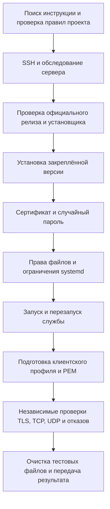

# Разворачивание Hysteria на внешнем сервере

6 ноября 2026 года на внешнем сервере установили Hysteria 2 **v2.13.0**, настроили защищённое подключение по адресу сервера и проверили передачу TCP и UDP с отдельного компьютера. Служба работает под отдельной системной учётной записью и включена в автозагрузку. Контейнер существующего VPN в Docker остался запущенным; его настройки не меняли.

Ниже описана последовательность выполненных действий, причины настроек и результаты проверки. Адреса, имена учётных записей, значения паролей, отпечаток сертификата и персональные пути исключены. Команды приведены в обезличенном виде: обозначения в угловых скобках нужно заменить своими значениями до запуска. Это не буквальная копия журнала терминала.



## 1. Поиск документации и определение границ

Сначала проверили документацию Гестии. В проекте нашлось [описание клиентского подключения Hysteria 2](../../docs/features/hysteria2.md), но отдельной инструкции установки внешнего сервера не было. Обратились к официальным руководствам по [установке](https://v2.hysteria.network/docs/getting-started/Server-Installation-Script/) и [настройке сервера](https://v2.hysteria.network/docs/getting-started/Server/).

Перед развёртыванием прочитали правила проекта, ограничения доступа к рабочим виртуальным машинам и контракт импорта клиентских профилей. Проверили состояние рабочей копии: в ней уже были несвязанные изменения, которые требовалось сохранить. Установка выполнялась только на указанном внешнем сервере; доступа к рабочему шлюзу и его виртуальным машинам для этой задачи не потребовалось.

Работу разделили между исполнителем установки, независимым тестировщиком и специалистом по безопасности. Критерием готовности был работающий внешний туннель с проверкой сертификата, а не только успешное завершение установщика.

## 2. Подключение по SSH и первичное обследование

Первая попытка SSH завершилась сообщением `Operation not permitted`: сетевой доступ ограничивала среда выполнения инструмента. Повторный вызов через предусмотренный механизм расширенного доступа прошёл успешно. Настройки SSH на сервере для этого менять не пришлось.

Проверки выполняли командами следующего вида:

```sh
ssh -o BatchMode=yes -o ConnectTimeout=15 '<SSH_USER>@<SERVER_ADDRESS>' \
  'uname -m; cat /etc/os-release; command -v hysteria; ss -ulnp; systemctl is-active hysteria-server'
```

Обнаружили Ubuntu **24.04.3 LTS**, архитектуру **x86_64** и systemd. До установки Hysteria не работала, UDP-порт **443** был свободен. На другом UDP-порту уже работал Docker-контейнер с VPN; это было существующее приложение, которое установка не должна была затронуть.

Отдельно просмотрели правила firewall для IPv4 и IPv6. Входящая политика уже разрешала нужный трафик, поэтому новые правила не добавляли и существующие не заменяли. Проверили наличие средств управления firewall и занятые сокеты. При повторении установки на другом сервере доступность UDP 443 нужно проверить заново, включая ограничения провайдера.

## 3. Проверка релиза и установка

Официальный API релизов на дату работы возвращал **v2.13.0**. Закрепили эту версию, чтобы установка не зависела от изменения указателя «последняя версия» в ходе работы.

Установочный скрипт скачали отдельно и просмотрели перед выполнением. Зафиксировали его SHA-256 и сохранили копию в закрытом каталоге на сервере. Последовательность можно представить так:

```sh
curl -fsSL https://get.hy2.sh/ -o '<PRIVATE_DIRECTORY>/install.sh'
less '<PRIVATE_DIRECTORY>/install.sh'
bash '<PRIVATE_DIRECTORY>/install.sh' --version v2.13.0
```

Установщик разместил исполняемый файл в `/usr/local/bin/hysteria`, создал системную учётную запись службы, пример конфигурации и unit-файлы systemd. Пример конфигурации заменили перед запуском сервера.

Специалист по безопасности независимо скачал официальный `hashes.txt` релиза и сравнил SHA-256 установленного Linux-бинарника с опубликованной контрольной суммой. Значения совпали. Также проверили четыре опубликованных предупреждения безопасности Hysteria: выбранная версия находилась вне указанных диапазонов уязвимых версий. Полный аудит всех транзитивных зависимостей в эту проверку не входил.

## 4. Создание сертификата и пароля

Для подключения был предоставлен адрес сервера без доменного имени. Создали самоподписанный сертификат **ECDSA P-256** и внесли адрес в расширение **IP SAN** — поле, по которому клиент проверяет соответствие сертификата серверу. В сертификате указали назначение `serverAuth` и срок действия **825 дней**.

Перед генерацией проверили, что файл приватного ключа ещё не существует. Эта проверка защищала от случайной замены ключа при повторном запуске подготовленного сценария:

```sh
set -eu
umask 077
test ! -e /etc/hysteria/server-key.pem
openssl req -x509 -newkey ec -pkeyopt ec_paramgen_curve:prime256v1 \
  -sha256 -days 825 -nodes \
  -keyout /etc/hysteria/server-key.pem \
  -out /etc/hysteria/server-cert.pem \
  -subj '/CN=<SERVER_ADDRESS>' \
  -addext 'subjectAltName=IP:<SERVER_ADDRESS>' \
  -addext 'extendedKeyUsage=serverAuth'
```

Пароль сформировали непосредственно в Python через `secrets.token_urlsafe(32)`: использовали 32 криптографически случайных байта и безопасное текстовое представление. Одно и то же значение записали в серверную конфигурацию и клиентский профиль, не выводя его в журнал и не добавляя в Git.

Серверная конфигурация `/etc/hysteria/config.yaml` получила следующий состав полей:

```yaml
listen: :443
tls:
  cert: /etc/hysteria/server-cert.pem
  key: /etc/hysteria/server-key.pem
auth:
  type: password
  password: <GENERATED_SECRET>
```

Самоподписанный сертификат не потребовал отключать TLS-проверку. Клиенту передали публичный PEM как явно доверенный сертификат; приватный ключ остался на сервере.

## 5. Ограничение доступа к файлам и службе

Конфигурацию и приватный ключ сделали доступными администратору и системной группе службы. Остальным пользователям чтение запретили. Для секретов с самого начала действовала маска создания файлов `077`.

| Объект | Права | Назначение |
|---|---|---|
| `/etc/hysteria` | `0750` | Доступ администратора и группы службы |
| Серверная конфигурация | `0640` | Чтение службой, изменение администратором |
| Приватный ключ | `0640` | Чтение службой, отсутствие общего доступа |
| Публичный сертификат на сервере | `0644` | Несекретная часть TLS; каталог ограничивает доступ |
| Каталог клиентских материалов | `0700` | Доступ только владельца |
| Клиентский профиль | `0600` | Защита содержащегося в нём пароля |

Служба уже использовала отдельные системные пользователя и группу, а также `NoNewPrivileges=yes`. Для обычного режима с одним UDP-портом оставили только capability `CAP_NET_BIND_SERVICE`, необходимую для привязки к порту ниже 1024. Дополнительные сетевые полномочия для этой конфигурации не требовались.

Создали каталог `/etc/systemd/system/hysteria-server.service.d` и файл `hardening.conf`:

```ini
[Service]
CapabilityBoundingSet=
CapabilityBoundingSet=CAP_NET_BIND_SERVICE
AmbientCapabilities=
AmbientCapabilities=CAP_NET_BIND_SERVICE
Restart=on-failure
RestartSec=5s
ProtectSystem=strict
ProtectHome=true
PrivateTmp=true
```

Пустые присваивания сбрасывают ранее заданные списки capabilities, после чего задаётся минимальный набор. Остальные параметры ограничивают запись в файловую систему, доступ к домашним каталогам и временным файлам. При аварийном завершении systemd повторяет запуск через пять секунд.

Подготовленный сценарий конфигурации прошёл проверку безопасности до применения. После запуска отдельно прочитали фактические свойства службы и права файлов, чтобы убедиться, что настройки вступили в силу.

## 6. Запуск и проверка перезапуска

Перечитали unit-файлы, включили автозагрузку и запустили службу:

```sh
systemctl daemon-reload
systemctl enable --now hysteria-server.service
systemctl is-enabled hysteria-server.service
systemctl is-active hysteria-server.service
journalctl -u hysteria-server.service -n 30 --no-pager
```

Получили `enabled` и `active`, а в журнале — подтверждение запуска сервера на UDP 443. Затем выполнили `systemctl restart hysteria-server.service` и проверили успешный повторный запуск.

Независимая проверка подтвердила отдельную системную учётную запись, ограниченный набор capabilities и действующие параметры защиты. Счётчик автоматических перезапусков `NRestarts` был равен нулю. Прежний Docker-контейнер и его UDP-сокеты сохранились; установка не перезапускала соседнее приложение.

## 7. Подготовка материалов клиента

Сформировали `client.yaml` и скопировали публичный `server-cert.pem` на компьютер, с которого выполнялась работа. Файлы разместили вне репозитория в закрытом временном каталоге. На сервере сохранили закрытую копию клиентского профиля для восстановления.

Состав клиентского профиля:

```yaml
server: <SERVER_ADDRESS>:443
auth: <GENERATED_SECRET>
tls:
  sni: <SERVER_ADDRESS>
  ca: server-cert.pem
  insecure: false
socks5:
  listen: <LOOPBACK_ADDRESS>:10808
```

Локальный SOCKS5-прокси привязан только к loopback-интерфейсу. Относительный путь `ca` означает, что официальный клиент нужно запускать из каталога, содержащего сертификат. `insecure: false` сохраняет проверку доверия и соответствия имени или адреса.

Для независимого теста скачали официальный клиент Hysteria той же версии для **macOS ARM64**. Предварительно сверили контракт импорта Гестии: он принимает `server`, `auth`, `tls` и `socks5`, а PEM загружается отдельно. Тестовые настройки перенаправления UDP не добавляли в профиль, предназначенный для импорта.

## 8. Независимая проверка внешнего подключения

Тестировщик запускал клиент с отдельными локальными портами SOCKS5 и UDP forwarding. Проверка шла с компьютера вне VPS, поэтому охватывала доступность внешнего QUIC-порта, установление TLS и аутентификацию.

Для UDP во временную копию профиля добавили:

```yaml
udpForwarding:
  - listen: <LOOPBACK_ADDRESS>:10539
    remote: <DNS_RESOLVER>:53
```

Через SOCKS5 отправили HTTPS-запрос к сервису определения внешнего адреса, а через UDP forwarding — DNS-запрос. Затем создали две отдельные копии профиля: с заведомо неверным паролем и без доверенного PEM.

| Сценарий | Фактический результат |
|---|---|
| Верный пароль и доверенный PEM | `connected to server`, передача UDP разрешена |
| HTTPS через SOCKS5 | Полученный внешний адрес совпал с адресом VPS |
| DNS через UDP forwarding | `NOERROR`, два A-ответа; время одного запроса 37 мс |
| Неверный пароль | Ошибка аутентификации HTTP 404, завершение клиента с кодом 1 |
| Отсутствие доверенного PEM | `x509: certificate signed by unknown authority`, код 1 |
| Итоговое состояние сервера | Служба активна, автозагрузка включена, UDP 443 прослушивается |

Проверки прошли 6 ноября 2026 года, в 16:45–16:46 по Москве. Время DNS-запроса относится только к этому измерению и не является оценкой производительности сервера. Результаты и команды воспроизведения сохранены в [протоколе проверки](../../experiments/hysteria2-server/README.md).

## 9. Завершение и передача результата

После тестов остановили временный клиент и удалили три производных проверочных профиля. Исходный профиль подключения и публичный PEM оставили для владельца. Приватный ключ сервера на компьютер не переносили.

Сохранили инструкцию установки, обезличенный протокол и свидетельства проверки; добавили ссылки в оглавления документации и отметили результат в дорожной карте. Исходники приложения не меняли, коммиты не создавали.

Для подключения в Гестии подготовлена пара `client.yaml` + `server-cert.pem`. Её импорт в рабочую Гестию в эту работу не входил. В панели нужно открыть «Подключения → Добавить → Hysteria 2», импортировать YAML, отдельно загрузить PEM и выбрать группу и разрешённые подключения до сервера. Файлы из временного каталога следует сохранить в постоянном защищённом месте.

## 10. Что остаётся для эксплуатации

Установленный сертификат действует до **8 февраля 2029 года** и автоматически не обновляется. До истечения срока потребуется подготовить новый сертификат и ключ, обновить доверенный PEM у клиентов и перезапустить службу в согласованное окно. Проверить срок можно командой:

```sh
openssl x509 -in /etc/hysteria/server-cert.pem -noout -dates
```

Перед обновлением Hysteria следует сохранить закрытые копии конфигурации, текущего бинарника и systemd drop-in, проверить новый релиз и повторить внешние проверки после установки. Эти действия относятся к будущему сопровождению, а не к выполненному развёртыванию.

Для остановки новой службы без удаления настроек предусмотрена команда:

```sh
systemctl disable --now hysteria-server.service
```

Она освобождает порт и сохраняет материалы для восстановления. Полное удаление выполняется отдельно проверенным установщиком с `--remove`; удалять соседние VPN-службы или их firewall-правила не требуется. Откат в ходе сегодняшней установки не понадобился.

Подтверждены запуск, перезапуск службы, внешние TCP и UDP, проверка сертификата и отказ при неверных данных подключения. Нагрузочные испытания, длительная устойчивость, восстановление после перезагрузки всего VPS и интеграция с рабочим шлюзом остаются отдельными проверками.

## Источники и связанные материалы

При работе использовали официальные [правила установки](https://v2.hysteria.network/docs/getting-started/Server-Installation-Script/), [поля серверной конфигурации](https://v2.hysteria.network/docs/advanced/Full-Server-Config/), [поля клиентской конфигурации](https://v2.hysteria.network/docs/advanced/Full-Client-Config/) и [предупреждения безопасности](https://github.com/HyNetworks/hysteria/security/advisories). Проверка источников выполнена 6 ноября 2026 года.

Проектные материалы: [контракт подключения Hysteria 2](../../docs/features/hysteria2.md), [протокол внешней проверки](../../experiments/hysteria2-server/README.md) и [обезличенные результаты](../../experiments/hysteria2-server/evidence/summary.txt).
