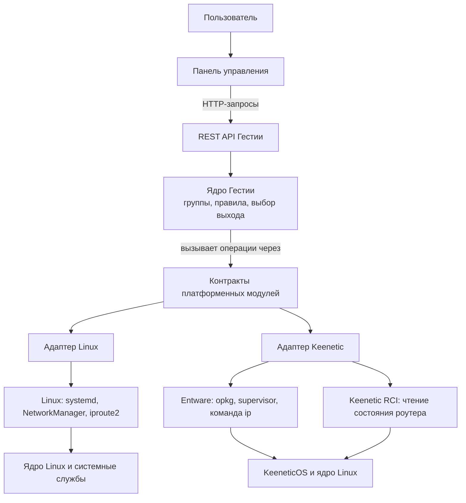
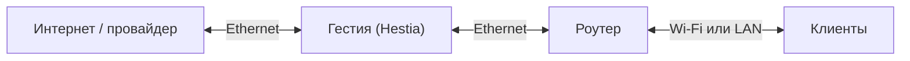
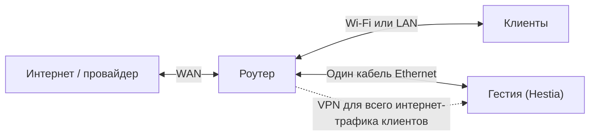
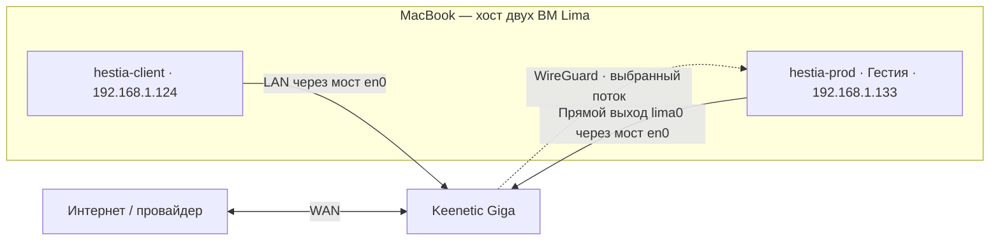
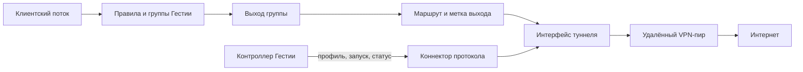
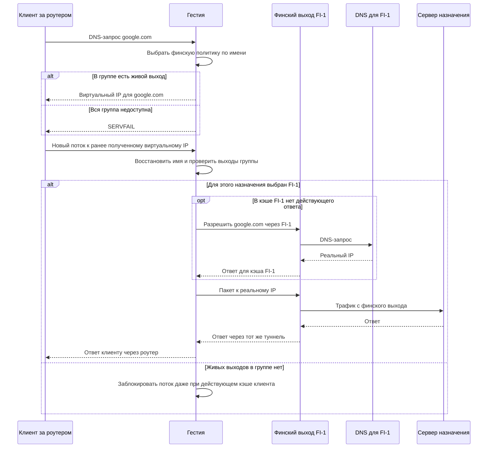
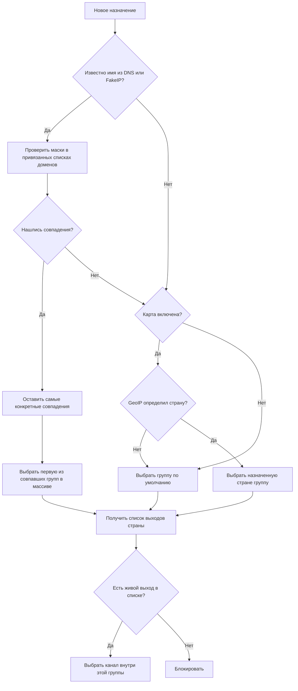
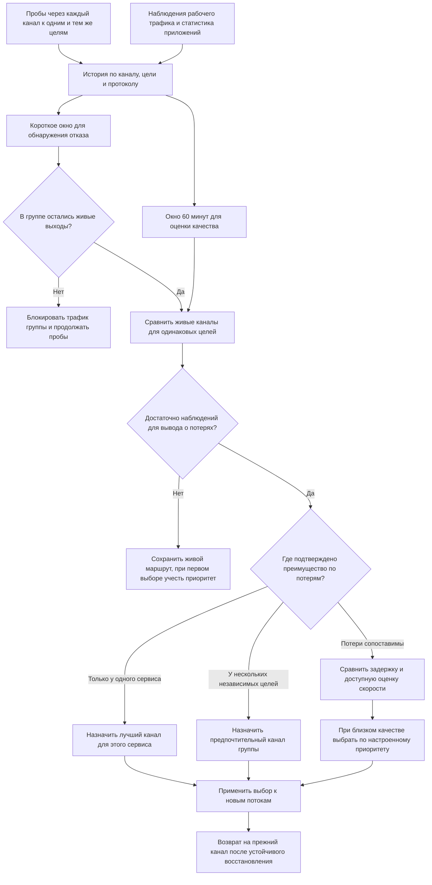

# Предлагаемая архитектура

Рабочая схема от 3 ноября 2026 года. Обязательное поведение описано в [требованиях](requirements.md).

## Слои приложения и платформенные адаптеры

Панель обращается к ядру через REST API. Ядро использует контракты платформенных модулей для системных операций; адаптеры реализуют эти контракты отдельно для Linux и Keenetic/Entware. Схема показывает логический путь вызовов, а не готовность каждого модуля: часть возможностей Keenetic ещё не реализована или не подтверждена на устройстве.

Ядро зависит от контрактов, а не от конкретной команды `systemctl`, NetworkManager или RCI. Платформенные адаптеры подключаются при сборке. Поскольку Keenetic использует ядро Linux, общие механизмы Linux остаются доступными там, где их предоставляет прошивка; отличия в основном касаются служб, сетевой конфигурации, путей хранения и доступных инструментов. Недоступную операцию адаптер должен явно отклонять, а не изображать успешное выполнение. Подробнее — в [спецификации платформенных модулей](features/platform-modules.md) и [плане поставки Keenetic](keenetic-roadmap.md).

## Схемы подключения

**Гестия (Hestia)** — Linux-шлюз проекта. На схемах «Гестия» обозначает устройство, которое выбирает выход в интернет, а «роутер» — существующий маршрутизатор, к которому подключены клиенты.

### 1. Основная схема — шлюз перед роутером

Клиент отправляет интернет-пакет роутеру, роутер передаёт его шлюзу. Шлюз выбирает выход из нужной группы. Один порт шлюза обращён к провайдеру, второй — к роутеру.

### 2. Отладочная схема — шлюз на одном кабеле

Пунктир — логический туннель поверх того же кабеля. Роутер устанавливает VPN к локальному адресу шлюза и передаёт в него весь интернет-трафик клиентов. Шлюз завершает туннель, выбирает подключение и через тот же Ethernet возвращает роутеру трафик для отправки в WAN. Если выбран внешний VPN, через WAN идёт трафик к серверу этого VPN. Обратный клиентский трафик шлюз возвращает роутеру через локальный туннель.

Чтобы избежать петли, на роутере разделяются клиентский маршрут в туннель и выход шлюза в WAN. Локальный адрес конца туннеля остаётся доступен напрямую. При отказе локального туннеля клиентский интернет-трафик блокируется: прямой выход клиентов через WAN обошёл бы выбор групп. Для восстановления связи во время отладки администратор вручную переключает Keenetic на профиль провайдера. Для этого локальный доступ к управлению Keenetic и DNS в профиле провайдера должны работать при отключённой Гестии. Отладочный путь не участвует в приёмке гигабитной скорости основной схемы. Конкретный протокол локального VPN и настройки маршрутизации зависят от возможностей роутера.

### Вариант второй схемы для Keenetic

На модели с компонентом WireGuard и профилями доступа предлагается выделить для Linux отдельный LAN-сегмент или порт. Клиентский сегмент Keenetic использует профиль только с локальным WireGuard. Сегмент шлюза использует профиль только с провайдером. Адрес WireGuard-пира — локальный Ethernet-адрес Linux, доступный без туннеля. На Linux обычный маршрут для транспорта внешних VPN ведёт к Keenetic. При прямом выходе IPv4 через WAN можно применять SNAT к адресу Linux на транзитном сегменте. Обратный трафик к клиентам должен возвращаться через локальный WireGuard.

Профили и выход через WireGuard описаны производителем. Их сочетание с локальным пиром в этой топологии требует проверки на конкретной модели и версии KeeneticOS, включая разрыв туннеля, DNS и IPv6. [Профили подключений Keenetic](https://support.keenetic.ua/city/kn-1511/uk/52109-connection-policies.html) · [Выход через WireGuard](https://support.keenetic.ru/eaeu/lite/kn-1311/ru/21424-internet-access-through-a-wireguard-vpn-tunnel.html)

### 3. Лабораторная схема — Гестия в ВМ на MacBook

Пока физическая машина для Гестии не куплена, Гестия временно работает в Linux ARM64-ВМ Lima на MacBook. MacBook подключён к Keenetic по Wi‑Fi, а сетевой адаптер ВМ подключён к тому же LAN мостом Lima `bridged` через интерфейс `en0`. На macOS для этого установлен `socket_vmnet` в `/opt/socket_vmnet` и добавлено ограниченное правило sudoers, сгенерированное `limactl sudoers`. ВМ получает собственный DHCP-адрес в домашней сети, поэтому Keenetic может установить WireGuard к её локальному адресу.

Тестовая ВМ отправляет пакеты Keenetic по адресу `192.168.1.1`. Для потока через Гестию роутер использует профиль `hestia-keenetic` с endpoint `192.168.1.133:51827`. В туннельной сети `10.253.241.0/30` Keenetic занимает адрес `.1`, Гестия — `.2`. На стороне Keenetic для теста расширили разрешённые назначения пира с `10.253.241.2/32` до `0.0.0.0/0`. Выбор подключения для конкретного пакета зависит также от маршрутизации Keenetic.

На Гестии таблица 200 направляет IPv4-пакеты с `wg-keenetic` в TUN `hestia0`. Для единственной группы `default` задан выход `keenetic-direct` через `lima0`, список доменных правил пуст. В наблюдаемом потоке Keenetic заменяет адрес клиента своим адресом `10.253.241.1`. Для ответа из TUN таблица 201 содержит маршрут `10.253.241.1/32 dev wg-keenetic`, а также маршрут клиентской LAN `192.168.1.0/24` через тот же интерфейс. Основной маршрут самой ВМ ведёт через Keenetic по `lima0` с метрикой 100, резервный — через Lima NAT по `eth0` с метрикой 200.

Сквозной путь подтверждён для HTTPS к `ya.ru`. Для `example.com` наблюдался обход Гестии. Подробности приведены в [протоколе схемы 3](validation.md#схема-3--wireguard-через-lima-вм-на-macbook).

## VPN-подключения через управляемые коннекторы

Архитектурный принцип, согласованный 4 ноября 2026 года: Гестия не должна заново реализовывать криптографию и транспорт каждого VPN-протокола в своём контроллере. Для каждого поддерживаемого протокола она управляет совместимым системным или userspace-коннектором, который поднимает туннель. Если протокол уже реализован используемым сетевым движком, таким коннектором может быть сам движок. Например, текущий WireGuard-выход обслуживает sing-box. Для AmneziaWG рассматривается отдельный Linux userspace-коннектор `amneziawg-go` с инструментами управления AmneziaWG.

Гестия остаётся владельцем прикладной конфигурации, групп и правил, выбора выхода, жизненного цикла подключения и проверки его доступности. Коннектор отвечает за протокол, peer-параметры, установление туннеля и предоставление именованного сетевого интерфейса. Протокол-специфичная интеграция в Гестии всё равно нужна: проверить профиль, передать секреты безопасным способом, запустить и остановить коннектор, связать состояние туннеля с выходом и корректно сообщить об ошибке.

Коннектор не должен самовольно менять основной маршрут ВМ. Для каждого выхода следует выделить интерфейс и таблицу/метку маршрутизации; маршрут к внешнему адресу VPN-пира должен оставаться через физический или транзитный uplink. При отказе коннектора потоки этой группы блокируются или переключаются на разрешённый резерв группы согласно её политике. Проверка выхода должна подтверждать фактический путь, включая DNS и отсутствие незапланированного обхода через uplink.

Первый кандидат для проверки — AmneziaWG userspace-коннектор в Linux-ВМ. В рабочем дереве реализован профильный/API/runtime путь для обычного WireGuard и AmneziaWG 3.1: отдельное root-only хранилище, временная проверка, транзакции изменения профиля, отдельный интерфейс, метка и таблица с unreachable guards для каждого активного профиля и heartbeat для failover группы. IPv6 в первой версии обрабатывается fail-closed. В схеме v2 также можно описать существующий TUN ingress и прямой underlay выход; принятие такой миграции требует семантического совпадения с установленным backend.

Назначения туннелей сохраняются по ID, отдельно от порядка и группы. Первый активный профиль прежней установки сохраняет `awg0`. [Устройство нескольких туннелей и критерии проверки](features/multiple-wireguard.md).

Изменения ещё не прошли независимое ревью и интеграционный прогон на отдельной ВМ. До этих проверок поддержку нельзя считать принятой или развёрнутой. Необходимо проверить согласованность AWG 3.1 профиля и runtime, фактические DNS/HTTP(S) потоки, отказ/восстановление, IPv6 блокировку, сохранение underlay, main default route и `wg-keenetic`; модуль ядра остаётся исключённым.

## От имени до выхода

1. Клиент запрашивает у шлюза адрес домена. Шлюз сопоставляет исходное имя с правилами и выбирает страну до запроса к внешнему DNS.
2. Внутри страны шлюз выбирает доступное подключение. Например, запрос для `google.com` получает выход `FI-1`. Резолвер проверяет кэш этого подключения, а при промахе обращается к DNS-серверу через тот же выход.
3. Шлюз направляет последующее соединение через выбранный канал. При отказе всей группы блокировку обеспечивает маршрутизация, включая пакеты к уже известным клиенту адресам. Для новых DNS-запросов предложен `SERVFAIL`. Ответ `NXDOMAIN` означал бы отсутствие имени и мог бы остаться в отрицательном кэше. [RFC 2308](https://www.rfc-editor.org/rfc/rfc2308.html)

### Путь трафика через шлюз

Пример для варианта с FakeIP. Клиент обращается к виртуальному адресу, а шлюз разрешает реальное имя в контексте выхода, выбранного для нового соединения.

### Как определяется группа подключений

Шлюз пропускает списки доменов без привязки к группе и выбирает самую конкретную совпавшую маску среди оставшихся. Маска охватывает сам домен и поддомены любой глубины. Для домена без совпадений диаграмма показывает выбор по карте GeoIP по стране назначения. Если GeoIP не определил страну, выбирается группа по умолчанию. См. [требования к карте](requirements.md#карта-стран-geoip).

### Первый запрос к vk.ru

Предположим, что RU-1 использует DNS Яндекса, FI-1 — DNS Google, оба выхода доступны и кэш пуст. При совпадении с правилом для России шлюз опрашивает Яндекс через RU-1. Без совпадения шлюз запускает две независимые попытки одновременно: к Яндексу через RU-1 и к Google через FI-1. Суффикс имени сам по себе группу не назначает. Наличие ответа у одного резолвера не подтверждает доступность сайта. Для нового соединения к реальному адресу действует обычный выбор по карте GeoIP.

Первый положительный ответ с пригодным адресом завершает ожидание клиента. Остальные попытки продолжаются в фоне до ответа или тайм-аута. Ранний NXDOMAIN не отменяет другие попытки. Выбор реального адреса при FakeIP предстоит согласовать.

### Срок хранения DNS-ответов

Служба DNS использует оставшийся TTL ответа резолвера. Положительные записи хранятся раздельно по имени, типу (A или AAAA), подключению и резолверу. При повторном запросе шлюз возвращает оставшийся TTL. Если для текущих правил и живых выходов есть действующий положительный ответ, повторного внешнего запроса не требуется. Чтение записи не продлевает её жизнь. При TTL 0 ответ используется только для текущего запроса. Одновременные запросы к одной кэшируемой записи при промахе объединяются. [RFC 1035](https://www.rfc-editor.org/rfc/rfc1035.html#section-3.2.1)

Служба сохраняет положительные записи на диске вместе с исходным временем получения и TTL. При перезапуске она вычисляет оставшийся срок по исходному времени. В штатном режиме после TTL шлюз запрашивает свежий адрес. Для часто используемых записей возможно фоновое обновление незадолго до истечения TTL. При включённой аварийной выдаче служба может вернуть старый положительный адрес только при временном сбое обновления во всех разрешённых контекстах, в пределах заданного окна и при наличии живого разрешённого выхода. Достоверный свежий ответ, включая отрицательный, не следует подменять старым положительным из того же контекста. TTL 0 исключается из долговременного кэша. В журнале фиксируются возраст записи, исходное время истечения и причина выдачи устаревшего ответа. [RFC 8767](https://www.rfc-editor.org/rfc/rfc8767.html)

Для фонового обновления служба учитывает клиентские обращения отдельно от попыток обновления. Ручные имена включаются независимо от клиентского спроса. Исключения действуют только на автоматический отбор. [Управление прогревом](dns-settings.md). Планировщик работает по ключу «имя, тип записи, подключение, резолвер». Очередную попытку планируем к более раннему из двух сроков: через Y после обновления либо незадолго до истечения TTL. TTL 0 исключаем. При малом TTL, ошибках или большой очереди ограничиваем частоту и параллелизм, даже если запись успеет устареть. Совпавшие фоновые и клиентские попытки объединяем. Перед каждой попыткой планировщик проверяет частоту клиентских обращений в скользящем окне X. Как только их недостаточно, имя выбывает из автоматического отбора. Ручная запись продолжает прогреваться. Истёкшие наблюдения удаляются из учёта частоты. Ни фоновая попытка, ни её DNS-ответ не возвращают домен в очередь прогрева. При смене правил старое назначение перепроверяем до отправки запроса. Служба регистрирует ошибки фоновых попыток. API автоматического отбора показывает имена и числа обращений; журнал всех DNS-попыток остаётся отдельной задачей.

Для NXDOMAIN и NODATA срок отрицательного кэширования определяется по SOA ответа. Такой результат хранится в контексте приславшего его резолвера и выхода. Тайм-аут и SERVFAIL обрабатываются как временные сбои разрешения. [RFC 2308](https://www.rfc-editor.org/rfc/rfc2308.html#section-5) · [RFC 9520](https://www.rfc-editor.org/rfc/rfc9520.html)

### Разные ответы DNS

Если через FI-1 сервер вернул адрес A, а через FI-2 — B, оба ответа могут быть корректны. Например, CDN учитывает расположение резолвера или клиентской сети. Страна выхода определяется правилом для имени. Предложено кэшировать ответы отдельно по подключениям с учётом TTL, в том числе если адрес самого резолвера совпадает. У каждого выхода может быть основной и резервный DNS. При тайм-ауте или SERVFAIL опрашивается резервный через тот же выход. Для внутренних зон VPN требуется резолвер, знающий эту зону. Отказ DNS и потерю самого канала следует учитывать раздельно. [RFC 7871](https://www.rfc-editor.org/rfc/rfc7871.html)

| Что получает клиент | Поведение после смены канала | Ограничение |
|---|---|---|
| Реальный IP | Пока клиент кэширует A, его можно направить через FI-2 при однозначной политике. Адрес B клиент получит после нового DNS-запроса. | A может быть недоступен через FI-2. Если один IP обслуживает домены разных политик, пакет к нему не содержит достаточно информации для выбора страны. |
| Виртуальный IP домена (FakeIP) | При новом соединении шлюз восстанавливает имя по виртуальному адресу, выбирает канал и может разрешить имя заново через FI-2. | В ARM64-эксперименте без сохранения FakeIP sing-box повторно назначил старый FI-only адрес новому RU-имени; TCP и UDP ушли через RU. `store_fakeip` с сохранённым файлом предотвратил повторное назначение. Интеграция ещё не сделана; до неё надо обеспечить сохранение соответствий либо безопасную блокировку и не допускать их повторной выдачи. IPv6 отложен. См. [эксперимент](../experiments/dns-restart/README.md). |

Для маршрутизации по реальным адресам обсуждались dnsmasq, наборы nftables и выбор таблицы по метке пакета. Для доменов со строгими требованиями к стране предпочтительный эксперимент — FakeIP. При прямом доступе по IP или клиентском DoH шлюз может не видеть имя. Для прямого IP без имени в базовой схеме используется группа по умолчанию. [dnsmasq](https://dnsmasq.org/docs/dnsmasq-man.html) · [ip-rule](https://man7.org/linux/man-pages/man8/ip-rule.8.html)

## Два SSTP с адресом 172.16.3.33

Предложено запускать SSTP-клиент и созданный им PPP-интерфейс в отдельном Linux network namespace для каждого подключения. У пространств собственные интерфейсы, маршруты и сетевые правила. С основным шлюзом их связывают разные пары veth с различными служебными адресами. [network_namespaces(7)](https://man7.org/linux/man-pages/man7/network_namespaces.7.html) · [ip-netns(8)](https://man7.org/linux/man-pages/man8/ip-netns.8.html)

~~~text
Роутер → Гестия     ┬─ veth-1 → sstp-1 → ppp0 172.16.3.33 → VPN № 1
                    └─ veth-2 → sstp-2 → ppp0 172.16.3.33 → VPN № 2
~~~

Маршрут к самому SSTP-серверу проходит через назначенную физическую линию и должен работать до поднятия PPP. Пользовательские пакеты, запросы к DNS подключения и контрольные пробы внутри туннеля должны быть привязаны к его выходу. При падении PPP проба не должна «выздороветь» за счёт прямого маршрута через провайдера. Кэш, измерения и наблюдаемый публичный IP связываются с постоянным ID подключения. Если два VPN зависят от одной физической линии, у них есть общая точка отказа.

## Наблюдение и решение

В эксплуатации шлюз отправляет через проверяемый выход один запрос непосредственно на IP резолвера и порт 53/UDP. Для всех выходов совпадают имя, тип записи и тайм-аут. Ответ должен прийти от опрошенного адреса и порта до истечения тайм-аута и соответствовать идентификатору и вопросу. Одна отправка даёт одну пробу, без повторов и перехода на TCP. Совпавший ответ с DNS-ошибкой подтверждает обмен по UDP, а код ошибки учитывается отдельно. В знаменатель доли тайм-аутов входят пробы с ответом и завершившиеся тайм-аутом. Локальная ошибка отправки учитывается отдельно.

Для проверки конкретного сервиса используют поддерживаемую им операцию. Например, для HTTP/3 это запрос к самому сервису по QUIC с обязательным HTTP/3. Результат DNS-пробы относится только к опрошенному резолверу.

UDP сам по себе не подтверждает доставку. Для подконтрольной цели можно отправлять нумерованные датаграммы и сравнивать их со счётчиками получателя. Возможен протокол STAMP с ответчиком. Для стороннего сервиса нужны ожидаемый ответ приложения или доступная телеметрия. Тайм-аут фиксирует неудачный обмен в целом, а потеря могла произойти в любом направлении. ICMP даёт дополнительный сигнал о пути. [UDP, RFC 768](https://www.rfc-editor.org/rfc/rfc768.html) · [STAMP, RFC 8762](https://www.rfc-editor.org/rfc/rfc8762.html)

Предложено вести историю по паре **подключение × цель**, различая тип пробы или сервис. Параллельные активные пробы идут через все выходы, включая резервные, и дополняют наблюдения приложений. При отсутствии трафика качество неизвестно. Пропускную способность тоже нельзя вывести из низкой текущей загрузки.

### Как выбирается стабильный канал внутри группы

Цикл повторяется и при работе на резерве. Короткое окно позволяет быстро исключить отказавший путь. Настраиваемое длинное окно (по умолчанию 60 минут) помогает отличить устойчивую разницу в качестве от случайного пропуска.

| Наблюдение | Предлагаемое действие |
|---|---|
| До X потери устойчиво выше через FI-1, FI-2 до X работает, остальные цели доступны | Перевести новые потоки к X на FI-2. Если данные есть только по одному UDP-порту, ограничить решение этим сервисом. |
| FI-1 деградировал до нескольких независимых целей, FI-2 до тех же целей работает | Сменить предпочтительный выход финской группы. |
| X одинаково плохо отвечает по обоим путям, остальные цели доступны | Сохранить маршруты. Смена пути не показала преимущества. |

К часовому окну предложено добавить короткое окно обнаружения аварии. При близком качестве действует административный приоритет. При устойчивом превосходстве по потерям выигрывает более качественный канал. Для возврата требуется период стабильного восстановления, чтобы избежать частых переключений. Сначала предполагается режим наблюдения с журналом предполагаемых решений, их причин, целей и времени.
