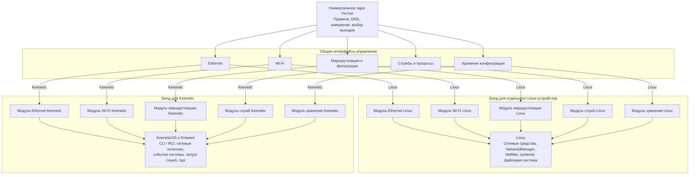

# Гестия внутри Keenetic и на отдельном устройстве

Исследование от 6 ноября 2026 года, исходники Гестии на ревизии `d6a6dbf`. Оценка совместимости основана на коде и публичной документации. Product Owner согласовал направление архитектуры с двумя билдами и универсальным ядром с платформенными модулями управления. Текущий этап — исследование и обсуждение. Детали реализации предстоит согласовать. Испытания KN-1012 в рамках исследования отсутствуют. Версия KeeneticOS пользователя пока неизвестна.

## Вывод

Две поставки технически обоснованы. Для отдельного устройства уже существует Linux ARM64-сборка и установщик. Для Keenetic KN-1012 перспективен пакет Entware `.ipk` с адаптацией управления службами, сетью и размещения файлов. Совместимость полного набора функций с ядром и ресурсами KN-1012 предстоит установить испытаниями.

Производитель указывает для KN-1012 установщик Entware aarch64. Проект SKeen демонстрирует интеграцию sing-box с перехватом TUN/TProxy на Keenetic. Это подтверждает возможность такого класса интеграции. Совместимость конкретного комплекта Гестии требует отдельной проверки. [Entware для KN-1012](https://support.keenetic.com/hero/kn-1012/en/20980-installing-the-entware-repository-on-a-usb-drive.html) · [SKeen](https://github.com/jinndi/SKeen)

Поставка для Keenetic рассматривается как устанавливаемая служба Entware со своей веб-панелью. Модули управления внутри Гестии описаны ниже как части её архитектуры. Возможность включения в каталог официальных компонентов KeeneticOS или встраивания панели в штатный интерфейс остаётся отдельным вопросом к производителю.

## Что существует в проекте

- `Makefile` собирает команды с `CGO_ENABLED=0 GOOS=linux GOARCH=arm64`. Angular собирается в статические ресурсы.
- `deploy/install.sh` устанавливает службы systemd, использует Python и пути `/etc/hestia`, `/usr/local/bin`, `/usr/local/lib/hestia`.
- `backend/internal/physical/physical.go` обнаруживает интерфейсы через sysfs и управляет Wi-Fi через NetworkManager и `/usr/bin/nmcli`.
- `backend/internal/awg/` использует фиксированные Linux-пути к утилитам и обращается к systemd.
- `backend/internal/binding/engine.go` и `awg_services.go` используют systemd внутри транзакционного применения и восстановления. Адаптации требует также этот жизненный цикл.
- `.github/workflows/go.yml` содержит общие проверки backend и frontend. Подготовку `.ipk` предстоит добавить.

Основания находятся в [Makefile](../Makefile), [установщике](../deploy/install.sh), [управлении физическими подключениями](../backend/internal/physical/physical.go), [AWG](../backend/internal/awg/) и [CI](../.github/workflows/go.yml).

## Два способа размещения

| Свойство | Внутри Keenetic | Отдельный Linux ARM64-шлюз |
|---|---|---|
| Системная сеть | Интеграция с настройками и событиями KeeneticOS | Управление сетевыми интерфейсами собственной ОС |
| Путь клиента | LAN/Wi-Fi → локальный перехват → sing-box → выбранный выход | Клиент → Keenetic → Ethernet или локальный туннель → Гестия → выбранный выход |
| Службы и файлы | Entware, каталог `/opt`, механизм запуска Entware | systemd и существующая раскладка Linux |
| Ресурсы | Общие с Wi-Fi и всеми службами роутера | Ресурсы отдельной платы и её накопителя |
| Wireless ISP | Предлагаемый адаптер команд KeeneticOS | Собственный Wi-Fi-адаптер либо отдельная интеграция управления Keenetic |
| Аппаратные проверки | Прошивка, ядро, Netfilter, TUN, ресурсы, взаимодействие с ускорением | Конкретная плата, образ, драйверы Ethernet/Wi-Fi, охлаждение и восстановление |

Для отдельного устройства проект предусматривает схему «провайдер → Гестия → Keenetic» с двумя Ethernet-портами. В этой схеме пакеты передаются по Ethernet. Существующий однокабельный вариант использует локальный WireGuard, чтобы разделить клиентский трафик и транспорт внешних VPN. Дополнительный вариант с VLAN и маршрутизацией потребует своего проектирования и испытаний. [Схемы проекта](architecture.md)

## Сборка и выбор возможностей

Согласовано выпускать два целевых билда — для отдельного Linux-устройства и для Keenetic. Каждый билд объединяет универсальное ядро, соответствующие платформе модули управления и средства установки. Ядро содержит общую логику правил, DNS, измерений и выбора выходов. Взаимодействие с системой выносится в отдельные модули по областям ответственности.

Для KN-1012 и отдельной ARM64-платы целевая архитектура процессора одинакова. Два билда различаются набором подключённых реализаций модулей и поставкой. Совместимость каждого проверяется на целевой системе, включая минимально поддерживаемое ядро и системные вызовы. Статическая сборка сохраняет требования к ядру, устройствам и внешним программам.

Цель сборки определяет платформенный комплект модулей. Конкретный механизм его выбора — например, точки сборки или Go build tags — предстоит определить при проектировании реализации. Дополнительные флаги отдельных функций рассматриваются при подтверждённой необходимости. Во время запуска модули проверяют возможности конкретной системы. Доступность операций в панели должна следовать типизированному ответу backend, а backend проверяет разрешённость операции при выполнении.

CI должен собирать и проверять обе цели. Предлагается использовать общие проверки ядра и отдельные задания сборки и упаковки Linux и Keenetic. Entware-задание формирует `.ipk`, зависимости, права, запуск служб, обновление и удаление. Проверки должны покрывать сохранение конфигурации, восстановление после сбоя установки и очистку принадлежащих Гестии правил. Испытания пакета на KN-1012 дополняют CI. Окончательные метаданные архитектуры opkg и версии зависимостей определяются по фактическому feed целевой прошивки.

## Универсальное ядро и модули управления

Согласованный принцип — ядро обращается к типизированным интерфейсам управления. Для каждой области Linux- и Keenetic-реализации предоставляют ядру одинаковый контракт, а операции над устройством выполняют средствами своей платформы. При запуске соответствующего билда ядру передаются реализации модулей этой платформы. Способ связывания модулей будет определён при реализации.

Ethernet и Wi-Fi выделяются в отдельные модули. Для остальных системных взаимодействий предлагается следующее разбиение, которое предстоит уточнить при проектировании.

| Модуль | Общий контракт для ядра | Реализация Linux | Реализация Keenetic |
|---|---|---|---|
| Ethernet | Перечень портов и подключений, состояние, применение поддерживаемых настроек | Интерфейсы и средства управления сетью Linux | Порты, сегменты и интерфейсы через управление KeeneticOS |
| Wi-Fi | Поиск сетей, настройка подключения, включение и чтение состояния | NetworkManager | Wireless ISP через команды KeeneticOS |
| Маршрутизация и фильтрация | Применение маршрутов и ограничений Гестии, чтение фактического состояния | Таблицы маршрутов и Netfilter Linux | Согласование с политиками и событиями KeeneticOS, доступные средства ядра |
| Службы и процессы | Запуск, остановка, состояние и восстановление компонентов | systemd | Механизмы Entware и события KeeneticOS |
| Хранение системной конфигурации | Сохранение, загрузка и восстановление принадлежащих Гестии настроек | Каталоги и права Linux-поставки | Каталоги `/opt` и интеграция с настройками KeeneticOS |

Схема показывает целевую архитектуру и выбор реализаций для каждого билда. Названия интерфейсов условные. Стрелки от интерфейсов к модулям обозначают вызов подключённой реализации.

Контракты должны описывать результат операции, ошибки, доступные возможности, повторное применение и восстановление после частичного отказа. Различия оборудования и прошивок выражаются в перечне возможностей модуля. Например, модуль Wi-Fi сообщает доступность сканирования и настройки WISP. Ядро использует эти сведения для принятия решения, а панель — для доступности действий. Обе реализации каждого интерфейса должны проходить общие проверки контракта и отдельные испытания взаимодействия с целевой системой.

## Wireless ISP и управление портами

Keenetic документирует WISP как основное или резервное интернет-подключение. В пределах одного диапазона клиент WISP и точка доступа используют общий радиомодуль и канал. Поэтому смена WISP может повлиять на Wi-Fi клиентов. [Документация WISP для KN-1012](https://support.keenetic.com/hero/kn-1012/en/14488-internet-connection-via-wi-fi--wisp-.html)

Предполагаемый путь управления из Гестии — адаптер KeeneticOS через CLI/RCI. Нужно отдельно подтвердить операции сканирования, выбора сети, аутентификации, включения, чтения состояния и сохранения конфигурации на конкретной прошивке. Существующий backend NetworkManager потребуется адаптировать. Сетевой путь через выбранный WISP проверяется отдельно от успешного изменения настроек.

Проект NDMS предоставляет `ndmq` для программного вызова команд. HydraRoute использует локальный RCI и учитывает различия авторизации между версиями прошивки. Это основания для оценки осуществимости адаптера. Контракт WISP для установленной прошивки остаётся открытым. Локальный RCI на loopback доступен процессу внутри роутера; отдельному устройству потребуется аутентифицированный удалённый канал или локальный посредник. [NDMS ndmq](https://github.com/ndmsystems/ndmq) · [Реализация HydraRoute](https://github.com/Ground-Zerro/HydraRoute/blob/main/Neo/docs/CORE.md)

Внутри роутера Гестия сможет работать с доступными ядру интерфейсами и правилами перенаправления. Физический RJ45, порт коммутатора, VLAN, мост и Linux-интерфейс требуют явного сопоставления. Изменение назначения порта должно проходить через согласованный адаптер настроек KeeneticOS. Прямой перенос текущего sysfs-обнаружения может дать неполный перечень портов.

Изменение ролей портов и назначение дополнительных WAN описаны производителем для KN-1012. [Управление портами](https://support.keenetic.com/hero/kn-1012/en/16485-changing-the-operating-mode-and-role-of-network-ports.html)

Для встроенного размещения предлагается локальный перехват TUN/TProxy. Локальный WireGuard между Keenetic и Гестией в такой топологии можно исключить после подтверждения перехвата и блокировки. Внешние VPN продолжают быть отдельными выходами. Для отдельного устройства доступны только его собственные аппаратные интерфейсы; управление портами удалённого Keenetic потребует отдельного канала управления.

Если отдельная Гестия использует WISP именно на Keenetic, транспорт её VPN должен идти обратно через Keenetic по выделенному транзитному пути. Это требует исключить петлю между клиентским маршрутом к Гестии и маршрутом Гестии к интернету. Для независимого выбора проводного WAN и WISP нужно подтвердить привязку каждого VPN и каждой измерительной пробы к нужному внешнему подключению. Переключение глобального default route может затронуть сразу несколько выходов.

## Проверки перед решением о реализации

1. Получить точную версию KeeneticOS, состав компонентов, версию ядра, состояние Entware и свободную память. Владелец — инженер по встраиваемому Linux. Результат — матрица совместимости KN-1012.
2. Проверить запуск бинарников, TUN, policy routing, Netfilter и необходимые средства изоляции SSTP. Для AWG проверить userspace runtime и UDP-путь. Результат — протокол запуска на конкретной прошивке.
3. Подтвердить управление WISP и сопоставление физических портов с интерфейсами. Владелец — инженер по сетям Linux. Результат — настройки до/после и фактический выход контрольных пакетов.
4. На выделенном клиенте проверить DNS, TCP, UDP, IPv6, отказ VPN, остановку Гестии, перезапуск роутера и восстановление правил после сетевых событий. Независимую проверку проводит тестировщик. Результат — захваты трафика, подтверждающие разрешённый выход либо блокировку.
5. Проверить обновление, удаление, откат, заполнение накопителя и исчезновение `/opt`. Владелец — DevOps-инженер. Измерить CPU, память и пропускную способность при целевом числе VPN и адресных проб.
6. Для отдельной платы повторить проверки пути, отказов, производительности и восстановления на выбранном образе. Результаты ВМ служат исходным материалом для этих проверок.

Доступ к личной ВМ `hestia-stage1` и её Keenetic требует отдельного разрешения владельца по правилам проекта. Подготовка этой оценки выполнена чтением репозитория и публичных источников. До испытаний остаются открытыми версия прошивки, доступность необходимых функций ядра, поддерживаемый набор VPN, расход памяти и скорость.
