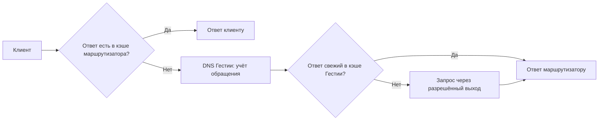

# Настройки DNS и управление прогревом

В разделе **DNS** (`/#/dns`) администратор задаёт, как долго хранить ответы, какие имена обновлять заранее и когда допустима выдача адреса после истечения TTL. Настройки и списки сохраняет панель. Запросы обслуживает отдельная служба `hestia-dns.service`. Автоматический отбор отражает только запросы, которые действительно дошли до этой службы.

## Страна назначения и ключ 2ip

Панель определяет страну по реальному IP назначения из журнала. При установке шлюз получает локальную базу DB-IP Country Lite. Для фонового уточнения в разделе **DNS** сохраните свой ключ **2ip.io**. Поле «Ключ API 2ip.io» показывает сохранённый ключ целиком, в том числе после перезагрузки страницы. Чтобы заменить ключ, отредактируйте значение и нажмите «Заменить ключ». Удаление ключа отключает новые запросы. Уже полученные уточнения действуют до истечения срока.

Сборщик ставит в очередь уникальные публичные адреса из новых потоков. Он передаёт сервису только IP назначения и ключ, с интервалом не менее секунды между запросами. Очередь вмещает 256 адресов и хранит их до пяти минут. Ответ с другой страной уточняет принадлежность только запрошенного IP. Ошибки 400 и 500 пропускают этот запрос, при 429 сборщик даёт сервису минуту перед следующим. Адрес после неудачной попытки может снова попасть в очередь при новом наблюдении через 15 минут. [Метод геопозиции 2ip](https://2ip.io/ru/api-docs/).

Локальный кэш хранит до 4096 уточнений по семь дней. Журнал использует действующее уточнение при чтении записи, включая сохранённую историю. Кэш записывается на диск и обновляет предложения для маршрутизации раз в минуту. После проверки обновлённые правила относятся к новым потокам. Если срок уточнения истёк, используется результат DB-IP. [База и условия распространения](../deploy/geoip/README.md).

Для воспроизведения импорта из корня проекта запустите команду ниже с новым путём вывода. Импорт проверяет порядок и отсутствие пересечений IPv4- и IPv6-диапазонов. Карта маршрутов и индекс журнала получаются из одного архива.

```sh
python3 deploy/import_geoip.py deploy/geoip/dbip-country-lite-2026-11.csv.gz /tmp/hestia-geoip-example
```

## Как настроить кэш

1. Задайте срок хранения положительного ответа **после TTL**, в секундах. Свежесть ответа определяется TTL резолвера. Чтение из кэша сохраняет исходное время истечения. Новый запрос после TTL в обычном режиме требует обращения к резолверу.
2. Для аварийной выдачи включите **«Разрешить истёкший ответ при временном сбое DNS»** и задайте положительное окно в секундах, в пределах срока хранения. Служба может выдать старый адрес с TTL 0 при сбое всех разрешённых попыток, если маршрут по-прежнему разрешён и окно ещё открыто. Свежий отрицательный ответ имеет приоритет.
3. Для автоматического отбора включите **«Автоматически добавлять частые домены»**. Укажите порог клиентских запросов N, скользящее окно X в часах и интервал обновления Y в минутах. Нажмите **«Сохранить настройки»**. При конфликте двух редакторов панель предлагает перечитать настройки со шлюза. После перечитывания повторите нужную правку.

На новой установке автоматический отбор включён, N = 5, X = 24 ч, Y = 10 мин. Хранение после TTL и аварийная выдача по умолчанию выключены. Кэш различает имя, тип записи, выход и резолвер. Планировщик учитывает Y и приближение срока TTL, ограничивает частоту повторов и число одновременных запросов. После перезапуска положительные записи читаются с исходным возрастом. Счётчик клиентского спроса собирается заново.

## Как изменить списки прогрева

| Раздел, сверху вниз | Действия и результат |
|---|---|
| **Автоматически добавленные** | Рядом с доменом виден счётчик запросов за окно X. При падении ниже N имя выбывает. Нажмите **«В чёрный список»**, чтобы исключить имя из автоматического отбора. |
| **Чёрный список автопрогрева** | Введите точное доменное имя и нажмите **«Добавить исключение»**. Это можно сделать до первого запроса. **«Изменить»** заменяет имя одной записью. **«Снять исключение»** разрешает повторный отбор по текущему числу обращений. |
| **Добавленные вручную** | Введите имя и нажмите **«Добавить домен»**, чтобы служба прогревала A и AAAA независимо от спроса. **«Удалить из ручного списка»** прекращает ручной прогрев. При достаточном спросе домен по-прежнему может отбираться автоматически. |

Для домена допускаются обе причины прогрева. Например, если популярное имя из ручного списка исключить из автоматического, ручное обновление продолжится. Одна запись в одном DNS-контексте обновляется однократно. Фоновые обращения не увеличивают счётчик. Оба редактируемых списка поддерживают точные DNS-имена в ASCII, включая Punycode. Панель приводит регистр и конечную точку к единому виду. Допускается до 4096 имён в каждом списке.

Автоматический список показывает время наблюдения. Пустой список означает, что служба опубликовала снимок без подходящих имён. При недоступности источника видна отдельная надпись. После изменения настройки может пройти несколько секунд, прежде чем появится снимок новой ревизии. Панель перечитывает наблюдения каждые 15 секунд, а также после успешного сохранения.

## Как подключить службу в изолированной сети

Установщик поставляет необязательный модуль systemd. Для запуска нужны установленные контроллер, sing-box и системные группы `hestia-panel` и `hestia-snapshot`. Администратор явно создаёт `/etc/hestia/dns.json` и включает службу на выбранном шлюзе. Ниже адреса **условного изолированного стенда**: `10.77.0.2` принадлежит Гестии, `10.77.0.1` — маршрутизатору, `10.77.0.53` — отдельному DNS-серверу, доступному через прямой выход `lab-wan`.

```json
{
  "listen": "10.77.0.2:53",
  "router": "10.77.0.1",
  "directResolvers": {
    "lab-wan": "10.77.0.53"
  }
}
```

- `listen` — конкретный локальный частный IPv4-адрес или loopback и свободный порт для UDP **и** TCP. `router` — точный IPv4-адрес единственного допустимого источника. Если маршрутизатор использует NAT, укажите адрес, видимый шлюзу.
- `directResolvers` сопоставляет существующий идентификатор прямого выхода с IPv4 его DNS-сервера. Если прямой выход не нужен, допустим пустой объект. DNS туннеля берётся из его конфигурации. Укажите реальные ID и достижимые адреса выбранного стенда. Резолвер прямого выхода должен разрешать имена самостоятельно или через независимый upstream, чтобы избежать петли с маршрутизатором.
- Сделайте конфигурацию доступной для чтения службе, например с владельцем `root:hestia-panel` и режимом `0640`. Запустите `systemctl enable --now hestia-dns.service` на выбранном стенде и проверьте `systemctl status hestia-dns.service` и `journalctl -u hestia-dns.service`. Служба сверяет пути с версией конфигурации sing-box. После смены этой конфигурации перезапуск DNS-службы заново формирует экспорт путей.
- В DNS-форвардере стендового маршрутизатора задайте адрес Гестии как upstream. Например, для dnsmasq отдельного стенда строки `no-resolv` и `server=10.77.0.2#53` направляют запросы на указанный адрес, если других записей `server` нет. Настройка форвардера — отдельное действие администратора. Доступ к личной ВМ владельца и его Keenetic для таких изменений требует отдельного разрешения.

Если маршрутизатор сам ответил из своего кэша, Гестия **не увидит** этот запрос и не засчитает его в N. То же относится к запросам, которые клиент направил другому DNS-серверу. Для проверки порога посылайте запросы со стендового маршрутизатора непосредственно службе. Например, `dig @10.77.0.2 service.lab.example A` и `dig +tcp @10.77.0.2 service.lab.example A` проверяют оба транспорта. Используйте имя, для которого у стендового резолвера есть запись.

Маршрутизатор и шлюз могут независимо кэшировать один и тот же ответ. Счётчик Гестии расположен после кэша маршрутизатора.



## Данные и права процессов

| Путь на шлюзе | Кто использует |
|---|---|
| `/var/lib/hestia-dns-policy/policy.json` | Панель под пользователем `hestia-panel` атомарно записывает политику и ревизию. В шаблоне запуска задан `-dns-policy` с этим путём. Файл создаётся с правами `0640`. Служба DNS читает его через группу `hestia-panel`. |
| `/var/lib/hestia-dns/cache.json` | Частный долговременный кэш службы `hestia-dns`. Служебный каталог имеет режим `0700`. |
| `/run/hestia-dns/paths.json` | Приватный экспорт разрешённых транспортов и адресов резолверов для DNS-службы. Создаётся перед запуском. Файл может содержать параметры аутентификации локального транспорта. |
| `/run/hestia-dns/report.json` | Служба публикует снимок спроса примерно раз в две секунды. Панель читает его через группу `hestia-panel` с правами `0640`. Для другого пути предусмотрен `-dns-report`. Отсутствующий или просроченный снимок даёт состояние недоступности. |

Сохранение в панели подтверждает запись политики. Проверять её фактическое использование следует по снимку той же ревизии и DNS-ответам. Локальный интеграционный тест проверяет UDP/TCP, учёт попаданий в кэш, ручной прогрев при исключении, обновление после TTL и восстановление возраста записи после перезапуска. Браузерный тест проверяет действия страницы с тестовыми ответами API, включая ширину 360 пикселей. Испытание установленной службы с реальными выходами проводится отдельно на разрешённом стенде. [Интеграционный тест службы](../backend/internal/dnsservice/integration_test.go) · [Браузерный тест](../frontend/tests/browser/dns.mjs) · [Контракт API](../backend/api/openapi.yaml)

Для проверки сохранения без действующего шлюза выполните из каталога `frontend` команду `npm run test:browser:dns-api`. Нужны установленные проектные зависимости, Go и Chromium для версии Playwright из lock-файла (на Linux установите его командой `npx playwright install --with-deps chromium`). Команда пересобирает панель и запускает два сценария Chromium на loopback. Первый проверяет сохранение независимых списков и конфликт двух редакторов через настоящий Go API. Второй подключает DNS-службу и локальный DNS-сервер. Три клиентских запроса добавляют имя в автоматический список. Браузер исключает его и снимает исключение, сверяя обе ревизии и сохранённое число обращений без новых запросов к имени. Для отдельной UDP-транзакции браузер также проверяет снижение процента после повторной передачи. Каждый сценарий получает собственный временный каталог. [Сквозной браузерный тест с DNS-службой](../frontend/tests/browser/dns-worker.mjs).

Если журнал DNS сообщает об ошибке сохранения кэша и невозможности удалить прежний файл, восстановите запись на диск и удалите устаревший файл кэша при остановленной DNS-службе перед её повторным запуском. Файл политики со списками хранится отдельно.

### Критерии проверки автоматического прогрева

* При N-м клиентском обращении за окно X домен попадает в автоматический список. Обращение ровно на левой границе окна уже истекло. Фоновое обновление меняет сохранённый DNS-ответ, а число клиентских обращений растёт только при новом клиентском запросе.
* Для домена, добавленного только автоматически, исключение останавливает последующие фоновые запросы. Если спрос ещё достигает N, снятие исключения возобновляет прогрев без дополнительного обращения клиента. В браузере этот цикл проверяется через панель, работающую с DNS-службой.
* Для одного имени ответы разных разрешённых выходов сохраняют собственные адреса и TTL. При повторном запрете FI клиент получает последний действующий ответ RU из кэша. Для имени, разрешённого только через FI, клиент получает SERVFAIL.
* Повтор той же клиентской UDP-транзакции означает, что предыдущая попытка осталась без ответа у клиента. Две передачи дают одно обращение для автопрогрева и одну неудачную попытку для показателя качества между клиентом и Гестией. Качество выхода оценивается по результатам обращений самой Гестии к резолверу.

Служба различает UDP-транзакции по адресу и порту клиента, DNS ID, имени без учёта регистра, типу и классу записи. Если с первой передачи прошло X часов или больше, запрос считается новым. Служба помнит до 32 768 транзакций и при заполнении продолжает отвечать. Попытки с неизвестным ключом при этом учитываются отдельно и пропускаются при подсчёте спроса. Доля повторов — число попыток, после которых пришёл повтор, делённое на число классифицированных корректных UDP-запросов с доступной политикой с момента запуска службы. Например, при трёх передачах одной транзакции доля равна 2/3. Панель показывает долю попыток, для которых повтор пока не наблюдался. При одной исходной передаче и одном повторе показатель снижается со 100 % до 50 %. Пока нет классифицированных попыток, процент ещё не определён. Если роутер повторно использует все признаки действующей транзакции для нового запроса, служба посчитает его повтором. В отчёт для панели попадают только суммарные показатели UDP.
