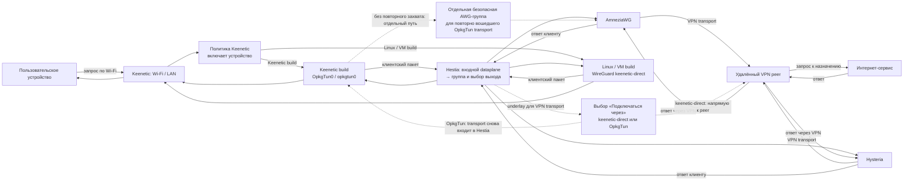

# Клиентский трафик через Hestia на Keenetic

**Статус:** базовая цель согласована Product Owner 8 ноября 2026 года; 9 ноября согласовано платформенное разделение входа и использование платформенных каналов как VPN-underlay. Keenetic IPK `20261109-094953-e523f5481e66` установлен на KN-1012; Hestia создаёт и владеет NDM `OpkgTun0`/Linux `opkgtun0`, supervisor готов, а `OpkgTun` опубликован в `/api/awg-underlays`. Подтверждены `global: yes`, `defaultgw: no` и неизменность IPv4 default route. Отдельный пакет `keen-mvp` удалён для передачи владения интерфейсом. Ни одна из четырёх Keenetic policy не разрешает OpkgTun; клиентские назначения и policy не менялись. После первого отказа postinst из-за отсутствия supervisor readiness повторный `opkg configure hestia` после завершения исходной транзакции прошёл успешно. Установка и API подтверждены на устройстве, но пользовательский трафик, policy delivery, VPN egress и fail-closed ещё не проверялись. [Отчёт установки](../../experiments/keenetic-client-dataplane/README.md#установка-hestia-opkgtun-на-kn-1012--9-ноября-2026-года).

**Дополнение к постановке от 9 ноября 2026 года:** Product Owner подтвердил платформенный вход: Linux/VM сохраняет текущий WireGuard-канал и `keenetic-direct`, Keenetic использует `OpkgTun` по образцу `keen-mvp`. Также оба канала могут быть underlay для VPN-соединений. Транспорт через OpkgTun возвращается во входной dataplane и направляется через отдельную безопасную группу без рекурсивного захвата.

## Цель

Передавать IPv4-трафик выбранных устройств из LAN/Wi-Fi Keenetic в Hestia, установленную на этом же роутере как Entware/opkg-пакет, чтобы Hestia применяла к потокам свои группы и подключения. В интерфейсе Keenetic Hestia должна отображаться как отдельное виртуальное подключение, которое администратор может добавить в политику доступа в Интернет. Первым тестовым клиентом служит виртуальная машина `hestia-client`.

## Входной канал по платформе

Платформенный канал Hestia может выполнять две роли: принимать клиентский трафик в dataplane и быть underlay/выходом для транспорта VPN до его удалённого peer. Наличие обеих ролей не означает, что один и тот же пакет проходит через интерфейс повторно.

- Сборка Linux/VM сохраняет текущий WireGuard-вход и существующую конфигурацию подключения `keenetic-direct`. `keenetic-direct` остаётся доступным VPN-соединениям как канал до peer; обработка входного WireGuard-трафика и выбор выходов остаются без изменений.
- Сборка Keenetic использует вход `OpkgTun0` KeeneticOS, сопоставленный Linux TUN `opkgtun0`. `OpkgTun` также доступен VPN-соединениям как канал до peer. Жизненный цикл NDM-объекта переносится из MVP в пакет Hestia; Hestia открывает TUN для обработки клиентских пакетов. Keenetic-сборка не должна требовать предварительно установленного WireGuard-интерфейса или отдельного `keen-mvp` пакета.
- Сборка/установка Keenetic должна создавать управляемый NDM-интерфейс по подтверждённому контракту MVP, с `global auto` и без `defaultgw`, не меняя системный маршрут по умолчанию. Имена, адреса, MTU, marker владения и поведение start/stop должны иметь одного владельца — пакет Hestia.
- При отсутствии возможности безопасно создать, проверить или открыть `OpkgTun` Keenetic-сборка сообщает ошибку и не включает незапланированный обход через WAN. Linux-сборка не создаёт `OpkgTun` и не зависит от NDM/Entware.
- Underlay, заданный для VPN-соединения, продолжает определять путь его внешнего транспорта к peer. Использование `OpkgTun` для VPN transport должно проходить через Hestia без захвата тем же ingress повторно и без цикла через это же VPN-соединение; если конечный путь нельзя доказать, соединение остаётся неготовым/заблокированным.
- Платформенное разделение не меняет семантику групп Hestia, порядка выходов и failover; оно добавляет платформенный канал в доступные underlay-кандидаты.

Проверяемые критерии платформенного разделения:

1. Linux/VM-путь с текущим WireGuard-входом и `keenetic-direct` остаётся без изменений; Keenetic bundle создаёт и регистрирует `OpkgTun0`/`opkgtun0` без обязательного WireGuard peer.
2. Keenetic package включает MVP lifecycle и его защищённое владение NDM-объектом; установка/остановка/повторный запуск не удаляют чужой интерфейс и не открывают второй конкурирующий TUN FD.
3. Для Keenetic `global` включён, `defaultgw` выключен, main default route до и после lifecycle совпадает; пакет не сохраняет конфигурацию Keenetic без отдельной команды владельца.
4. В обоих вариантах неподдерживаемые платформенные зависимости отсутствуют: Linux runtime не устанавливает Keenetic-only keeper/NDM hooks, Keenetic bundle не требует наличия `wg-keenetic` для приёма пакетов.
5. `keenetic-direct` остаётся допустимым underlay для VPN-соединений в Linux/VM, а Keenetic `OpkgTun` можно выбрать как underlay VPN-соединения; маршрут его внешнего транспорта не возвращает пакет в тот же туннель и не захватывает его ingress повторно.
6. Тесты сборки проверяют оба набора артефактов и их стартовые профили; на KN-1012 отдельно подтверждаются видимость, start/stop/restart и неизменность main default route до назначения клиентской policy.

## Схема направления трафика

Сплошные стрелки показывают запрос выбранного пользовательского устройства и обратный ответ. `WireGuard` и `OpkgTun` — альтернативные входы в зависимости от сборки. Пунктир показывает underlay внешнего транспорта VPN, выбираемый в поле «Подключаться через»; он не меняет выход группы для пользовательского запроса.

При `OpkgTun` как underlay внешний транспорт VPN повторно входит в Hestia; для него разрешён только отдельный путь без рекурсивного выбора того же туннеля. `keenetic-direct` остаётся underlay для Linux/VM-соединений и ведёт внешний транспорт к peer напрямую.

## Узкий эксперимент: OpkgTun → AmneziaWG

Для ближайшей попытки контракт ограничен одним путём: NDM `OpkgTun0`/Linux `opkgtun0` принимает IPv4-пакеты, sing-box в Hestia выбирает для этого inbound отдельную группу, состоящую только из готовых AmneziaWG-коннекторов, а эти коннекторы используют интерфейсы `awgN`, поднятые `amneziawg-go`. Единственным допустимым `defaultExit` такой группы является `deny` или один из этих AWG-коннекторов; прямой и другой не-AWG fallback запрещён. Если такой единственной безопасной группы нет, включение ingress должно завершиться ошибкой. Входной поток не должен следовать `route.final`, domain/country overrides или прямому WAN fallback; отказ/неготовность AWG должен закрыть поток. Прочие inbound и их маршрутизация остаются прежними.

Пакет `keen-mvp` при этом оставляет NDM-объект и marker владения, но перестаёт удерживать `/dev/net/tun`: TUN FD должен принадлежать только sing-box. Это проверяется отдельно до назначения тестового клиента. Затем Product Owner вручную выбирает OpkgTun в policy и назначает только `hestia-client`; сквозные TCP/UDP и fail-closed пробы выполняются лишь после готовности AWG и guard-маршрутов. Настройки policy, созданные владельцем, мы сами не меняем.

Транзакционное включение/отключение профиля вызывается только на Keenetic-сборке от root: `/opt/bin/hestia -enable-keenetic-ingress` и `/opt/bin/hestia -disable-keenetic-ingress`. Операция требует работающего supervisor/binding watcher, проверяет candidate через установленный sing-box и публикует профиль через штатный binding journal с rollback.

## Границы первого этапа

- Отбор выполняется политикой Keenetic, в список разрешённых подключений которой добавлен виртуальный интерфейс Hestia, а тестовый клиент `hestia-client` назначен этой политике. Hestia создаёт доступное для выбора подключение; Product Owner сам меняет policy `hestia-client` после появления интерфейса. Hestia не меняет другие правила Client Lists. Временная привязка по IP допустима только в изолированном прототипе и должна быть подтверждена DHCP lease/инвентарём перед запуском.
- `OpkgTun` в Keenetic имеет два отдельных назначения: входной интерфейс клиентского dataplane и специальный underlay для внешнего транспорта VPN-соединений. Он не добавляется как обычный выход в группы Hestia; пакет, отправленный VPN через OpkgTun, повторно входит в Hestia и маршрутизируется через безопасную группу.
- Входной `OpkgTunN` и TUN-интерфейс выхода AmneziaWG, создаваемый `amneziawg-go`, — разные интерфейсы с разными владельцами и назначением. Наличие входного TUN само по себе не включает AWG как выход: Hestia должна направить выбранный поток в AWG-маршрут, а внешний UDP-транспорт AWG должен идти через underlay и исключаться из входного захвата.
- Тестовый IPv4 TCP- и UDP-трафик к внешним контрольным адресам должен попасть во вход dataplane Hestia и выйти через единственное заранее выбранное готовое подключение группы.
- Возвратные пакеты должны попасть тестовому клиенту; входной поток не должен повторно захватывать исходящие соединения Hestia.
- При остановленном или неготовом Hestia и при недоступном выходе тестовый поток блокируется. Он не переходит на обычный WAN.
- Трафик самого роутера, других клиентов, настройки DNS и радио, сохранённые политики Keenetic и системный маршрут по умолчанию остаются вне изменений этого этапа.
- Сейчас `hestia-client` использует `hestia-prod` для внешнего трафика. До ручного переключения его policy на отдельное подключение Hestia не отправлять из него внешние тестовые TCP/UDP-потоки; переключение выполняет Product Owner после добавления интерфейса.
- Сам факт появления `OpkgTun` в списке подключений не гарантирует маршрут по умолчанию в таблице выбранной Keenetic policy. На KN-1012/5.2 Beta 3 временная policy с разрешённым `OpkgTun0` создалась с таблицей 4103, но без default route. Установленный `/opt/sbin/ip` — BusyBox 1.37; он отклонил номер таблицы 4103 при `ip route add`. Дополнительно, read-only RTM_GETRULE показал `lookup main` на приоритете 9, а fwmark lookup для table 4102 — на приоритете 100; flow lookup с этим mark фактически выбрал main. Runtime policy table также содержит собственные маршруты Keenetic, которые нельзя безопасно подменять. Проверяемый дизайн-кандидат — отдельная Hestia-owned таблица только с TUN default/guard, Hestia fwmark rule с `iif br0` до `main`, направляющий туда помеченный клиентский ingress, и следующий terminal rule для того же ingress/mark. Так Hestia не переписывает NDM table и не использует её посторонние специфичные маршруты. Таблица должна содержать `unreachable default` до готовности TUN и при отказе. Приоритеты 7/8 пересекаются с резервами AWG слота 3 и допустимы только при подтверждённой непересекаемости marks и безопасном поведении одинакового priority. Нельзя показывать интерфейс для переключения, пока такой путь и fail-closed не проверены; при конфликте/неизвестном mark интерфейс остаётся неготовым.
- Для IPv6 тестовый клиент не должен иметь незаметного обхода через WAN. На первом этапе IPv6 либо явно блокируется для тестовой политики, либо проверяется как поддержанный путь до отправки внешнего трафика.
- Целевой прогон выполняется только после проверки плана изменения и восстановления конфигурации. Не используются `hestia-prod` и его пользовательские подключения.

## Предлагаемые критерии приёмки

1. В интерфейсе Keenetic и через доступный read-only API/RCI видно виртуальное подключение Hestia; его можно включить в политику доступа в Интернет.
2. Если Keenetic не создаёт маршрут `default` для `OpkgTun` в таблице policy, Hestia через проверенный route adapter обеспечивает выбор этой policy по её mark только для ingress с LAN bridge до правила `main`, направляет его в отдельную Hestia-owned IPv4 таблицу и управляет только собственными routes/rules. В этой таблице есть terminal guard до готовности TUN и при отказе, а mark policy имеет terminal fallback при отсутствующем route table; системная таблица `main`, NDM policy table, чужие RPDB rules и глобальный маршрут не меняются. Проверка должна включать фактический порядок RPDB rules, совпадение ingress/mark и отсутствие fallback.
3. До включения dataplane сохранены исходные настройки/снимки правил и подтверждён адрес именно `hestia-client`; выбранная политика содержит подключение Hestia и охватывает только эту ВМ.
4. Для контрольных TCP- и UDP-потоков захват/счётчики подтверждают путь `hestia-client → политика Keenetic → виртуальный интерфейс Hestia → выбранное подключение`. Контрольный удалённый ответчик подтверждает получение обоих уникальных маркеров через ожидаемый выход.
5. На прямом WAN отсутствуют пакеты тестовых потоков, кроме явно перечисленных служебных пакетов транспорта выбранного VPN-выхода.
6. Трафик другого LAN-клиента и трафик, созданный самим Keenetic, не захватывается и сохраняет исходный путь.
7. При остановке Hestia, недоступности выбранного выхода и неполной установке правил тестовые TCP- и UDP-потоки не выходят через прямой WAN и не переходят на другое подключение policy; после восстановления Hestia новые потоки проходят выбранным выходом.
8. После штатного отключения прототипа его правила и маршруты удалены, а сохранённая конфигурация Keenetic и системный маршрут совпадают с исходным снимком.
9. Команды прогона, версия пакета/прошивки, наблюдаемые результаты, ограничения и проверяемые свидетельства записаны в `experiments/`.

## План реализации

Декомпозиция идёт от управляемого NDM-объекта к клиентскому dataplane. Каждый этап начинается после критериев предыдущего; policy `hestia-client` остаётся вне изменений до этапа 6.

1. **Зафиксировать контракт NDM lifecycle.** Руководство AWG-Go на KeeneticOS 5 указывает команды `ndmc -c interface OpkgTun0`, `... description <name>`, `... ip global auto`, `... ip address <IPv4> 255.255.255.255`, `... ip mtu <value>`, `... ip tcp adjust-mss pmtu`, `... up` и удаление `ndmc -c "no interface OpkgTun0"`. Установка `keen-mvp 0.1.0-1` подтвердила создание интерфейса, но UI его не показывал при `global: no`. После `ip global auto` поле стало `yes`, `defaultgw` осталось `no`, основной IPv4 default route не изменился; Keenetic сообщил о пересчёте global priority. Следующая сборка прототипа включает этот флаг. `system configuration save` и `ip route default OpkgTun0` не вызываются. Источник команд — [руководство OpkgTun для AWG-Go](https://gitlab.com/ShidlaSGC/keenetic-entware-awg-go/-/raw/main/blob/02__KeenOS_5.0_%28OpkgTun%29/KeenOS_5.0_%28OpkgTun%29.md).
2. **Перенести проверенный lifecycle в владельца Hestia.** После локальной сборки и no-client проверки `keen-mvp` определить точный контракт создания, read-back, старта, остановки и восстановления. Затем встроить узкий типизированный менеджер в Hestia с таймаутами и проверкой состояния после записи. Объект без записи владения либо с другими параметрами считается чужим: Hestia прекращает запуск и не меняет его. Удаление разрешено только после совпадения registry и текущей NDM/Linux identity. Отдельный экспериментальный IPK не становится production-пакетом Hestia.
3. **Встроить start/stop/recovery порядок.** При старте сначала установить fail-closed guard для политик, уже разрешающих `OpkgTun0`; затем создать/проверить NDM-объект, открыть `opkgtun0` из sing-box с `auto_route=false`, проверить link/address/MTU и только потом активировать путь в TUN. При штатной остановке оставить guard, закрыть sing-box, удалить принадлежащий Hestia NDM-объект и запись владения. После `SIGKILL`, рестарта supervisor и перезагрузки reconciliation должен восстановить интерфейс либо сохранить блокировку. Не удалять NDM-адрес отдельно от удаления принадлежащего Hestia объекта.
4. **Добиться появления `OpkgTun` в Keenetic без клиентов.** На KN-1012 создать интерфейс через менеджер в runtime-конфигурации, установить description `Hestia` и подтвердить имя интерфейса через `ndmc show interface` и read-only RCI. Затем проверить, что он виден под этим именем в веб-интерфейсе и доступен среди подключений тестовой policy без устройств. Проверить sing-box handoff и остановку. Сравнить до/после NDM interfaces, Linux links/addresses, routes/rules и main default; удалить только временную policy и объект Hestia, не вызывая сохранение конфигурации. Ручное создание и handoff уже проверены; UI selection ещё нет.
5. **Подтвердить route adapter и fail-closed на Keenetic.** На no-client policy проверить динамический policy mark/table, порядок RPDB до `main`, совпадение только `iif br0` и точного mark, отдельную Hestia route table и terminal guard при отсутствии TUN. Полный guard install/remove на KN-1012 ещё не проверен. Не менять чужие rules/routes, NDM policy table, `main`, сохранённые настройки или список устройств.
6. **Подключить только тестовый клиент.** После прохождения предыдущих этапов интерфейс Hestia доступен для выбора; Product Owner вручную направляет `hestia-client` в тестовую policy. Сверить его DHCP identity и оба IPv4 маршрута, включая альтернативный Lima `eth0`; проверить TCP/UDP маркеры на внешнем ответчике и ожидаемый Hestia выход. Не использовать пользовательский `hestia-prod` как VPN-выход.
7. **Проверить отказ и восстановление.** На той же policy проверить остановку Hestia/sing-box, исчезновение TUN, недоступность VPN-выхода, аварийный процесс, restart и удаление пакета. Новые тестовые потоки при отказе должны блокироваться, а не уходить в WAN или через альтернативный интерфейс клиента. Проверить обратный путь, отсутствие повторного захвата трафика роутера/Hestia и неизменность контрольного LAN-клиента. После каждого прогона очищать только подтверждённые объекты Hestia и сверять snapshots.
8. **Расширять отдельно после приёмки.** DNS/доменные правила, несколько политик/групп, IPv6 и аппаратное ускорение требуют отдельных критериев и испытаний и не входят в базовый этап.

## Сравнение и выбор механизма

Сравнение ограничено вариантами, которые могут направить клиентский трафик в Hestia на том же Keenetic и могут быть привязаны к политике или клиенту:

| Вариант | Видимость в политике Keenetic | Путь данных и повторное использование Hestia | Сильные стороны | Что ещё нужно доказать / ограничения |
|---|---|---|---|---|
| **OpkgTun → Hestia TUN inbound** | Да: KeeneticOS 5 распознаёт OPKG-интерфейсы `OpkgTun`/`OpkgTap` для политик и статических маршрутов. | sing-box открывает именованный TUN через `/dev/net/tun`; профиль Hestia уже поддерживает TUN inbound. | Полноценный IP-вход; Keenetic policy выбирает устройства, Hestia выбирает VPN-группу/выход. | На KN-1012 подтверждено создание/подключение и restart; `SIGKILL` требует очистки оставшегося адреса. Policy без устройств не получила default route автоматически; `/opt/sbin/ip` BusyBox 1.37 не принимает числовой ID table 4103. Нужен отдельный проверенный route adapter и fail-closed guard. См. [протокол](../../experiments/keenetic-client-dataplane/README.md), [policy route discussion](https://forum.keenetic.ru/topic/27959-%D0%B0%D0%B2%D1%82%D0%BE%D0%BC%D0%B0%D1%82%D0%B8%D1%87%D0%B5%D1%81%D0%BA%D0%B8%D0%B9-default-route-%D0%B4%D0%BB%D1%8F-opkgtun0-%D0%B2-%D0%BF%D0%BE%D0%BB%D0%B8%D1%82%D0%B8%D0%BA%D0%B0%D1%85-%D0%B4%D0%BE%D1%81%D1%82%D1%83%D0%BF%D0%B0/). |
| **Proxy Client SOCKS5 → локальный SOCKS-вход Hestia** | Да: отдельное SOCKS5 proxy-подключение Keenetic выбирается политикой. | Proxy Client передаёт соединения в уже поддерживаемый Hestia SOCKS inbound на loopback. Для UDP у Keenetic документирован параметр `proxy socks5-udp`. | Самый короткий путь к тесту; не требует собственных Netfilter-цепочек или маршрутизационных таблиц Hestia; поддерживается текущим контрактом inbound. | На KN-1012 проверить loopback-доступ Proxy Client, UDP ASSOCIATE, отказ без fallback, представление DNS/домена и учёт источника. SOCKS не сохраняет L3 адрес клиента; для одного тестового клиента это допустимо, для нескольких потребуется отдельное решение. Источники: [Keenetic Proxy Client](https://support.keenetic.com/hero/kn-1012/en/49443-proxy-client.html), [XKeen SOCKS-вариант](https://github.com/jameszeroX/XKeen/wiki/FAQ), [SOCKS inbound Hestia](../../deploy/profile.py). |
| **Нативный WireGuard-интерфейс → локальный Hestia peer** | Да: WireGuard-подключение Keenetic можно добавить в политику. | Нужен входной WG-сервер/peer в Hestia и L3-маршрут из него к существующему dataplane. | Даёт явное виртуальное VPN-подключение и IP-пакеты. | Текущий Hestia WG/AWG runtime — исходящий клиент, не WG-сервер. Нужны новый listener, ключи, адресация, loop prevention, reverse route и lifecycle. Сложнее SOCKS и OpkgTun; пока не найдено преимущества для same-router сценария. |
| **Policy mark + Netfilter TProxy/Redirect (модель XKeen/SKeen)** | Не как отдельное подключение. Устройства назначаются политике/сегменту, а Netfilter перехватывает соответствующий mark/source. | Добавить transparent inbound Hestia и интегрировать цепочки Netfilter/NDM hooks. | Гибкая выборка TCP/UDP и известный путь для transparent proxy. | Не соответствует требованию отдельного пункта Hestia в списке подключений. Требует поддержки kernel targets, marks, hooks, восстановления правил и проверки offload/conntrack. Не первый выбор, пока нужен выбираемый интерфейс. Источники: [XKeen modes](https://github.com/jameszeroX/XKeen/wiki/XKeen-modes), [SKeen](https://github.com/jinndi/SKeen). |

**Выбор для следующего этапа:** продолжить `OpkgTun` → sing-box TUN inbound. На KN-1012 NDM создал объект `OpkgTun0` с тестовым адресом `/32`, MTU 1500, public security level и состоянием up без изменения системного default route. sing-box 1.14.4 открыл `opkgtun0` с `auto_route=false`; штатный stop снял свой адрес, а NDM адрес оставил. После `SIGKILL` sing-box адрес сохранился, но новый процесс повторно открыл интерфейс. В отдельной временной policy с разрешённым `OpkgTun0` RCI выделил table 4103 без default route. Read-only lookup показал, что текущая таблица policy не выбирается до `main`, поэтому Hestia-owned отдельная таблица и входное правило с `iif br0` должны направить только помеченный LAN ingress в TUN и иметь terminal guard. На устройстве `/opt/sbin/ip` — BusyBox 1.37 и отклоняет table 4103. Для таблицы Hestia будет использоваться Linux route netlink, а не числовой `ip route` вызов. В тесте не было пользовательских пакетов; маршрут, обратный путь и fail-closed всё ещё не подтверждены. Если route adapter нельзя сделать надёжным, запасной путь — штатный SOCKS5 Proxy Client → локальный Hestia SOCKS inbound; для него обязательны тесты loopback, `socks5-udp`, отказа без fallback и получения DNS/домена. TProxy/Redirect не создаёт видимое connection и не соответствует выбранному UX; локальный WireGuard откладывается из-за отсутствующего входного peer.

До proof-of-concept фиксируются версия пакета, модель и KeeneticOS, kernel/Entware, способ создания и состояние `OpkgTunN`, профиль Hestia, адрес DHCP/MAC `hestia-client` и снимок тестовой политики. Только тестовая политика меняется; в ней разрешён исключительно виртуальный интерфейс Hestia, а поведение при его недоступности заранее подтверждается как блокирующее. Уникальные TCP/UDP-маркеры проверяются у удалённого ответчика, в журнале Hestia и на прямом WAN. Отдельно подтверждаются второй клиент и соединение, созданное самим роутером, как неизменённые контроли. При отказе Hestia, `OpkgTunN` или выхода отправляются только новые потоки; ожидается отсутствие маркеров на прямом WAN и восстановление новых потоков после возврата службы. IPv6 в этом IPv4 прототипе для тестовой политики блокируется и подтверждается отрицательной внешней пробой. DNS-доменные правила не оцениваются по результату этого прогона; отдельно проверяется, какую информацию о DNS/домене получает Hestia. Конфигурация интерфейса и тестовой policy восстанавливается по сохранённому снимку, затем подтверждается совпадение с исходным состоянием.

## Известное состояние

Экспериментальный opkg пакет, API и управление VPN-профилями Hestia проверялись на KN-1012. NDM OpkgTun ↔ sing-box TUN handoff подтверждён без клиентского трафика. Отдельная dynamic TUN проба показала, что sing-box создаёт Linux `opkgtun0`, но этот link не появляется в `ndmc show interface`; для выбора через Keenetic policy требуется заранее созданный NDM `OpkgTun0`. Временная policy подтверждена RCI с отдельной таблицей без автоматического default route; текущий BusyBox `ip` не умеет адресовать эту таблицу числом. Локально добавлены typed RCI policy reader, reconciler стабильных policy snapshots, IPv4 ingress rules/routes с `unreachable` guard, IPv6 ingress block rule, netlink adapter и guarded cleanup. Policy mark детерминированно отображается в Hestia table ID 30000–34095. На kernel 4.9 `FRA_PROTOCOL` не является ownership marker; вместо него реализован приватный persistent registry точных RPDB identities. ARM64 target test на KN-1012 подтвердил запись, чтение и безопасное удаление одного правила с `iif lo`; install/remove полного guard набора и route table на Keenetic ещё не проверены. Host unit-тесты route-модели, reconciler, registry и pure netlink codec прошли под build tag `keenetic`; Linux ARM64 syscall/netlink adapter прошёл opt-in integration test в отдельном namespace `hestia-dev`. Reconciler встроен в Keenetic Entware supervisor и подтверждает стабильное состояние policy до запуска sing-box. Исправлены повторная установка блокирующего floor route при каждом цикле и обход readiness через root IPC; тесты покрывают steady-state, восстановление fallback и блокировку раннего запуска. Добавлен синхронный IPv4 `mangle` callback через NDM `netfilter.d`; при недоступном supervisor CLI напрямую пытается установить guard-only route state из RCI. Общий root-only `flock` сериализует callback с resident reconciler; IPC передаёт deadline и ограничивает работу 16 секундами, а package maintenance ждёт завершения внешнего hook перед заменой lock-файла. Маркер транзакции содержит PID `opkg`/`opkg-cl`, boot ID и process start-time ticks; PID определяется обходом родительской цепочки `prerm`, а hook и Go reader проверяют точное число полей, process start time и root-owned regular file с режимом `0600`, одной hard link и размером до 128 байт. Если предок `opkg` не найден, замена пакета прекращается. Локальные проверки прошли; фактическая process ancestry Entware ещё не измерялась и ожидается повторное независимое ревью целевых изменений. Схема потенциально закрывает стартовый интервал, если NDM запускает hook после доступности `/opt`/RCI и до forwarding, но эти условия не документированы как гарантия. Первый отказ установки IPv4 block rule теперь вызывает fallback через `unreachable` table и lookup rule. Остался fail-closed риск при ошибке RCI/preflight, одновременном отказе обоих маршрутизирующих вариантов или смене policy без подтверждённого event barrier. Supervisor и NDM callback ещё не запускались в Linux runtime; target подтверждает только rule ownership probe, но не полный adapter. Также добавлено обратимое преобразование профиля с сохранением существующего SOCKS listener и групп. Для OpkgTun проверен только вариант с заранее созданным временным NDM объектом; выбранная policy при отсутствии TUN не тестировалась. Видимость в UI/RCI, безопасное поведение до запуска Entware после перезагрузки, отключение интерфейса и публикация действия в панели остаются открытыми. Поэтому полный IPv4 fail-closed, IPv6-блокировка и безопасный запуск после перезагрузки не подтверждены; сквозной путь LAN/Wi-Fi пакетов, обратный путь и TCP/UDP тоже не проверялись. Существующий RoutePolicy относится к исходящим VPN-подключениям Hestia и не является входным dataplane. Подробности аппаратного proof — в [отчёте](../../experiments/keenetic-client-dataplane/README.md). Сведения о возможностях Keenetic и результаты предыдущих проверок собраны в [исследовании платформы](../keenetic-platform.md) и [дорожной карте Keenetic](../keenetic-roadmap.md).
