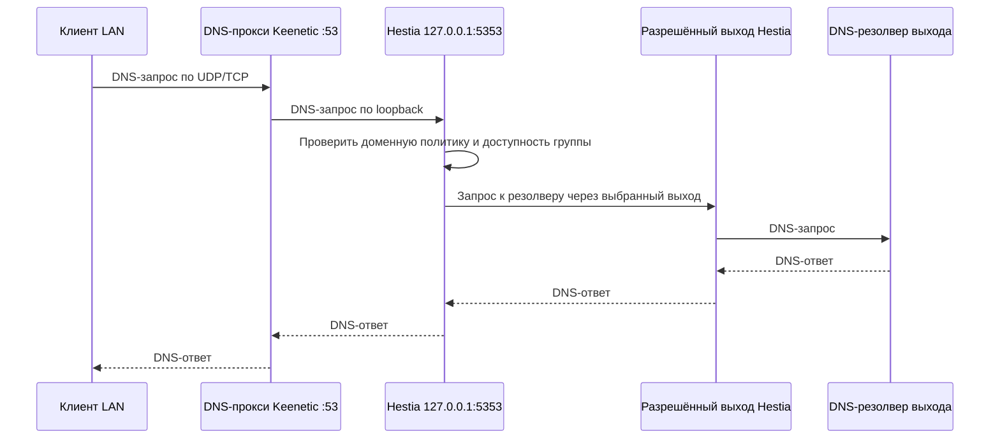

# DNS-форвардер Keenetic для Hestia

**Статус:** первая реализация согласована Product Owner 12 ноября 2026 года для всех LAN-клиентов, использующих DNS-прокси Keenetic. Текущие настройки DNS и сеть устройства не изменялись.

## Цель

Передавать DNS-запросы клиентов из выбранных LAN-сегментов через штатный DNS-прокси Keenetic в DNS-службу Hestia. Hestia сопоставляет имя с доменной политикой, выбирает разрешённый выход, получает ответ от резолвера этого выхода и возвращает его клиенту.

## Схема

Встроенный DNS-прокси Keenetic продолжает слушать UDP/TCP `:53`. DNS-служба Hestia слушает только loopback на отдельном высоком порту, первоначально `127.0.0.1:5353`. Профиль DNS Keenetic пересылает запросы на этот адрес и назначается клиентскому LAN-сегменту. Hestia принимает запросы только от loopback. Встроенный прокси остаётся владельцем клиентского порта 53; внешние DNS-настройки роутера для других сегментов и системных запросов не переписываются.

Для профиля Keenetic документированы отдельный DNS-upstream с пользовательским портом и назначение профиля интерфейсу сегмента. Поддержка и фактическое поведение этой схемы на KN-1012/KeeneticOS 5.2 Beta 3 должны быть подтверждены целевым прогоном до включения в рабочую сеть: [справочник команд Keenetic, DNS-профили и upstream](https://docs.help.keenetic.com/cli/4.0/en/cli_manual_kn-1011.pdf).

## Границы и отказы

- В первой версии профиль назначается только явно указанным клиентским LAN-сегментам. Имена сегментов определяются конфигурацией устройства; WAN, VPN-интерфейсы и системный DNS-маршрут не назначаются профилю автоматически.
- Если целевой сегмент уже связан с пользовательским DNS-профилем/пресетом, есть назначение DNS-профиля отдельному устройству, другой DNS-engine или любой профиль, который затронуло бы включение глобального interceptor-engine, включение должно завершиться конфликтом без изменения конфигурации.
- Профиль Hestia содержит только upstream Hestia. При недоступности службы запрос завершается ошибкой DNS; обычные upstream-адреса не используются как обход доменной политики.
- Маркер владения профиля сохраняет точный набор назначенных интерфейсов. Отключение удаляет только этот профиль и эти назначения. Если профиль или набор назначений изменились после включения, автоматическое удаление отказывает и сохраняет чужие изменения.
- DNS-служба остаётся optional. Наличие `dns.json` само по себе не меняет настройки DNS-прокси Keenetic; требуется отдельное явное включение профиля.
- Прямые запросы клиента к стороннему DNS, DoH/DoT самого клиента, IPv6 DNS и другие сегменты вне списка назначения не перехватываются первой версией.

## Критерии приёмки

1. Hestia поднимает UDP и TCP DNS listener на заданном loopback-порту и принимает запросы только от `127.0.0.1`.
2. Команда включения создаёт отдельный DNS-профиль с единственным upstream `127.0.0.1:<порт Hestia>` и назначает его каждому запрошенному LAN-сегменту; она отказывает до первой мутации при конфликте имени, назначения, per-device DNS override или неподдерживаемой схеме.
3. Включение не занимает и не меняет Keenetic `:53`, обычные DNS-upstream для прочих сегментов, DHCP, политики доступа, маршруты и WAN.
4. После включения клиентский UDP- и TCP-запрос с пустым кэшем достигает Hestia; ответ, счётчик DNS-службы и захват подтверждают локальную пересылку, затем внешний запрос через разрешённый выход.
5. При отказе выбранной группы клиент получает SERVFAIL; захваты подтверждают отсутствие запроса на другом выходе и отсутствие обращения к upstream-адресам профиля Keenetic в обход Hestia.
6. Включение повторно идемпотентно. Маркер хранит точный список назначений. Отключение сверяет этот список и удаляет только подтверждённые Hestia-профиль и назначения; при частичном сбое оно восстанавливает их либо явно сообщает о неполном откате.
7. Целевая приёмка выполняется только на выделенном клиенте `hestia-client`, хотя профиль охватывает все устройства перечисленных LAN-сегментов. До неё профиль не включается в рабочей конфигурации Keenetic.

## План реализации

1. Добавить отдельную команду явного управления DNS-профилем Keenetic с проверкой конфликтов и ограниченным откатом частичного изменения.
2. Подключить команду к настройкам loopback DNS-службы и документировать включение, проверку и отключение.
3. Выполнить локальную сборку и статические проверки; отдельно провести согласованный целевой прогон UDP/TCP, выбора выхода и fail-closed на KN-1012.
