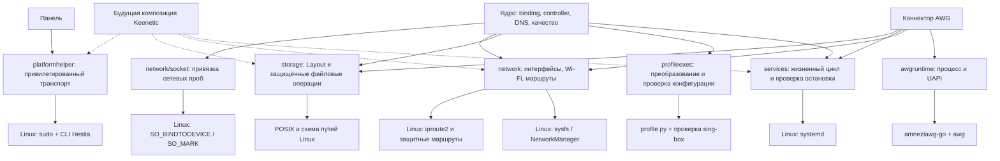

# Модули системных операций, хранения и сети

Продолжение согласованного [плана разделения](../keenetic-roadmap.md) после `37eaf06`. Product Owner поручил вынести оставшиеся системные вызовы, хранение и управление сетью, затем выполнить тесты, коммит и push. Цель этого этапа — сохранить действующее поведение Linux и отделить платформенные механизмы от координации. Реализация Keenetic и испытания роутера следуют отдельным этапом.

## Контракты и границы

- Системные операции: типизированные операции генерации и проверки конфигурации, привилегированный транспорт панели, управление службами и внешними процессами. Адаптеры сохраняют фиксированные программы, аргументы, окружение, обработку кодов завершения и контексты. Остановка backend для снятия guards и проверка готовности службы — разные операции.
- Хранение: типизированная схема установленных путей и отдельные POSIX-примитивы защищённого открытия файлов, метаданных и блокировок. Предметные форматы, журналы транзакций и алгоритмы отката остаются у своих владельцев. Перенос не меняет атомарность, права, владельцев, запрет ссылок и поведение при конкурирующих операциях. Переносимые операции стандартной библиотеки не требуют механической обёртки.
- Сеть: семантический контракт инвентаризации и изменения Wi-Fi, Linux-адаптер NetworkManager/sysfs, привязка сокетов к устройству и метке, интерфейс политики маршрутизации VPN и Linux-реализация iproute2. Порядок установки guards, проверка чужих правил, изоляция слотов и подтверждение остановки перед удалением сохраняются.

Композиция подключает Linux-реализации явно. Новые зависимости и RPC не требуются. CLI, REST, генерируемые модели, форматы файлов и состав пользовательских функций сохраняются. Имеющиеся интерфейсы переиспользуются, если уже выражают нужный контракт. Сигналы завершения процесса и классификация стандартных ошибок сокета остаются допустимыми в точках входа и протокольном коде.

## Связи модулей

Сплошные связи показывают текущую Linux-реализацию. Пунктирные обозначают ещё не реализованную замену адаптеров в поставке Keenetic. Hysteria 2 сохраняет существующий путь через общую конфигурацию и процесс sing-box.

## Приёмка

- MOD-1. Установленные пути собраны в модуле хранения; потребители используют именованные ресурсы. Тесты подтверждают прежние значения.
- MOD-2. Файловые POSIX-механизмы выделены; сохраняются защита от symlink/FIFO, проверки владельцев, блокировки и атомарная публикация. Отрицательные проверки проходят.
- MOD-3. Вызовы внешних программ вынесены в адаптеры; предметный код вызывает операции с определённым контрактом. Не появляется shell, произвольная команда из API или раскрытие секретного stdout/stderr.
- MOD-4. Семантические сетевые интерфейсы подключены к реальным потребителям. Ошибка привязки сокета исключает отправку через случайный выход; unsupported не превращается в успех.
- MOD-5. Маршрутный адаптер сохраняет точное владение правилами, IPv4/IPv6 guards, запрет обхода и порядок teardown. Неизвестное состояние процесса не разрешает удаление guards.
- MOD-6. Повторный запуск, частичный отказ и откат сохраняют поведение; существующие регрессионные тесты дополняются проверками границ модулей.
- MOD-7. Выполнены `make fmt`, `make check`, ARM64-сборка, проверки frontend и API из дорожной карты; независимые тестировщик, ревьюер и аналитик ИБ фиксируют результаты и ограничения. Linux-зависимые проверки учитываются отдельно от macOS.

## Проверка и возврат

Исходный полный прогон описан в дорожной карте, первый модуль проверен в `37eaf06`. Перед изменениями каждого участка выполняются относящиеся к нему тесты; после переноса повторяются те же проверки. Откат кода выполняется отменой коммита рефакторинга: миграции данных нет. В этой работе устройства и личная ВМ не изменяются.

## Статус

Перенос реализован. `binding` использует `profileexec.CompilerAPI` и `services.Manager`; панель — `platformhelper.Transport`; AWG — `awgruntime.Driver`, `services.Offline` и `network.RoutePolicy`. Инвентаризация и Wi-Fi перенесены в `network/linuxphysical`, iproute2 и проверки владения — в `network/linuxroute`. Привязка сокетов сосредоточена в `network/socket`. Пути выбираются через `storage.Installed()`, файловые POSIX-вызовы — через модуль хранения. Существующий пакет `physical` оставляет совместимые типы и ошибки для прежних потребителей.

Прошли форматирование, `make check`, ARM64-сборка, воспроизводимость API, frontend и браузерная регрессия. На изолированной Linux ARM64-ВМ прошли 22 пакета и дополнительные loopback-тесты с настоящим sing-box и raw ICMP. Независимый тестировщик подтвердил 16 пакетов адаптеров и потребителей. Ревью кода и безопасности завершены без блокирующих замечаний; зависимости не изменены. [Протокол, свидетельства и пропуски](../../experiments/platform-modules/README.md).

Тест с настоящим `nmcli` не выполнен из-за отсутствия утилиты. Проверки реального systemd, Ethernet/Wi-Fi, TUN и пути клиентского трафика остаются интеграционным этапом. Поставка и адаптеры Keenetic ещё не реализованы: пока точки композиции выбирают Linux; двух целевых билдов этот перенос сам по себе не добавляет.
