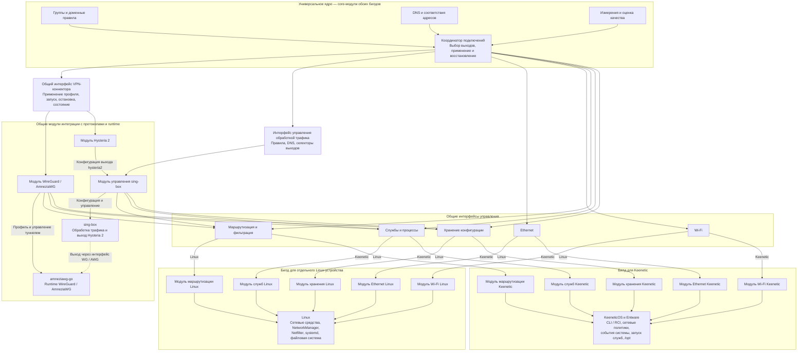

# Устройство Keenetic и интеграция Hestia

Этот документ — единое место исследований устройства Keenetic, его ограничений и интеграции Hestia, включая разбор исходников конкурентов. По решению владельца от 6 ноября 2026 года исследование двух поставок перенесено сюда из `deployment-targets-research.md`. Планы работ остаются в [дорожной карте Keenetic](keenetic-roadmap.md), критерии — в спецификациях, сырые свидетельства и протоколы прогонов — в [отчёте аппаратных проверок](../experiments/keenetic-capabilities/README.md).

Исходная архитектурная оценка выполнена на ревизии `d6a6dbf`; последующие переносы системных операций описаны в [документе модулей](features/platform-modules.md). Владелец согласовал два билда с универсальным ядром и платформенными модулями. Команда `show version` на целевом KN-1012 6 ноября 2026 года вернула KeeneticOS 5.2 Beta 3 (`5.02.B.3.0-2`); прежде сохранённые сведения о Beta 2 устарели. Запуск диагностического кода подтверждён на устройстве; полная служба Hestia ещё не установлена. Дата актуализации исследования — 6 ноября 2026 года.

Навигация:

- [Матрица всех функций и статусов](#матрица-возможностей-hestia-на-keenetic)

- [Подтверждённые ограничения устройства](#подтверждённые-ограничения-целевого-устройства)
- [Документация и network namespaces](#документация-производителя-и-сетевые-пространства-имён)
- [Два способа размещения](#два-способа-размещения) и [модули платформы](#универсальное-ядро-и-модули-управления)
- [Wireless ISP и порты](#wireless-isp-и-управление-портами)
- [Доступ к Entware](#подтверждённый-ssh-доступ-к-entware)
- [Исходники XKeen, SKeen и HydraRoute](#реализация-похожих-решений-исходный-код)
- [Выводы для Гестии](#что-применимо-к-гестии)

## Матрица возможностей Hestia на Keenetic

Состояние на 6 ноября 2026 года для KN-1012 и проверенного комплекта. Таблица охватывает функции из требований, спецификаций и дорожных карт, включая запланированные и явно отмеченные открытые вопросы. Проверки Linux-стенда не считаются проверками Keenetic. «Не проверено» означает, что работоспособность функции Hestia на устройстве ещё не установлена, даже если аналогичный механизм найден у конкурента. Проверенный отдельный механизм не подтверждает всю функцию, производительность или безопасность переходных состояний.

Ссылки в первом столбце ведут к требованиям функции; ссылки во втором — к способу и границам проверки в этом документе. При добавлении функции в спецификации нужно добавлять строку сюда; при исследовании обновлять статус и раздел с доказательствами. Успешный статус требует воспроизводимого свидетельства для указанного объёма проверки. После назначения отдельного субагента строка сразу получает статус «Исследуется» с кратким объёмом опыта. Этот статус не подтверждает работоспособность; после проверки свидетельств он заменяется фактическим выводом и ссылкой на протокол.

| Фича | Возможность реализации на Keenetic |
|---|---|
| **Подключения и путь клиента** | |
| [Основной шлюз между провайдером и LAN, два Ethernet-порта](requirements.md) | Не проверено. |
| [Однокабельная схема с локальным WireGuard от роутера](requirements.md) | Не проверено. |
| [Ручной обход Hestia для восстановления доступа](requirements.md) | Не проверено. |
| [Маршрутизация 1 Гбит/с и одновременная нагрузка на порты](requirements.md) | Не проверено. |
| [Несколько физических линий провайдеров](requirements.md) | Не проверено. |
| [Транзит TCP и UDP через выбранный выход](requirements.md) | Не проверено. |
| [Обработка IPv6 и защита от обхода правил через IPv6](requirements.md) | Не проверено для клиентского трафика и глобального IPv6. Отдельно подтверждены SOCKS TCP/UDP direct/block только на `::1`; [свидетельство](../experiments/keenetic-ipv6-loopback/README.md). |
| **Физическая сеть** | |
| [Обнаружение Ethernet-портов, состояние кабеля и готовность IPv4](features/physical-connections.md) | Не проверено. |
| [Назначение физического подключения группе и управление портами](features/physical-connections.md) | Не проверено. |
| [Wireless ISP: подключение к Wi-Fi 2,4/5 ГГц, SSID и пароль](features/physical-connections.md) | Не проверено. |
| [Сосуществование с LAN, Wi-Fi, сегментами и ускорением KeeneticOS](features/physical-connections.md) | Не проверено. |
| **VPN** | |
| [Полный туннель WireGuard: запуск, handshake, клиентский трафик](features/amneziawg-connector.md) | Не проверено. |
| [Полный туннель AmneziaWG, включая параметры обфускации](features/amneziawg-connector.md) | Не проверено. |
| [DNS и маршруты конкретного VPN, проверка доступности сервера](features/amneziawg-connector.md) | Не проверено. |
| [VLESS: клиентское подключение первого выпуска](requirements.md) | Частично: sing-box 1.14.4 на KN-1012 передаёт TCP/UDP-маркеры через локальные VLESS-клиент и сервер; неверный UUID отклонён в TCP-пробе при живом сервере. Внешний сервер, WAN и клиентский транзит не проверены. [Протокол](../experiments/keenetic-vless-local/README.md). |
| **Профили WireGuard и AmneziaWG** | |
| [Создание вручную и импорт .conf, проверка неизвестных параметров](features/wireguard-editor.md) | Не проверено. |
| [Редактирование, переименование, удаление и сохранение черновика при ошибке](features/wireguard-editor.md) | Не проверено. |
| [Постоянный UUID и сохранение ссылок при переименовании](features/wireguard-editor.md) | Не проверено. |
| [Чтение и изменение секретов отдельного профиля без утечек в список и журнал](features/wireguard-editor.md) | Не проверено. |
| [Проверка VPN перед сохранением и обновление состояния подключений](features/amneziawg-connector.md) | Не проверено. |
| **Несколько VPN** | |
| [До 50 одновременно настроенных WG/AWG, отдельные интерфейсы и слоты](features/multiple-wireguard.md) | Не проверено. |
| [Пересекающиеся адреса и AllowedIPs, независимые маршруты туннелей](features/multiple-wireguard.md) | Не проверено. |
| [Независимые обновление, удаление и измерения подключений](features/multiple-wireguard.md) | Не проверено. |
| [Сохранение назначений после перезапуска и миграция старого awg0](features/multiple-wireguard.md) | Не проверено. |
| **Hysteria 2** | |
| [Полный туннель Hysteria 2 через sing-box](features/hysteria2.md) | Частично: sing-box 1.14.4 на KN-1012 передаёт TCP/UDP через локальные Hysteria 2 клиент и сервер с проверкой CA и имени TLS; неверный пароль отклонён без роста счётчиков сервиса. Финальный прогон сохранил четыре хеша маршрутов/правил; в предыдущем изменился хеш IPv4 rules, причина не установлена. Полный WAN-туннель не проверен. [Протокол](../experiments/keenetic-hysteria2-local/README.md). |
| [Импорт YAML, редактирование сервера и аутентификации](features/hysteria2.md) | Не проверено. |
| [Импорт, скачивание и удаление PEM-сертификата, проверка TLS и доступности туннеля](features/hysteria2.md) | Не проверено. |
| [Port hopping — открытый вопрос спецификации](features/hysteria2.md) | Не проверено. |
| [Импорт hy2:// и обфускация — вне согласованного объёма](features/hysteria2.md) | Не проверено. |
| **SSTP** | |
| [Один SSTP: запуск PPP, маршрутизация и восстановление соединения](architecture.md) | Не проверено. |
| [Измерение и выбор SSTP как выхода группы](architecture.md) | Не проверено. |
| [Два SSTP с одинаковым внутренним IP](architecture.md) | Текущие исследования не смогли дать положительный ответ касательно работоспособности этой фичи в среде Keenetic. Проверенный на Linux способ требует netns; замена политиками пока не доказана. [Ограничение и варианты](keenetic-platform.md#документация-производителя-и-сетевые-пространства-имён). |
| **Транспорт VPN** | |
| [Режим «Любое» и упорядоченный список транспортов](features/wireguard-underlay.md) | Не проверено. |
| [Физическое подключение или другой VPN как транспорт; цепочки разных протоколов](features/wireguard-underlay.md) | Не проверено. |
| [Проверка циклов и зависимостей при изменении и удалении](features/wireguard-underlay.md) | Не проверено. |
| [Переход на резерв при устойчивой деградации транспорта](features/wireguard-underlay.md) | Не проверено. |
| [Возврат на предпочтительный транспорт после проверки конкретного peer](features/wireguard-underlay.md) | Не проверено. |
| [Блокировка туннеля, когда все разрешённые транспорты недоступны](features/wireguard-underlay.md) | Не проверено. |
| **Группы** | |
| [Создание, переименование и удаление групп](features/connection-groups.md) | Не проверено. |
| [Группа по умолчанию, порядок групп и подключений](features/connection-groups.md) | Не проверено. |
| [Перенос подключения между группами с сохранением ограничений](features/connection-groups.md) | Не проверено. |
| [Транзакционное применение, конфликты ревизий и восстановление прежнего состояния при ошибке](features/connection-groups.md) | Не проверено. |
| **Доменные правила** | |
| [Создание, редактирование, отключение и удаление отдельных списков доменов](features/domain-lists-editor.md) | Не проверено. |
| [Привязка и перепривязка списка к одной группе без потери записей](features/domain-lists-editor.md) | Не проверено. |
| [Маски доменов, исключения и приоритет наиболее точного совпадения](features/domain-lists-editor.md) | Не проверено. |
| [Точное совпадение домена — предложенное расширение](features/domain-lists-editor.md) | Не проверено. |
| **Выбор выхода и блокировка** | |
| [Выбор группы по домену и приоритет доменного правила перед GeoIP](requirements.md) | Не проверено. |
| [Группа по умолчанию для неизвестных доменов и прямых IP](requirements.md) | Не проверено. |
| [Автоматический резерв внутри группы и возврат после восстановления](requirements.md) | **Исследование не завершено — приостановлено по просьбе владельца.** Первая попытка urltest подтвердила выбор выхода A для TCP, UDP-проба завершилась таймаутом. Переключение на резерв, возврат и блокировка при отказе обоих выходов не проверены; исправленный прогон не запускался. [Протокол](../experiments/keenetic-exit-failover/README.md). |
| [Блокировка при отказе всех выходов явной группы без перехода в другую страну](requirements.md) | **Исследование не завершено — приостановлено по просьбе владельца.** Первая попытка urltest подтвердила выбор выхода A для TCP, UDP-проба завершилась таймаутом. Переключение на резерв, возврат и блокировка при отказе обоих выходов не проверены; исправленный прогон не запускался. [Протокол](../experiments/keenetic-exit-failover/README.md). |
| [Соблюдение блокировки для адресов из клиентского кэша](requirements.md) | Не проверено. |
| [Выбор по имени из протокола и обработка трафика без известного домена](requirements.md) | Не проверено. |
| [Динамические исключения для конкретного адреса и протокола, ограничение их числа и снятие](requirements.md) | Не проверено. |
| **GeoIP** | |
| [Включение и выключение GeoIP, исходно выключенного](requirements.md) | Не проверено. |
| [Привязка страны к единственной группе, массовое назначение и сохранение карты](requirements.md) | Не проверено. |
| [Определение страны по фактическому IP назначения нового соединения](requirements.md) | Не проверено. |
| [Локальная база DB-IP и объяснимое поведение при неизвестной стране](requirements.md) | Не проверено. |
| [Необязательное асинхронное уточнение через 2ip, API-ключ и локальный кэш](requirements.md) | Не проверено. |
| **DNS** | |
| [Собственная DNS-служба UDP/TCP, интеграция с форвардером и ограничения источников](dns-settings.md) | Не проверено. |
| [Резолверы каждого выхода и DNS только через разрешённую группу](dns-settings.md) | Не проверено. |
| [Параллельные запросы групп для неизвестного домена, первый положительный ответ](requirements.md) | Не проверено. |
| [Обработка NXDOMAIN без подавления возможного положительного ответа](requirements.md) | Не проверено. |
| [Связь ответа, TTL, резолвера и фактического выхода](requirements.md) | Не проверено. |
| [Кэш после TTL и устаревший ответ при отказе обновления](dns-settings.md) | Не проверено. |
| [Сохранение кэша и восстановление после перезапуска](dns-settings.md) | Не проверено. |
| [Автопрогрев по активности клиентов: N, X, Y и обновление перед TTL](dns-settings.md) | Не проверено. |
| [Ручной список прогрева, чёрный список и управление динамическим списком](dns-settings.md) | Не проверено. |
| [Ограничение параллелизма и повторов; фоновые запросы не считаются активностью](dns-settings.md) | Не проверено. |
| **FakeIP** | |
| [FakeIP для связи доменного решения с TCP/UDP-потоком и смена реального IP после TTL](dns-rotation.md) | Частично: sing-box 1.14.4 на KN-1012 выдал FakeIP для синтетического домена; TCP/UDP-запросы через SOCKS к числовому FakeIP доставили маркеры локального сервиса, журнал подтвердил восстановление домена. Маршруты/правила не изменились. Дополнительный прогон на Beta 3 показал TCP/UDP к новой loopback-цели после TTL с прежним FakeIP, без повторного DNS-запроса клиента; старая цель оставалась доступна. Независимая сверка TTL-прогона и пересборка helper подтверждены; клиентский транзит и смена группы не проверены. [TTL-протокол](../experiments/keenetic-fakeip-ttl/README.md). [Протокол](../experiments/keenetic-fakeip-local/README.md). |
| [Сохранение привязок FakeIP после перезапуска без назначения старого IP другой группе — эксперимент, ещё не интегрирован](roadmap.md) | Частично: на KN-1012 sing-box 1.14.4 с store_fakeip восстановил привязку после штатного перезапуска собственного процесса; TCP/UDP к прежнему числовому FakeIP прошли без повторного DNS-запроса клиента. Проверены один домен и неизменный конфиг; перераспределение между группами, сбой питания и смена диапазона не проверены. [Протокол](../experiments/keenetic-fakeip-local/README.md). |
| **Измерение качества** | |
| [Проверка всех выходов, включая резервные, на одинаковых целях](observer.md) | Не проверено. |
| [Потери как основной критерий, RTT и скорость как дополнительные](observer.md) | Не проверено. |
| [Настраиваемое окно качества; сохранение порядка при равенстве или отсутствии данных](observer.md) | Не проверено. |
| [Раздельные результаты по протоколу и адресу назначения](observer.md) | Не проверено. |
| [TCP connect, UDP echo и ICMP с учётом ограничений транспорта](features/connection-quality.md) | Не проверено. |
| [UDP DNS к независимым публичным резолверам](features/connection-quality.md) | Не проверено. |
| [DNS-проверки: CNAME и TCP fallback при усечённом ответе](features/connection-quality.md) | **Исследование не завершено — приостановлено по просьбе владельца.** Аппаратные прогоны завершены; осталось независимо воспроизвести сборку helper. Подтверждено частично: на KN-1012 / KeeneticOS 5.2 Beta 3 sing-box 1.14.4 передал полный CNAME+A ответ и повторил усечённый UDP-запрос по TCP. Одиночный CNAME передавался без дополнительного запроса псевдонима. Интеграция с измерителем Hestia не проверена; журналы независимо сверены, пересборка helper остаётся неподтверждённой из-за неполного снимка зависимостей. [Протокол](../experiments/keenetic-dns-fallback/README.md). |
| [Проверки HTTPS и HTTP/3](features/connection-quality.md) | Не проверено. |
| [Оценка 0–100, учёт завершённых проб и исключение локальных ошибок](features/connection-quality.md) | Не проверено. |
| [Равновесное среднее проверок, различение отсутствия данных и полного отказа](features/connection-quality.md) | Не проверено. |
| [Переключение сервиса только на основании измерений самого сервиса](observer.md) | Не проверено. |
| [Пассивные наблюдения рабочего трафика, задержки и скорости](requirements.md) | Не проверено. |
| **Настройки измерений** | |
| [Редактирование целей, типов, интервалов и таймаутов проверок, проверка TCP-целей при сохранении](features/connection-quality.md) | Не проверено. |
| [Отображение качества всех групп, выходов и отдельных проверок](features/connection-quality.md) | Не проверено. |
| **Журнал трафика** | |
| [События новых TCP/UDP-соединений и смены маршрута](features/traffic-journal.md) | Не проверено. |
| [Фактический выход и явная отметка «выход не подтверждён»](features/traffic-journal.md) | Не проверено. |
| [Домен, реальный IP, FakeIP, GeoIP, группа и причина решения](features/traffic-journal.md) | Не проверено. |
| [Фильтры по времени, домену, IP, стране, протоколу и выходу; детали и виртуальная прокрутка](features/traffic-journal.md) | Не проверено. |
| [Хранение по сроку и размеру, учёт потерянных событий](features/traffic-journal.md) | Не проверено. |
| [Диагностика медленного домена: DNS-временная шкала, SYN, повторные передачи и первый UDP-ответ](features/traffic-journal.md) | Не проверено. |
| **Наблюдаемость** | |
| [Prometheus и node_exporter: CPU, память, накопитель, conntrack и интерфейсы](monitoring.md) | Не проверено. |
| [Метрики RTT, jitter, потерь, свежести измерений и переподключений SSTP](monitoring.md) | Не проверено. |
| [Метрики DNS, кэша и задержек по выходам](monitoring.md) | Не проверено. |
| [Сопоставление выбранного выхода с наблюдаемым внешним IP](monitoring.md) | Не проверено. |
| [Постоянный журнал переключений с причиной, окном и выборкой](monitoring.md) | Не проверено. |
| [Дашборды Grafana: обзор, качество, DNS и Linux/SSTP](monitoring.md) | Не проверено. |
| [Локальный HTTPS grafana.home.arpa через Wi-Fi без интернета](monitoring.md) | Не проверено. |
| [Ограничение доступа к мониторингу из WAN/VPN для IPv4 и IPv6](monitoring.md) | Не проверено. |
| [Alertmanager: отказы, неверный выход, деградация, DNS, flapping и место на диске](monitoring.md) | Не проверено. |
| [Группировка и подавление алертов; доставка через разрешённый выход, получатель ещё не выбран](monitoring.md) | Не проверено. |
| [Независимость маршрутизации от отказа мониторинга](monitoring.md) | Не проверено. |
| [Loki/Alloy для централизации журналов — необязательное направление](monitoring.md) | Не проверено. |
| **Веб-панель и API** | |
| [Angular/PrimeNG, автономная работа с локальными ресурсами без CDN](frontend.md) | Не проверено. |
| [Навигация, прямые ссылки, адаптивность и клавиатурная доступность](frontend.md) | Не проверено. |
| [Экраны групп, списков, подключений, DNS, GeoIP, качества и журнала](frontend.md) | Не проверено. |
| [Ссылка на Grafana при наличии настроенного адреса](frontend.md) | Не проверено. |
| [Типизированный REST API, OpenAPI и сгенерированный клиент с проверкой входных данных](frontend.md) | Не проверено. |
| **Авторизация — проект спецификации** | |
| [Первичная установка пароля через консоль и безопасное хранение Argon2id](features/admin-password.md) | Не проверено. |
| [Вход, выход, смена пароля и отзыв сессий](features/admin-password.md) | Не проверено. |
| [Защита сессий и CSRF, работа без внешней службы авторизации](features/admin-password.md) | Не проверено. |
| **Платформенная интеграция** | |
| [Универсальное ядро Hestia с Keenetic-адаптерами](features/platform-modules.md) | Не проверено. |
| [Управление маршрутами, метками, таблицами и фильтрацией Hestia](features/platform-modules.md) | Не проверено. |
| [Перехват TUN/TProxy/Redirect и согласование с системным DNS](features/platform-modules.md) | Не завершено: подготовлен план read-only инвентаризации; к роутеру не обращались, поддержка TPROXY/socket match не проверена. [Материалы](../experiments/keenetic-netfilter-readonly/README.md). |
| [Согласование с политиками KeeneticOS без конфликтов меток и таблиц](features/platform-modules.md) | Не проверено. |
| [Восстановление своих правил после событий интерфейсов и пересборки Netfilter](features/platform-modules.md) | Не проверено. |
| [Проверка возможностей устройства и доступности операций в панели](features/platform-modules.md) | Подтверждено частично: `ndmc -c 'show version'` и `ndmc -c 'show system'` успешно вернули разрешённые сведения; `ndmc -c 'show ip policy'` успешно выполнен, но его вывод сохранён только как размер и SHA-256. RCI по HTTP не проверялся, настройки не менялись. [Протокол](../experiments/keenetic-rci-readonly/README.md). |
| [Размещение файлов в /opt, секреты и атомарное сохранение конфигурации](features/platform-modules.md) | Не завершено: локально подготовлен прототип синтетической атомарной замены; на роутере не запускался, поведение файловой системы `/opt` не проверено. [Материалы](../experiments/keenetic-storage-atomic/README.md). |
| [Создание veth для изолированного пути пакета](architecture.md) | Не проверено. |
| **Службы** | |
| [Запуск, остановка и диагностика служб средствами Entware](features/platform-services.md) | Не завершено: подготовлен локальный план read-only анализа `rc.func`; установленный helper на роутере не исследован, службы не запускались. [Материалы](../experiments/keenetic-entware-rcfunc-readonly/README.md). |
| [Автозапуск после перезагрузки и готовности накопителя /opt](features/platform-services.md) | Не проверено. |
| [Транзакционные изменения служб и восстановление после прерванного применения](features/platform-services.md) | Не проверено. |
| **Поставка и эксплуатация** | |
| [Полная ARM64-сборка Hestia для Keenetic и пакет .ipk](keenetic-roadmap.md) | Не проверено. |
| [Идемпотентная повторная установка, контроль целостности и автоматическая проверка установки](../deploy/docs/installer.md) | Не проверено. |
| [Установка, обновление, откат и удаление только своих ресурсов](keenetic-roadmap.md) | Не проверено. |
| [Резервная копия, экспорт и импорт профиля без VPN-секретов; перенос исходных VPN-файлов отдельно](keenetic-roadmap.md) | Не проверено. |
| [Восстановление после отключения питания или исчезновения USB](keenetic-roadmap.md) | Не проверено. |
| [CI обеих поставок и воспроизводимость зависимостей](keenetic-roadmap.md) | Не проверено. |
| [Ресурсные и длительные испытания совместно со службами роутера](keenetic-roadmap.md) | Не проверено. |
| [Включение в официальный каталог компонентов или штатный интерфейс KeeneticOS — отдельный вопрос](keenetic-roadmap.md) | Не проверено. |
| **Проверенные части подготовки и ограничения runtime** | |
| Доставка диагностической сборки по SSH и проверка целостности | Проверено: отдельный каталог в /opt/tmp, проверка SHA-256. [Способ и свидетельство](keenetic-platform.md#проверенные-способы-подготовки). |
| Запуск статической ARM64-диагностики и инвентаризация | Проверено: help, version и чтение окружения. [Способ и свидетельство](keenetic-platform.md#проверенные-способы-подготовки). |
| Чтение существующих IPv4/IPv6-правил и таблиц | Проверено чтение через ip; изменение маршрутов не проверено. [Способ и свидетельство](keenetic-platform.md#проверенные-способы-подготовки). |
| Запуск amneziawg-go только с --version | Проверено для закреплённой статической сборки; туннель не запускался. [Способ и свидетельство](keenetic-platform.md#проверенные-способы-подготовки). |
| Изоляция процессов в Linux network namespace | Текущие исследования не смогли дать положительный ответ касательно работоспособности этой фичи в среде Keenetic. [Результат проверки и причина](keenetic-platform.md#подтверждённые-ограничения-целевого-устройства). |
| Прямой запуск sing-box из текущего Linux-комплекта | Текущие исследования не смогли дать положительный ответ касательно работоспособности этой фичи в среде Keenetic. [Результат проверки и причина](keenetic-platform.md#подтверждённые-ограничения-целевого-устройства). |
| Прямой запуск awg-tools из текущего Linux-комплекта | Текущие исследования не смогли дать положительный ответ касательно работоспособности этой фичи в среде Keenetic. [Результат проверки и причина](keenetic-platform.md#подтверждённые-ограничения-целевого-устройства). |
| Запуск sing-box через загрузчик Entware `/opt/lib` | Проверено для неизменённого динамического ARM64 sing-box 1.14.4: `version`, `check`, запуск и HTTP 200 через loopback SOCKS/direct. Статическая сборка, VPN и клиентский транзит этим не подтверждены. [Протокол и свидетельства](../experiments/keenetic-capabilities/README.md#совместимый-sing-box-loopback-прототип--6-ноября-2026-года). |
| Совместимый awg-tools; загрузчик Entware и статическая альтернатива | Статический ARM64/musl awg-tools v3.1.20260812 из закреплённого исходного коммита успешно выполняет `--version` и `--help`. Прежний динамический бинарник требует GLIBC_2.33/2.34 и не работает с glibc 2.27. VPN/UAPI не проверены. [Протокол и свидетельства](../experiments/keenetic-awg-runtime/README.md). |
| Локальный SOCKS TCP/UDP и блокирующий outbound sing-box | Проверено на sing-box 1.14.4: TCP/UDP-маркеры через SOCKS; UDP к второму loopback-адресу блокируется при живом процессе и доступном напрямую ответчике. Клиентский транзит и блокировка группы не проверены. [Протокол](../experiments/keenetic-singbox-udp-block/README.md). |
| IPv6 SOCKS TCP/UDP и блокирующий outbound sing-box | На KN-1012 с sing-box 1.14.4 проверены direct-маркеры для TCP/UDP на `::1` и блокировка двух других IPv6 loopback-портов; хеши маршрутов/правил до и после совпали. Глобальный IPv6, клиентский транзит и DNS не проверялись. [Протокол и свидетельства](../experiments/keenetic-ipv6-loopback/README.md). |
| Локальная DNS-служба sing-box по UDP/TCP | Проверены A и NXDOMAIN для синтетических `.test` через собственный loopback-ответчик в финальном прогоне. Источник дополнительного TCP A-запроса не установлен. Интеграция с DNS Keenetic, порт 53 и клиентский перехват не проверены. [Протокол](../experiments/keenetic-dns-local/README.md). |
| Запуск amneziawg-go и приватный UAPI | Проверена отдельная сборка закреплённого v3.1.20260828 с приватным путём сокета: запуск на собственном TUN, set/get синтетического ключа с проверкой публичного производного, ноль пиров, интерфейс DOWN, штатный выход и очистка. Handshake и трафик не проверены. [Протокол](../experiments/keenetic-awg-uapi/README.md). |
| Создание и очистка непостоянного TUN | Проверено на KN-1012: `TUNSETIFF` с `IFF_TUN_EXCL`, появление интерфейса и удаление закрытием дескриптора; снимки маршрутов и правил совпали. [Протокол и свидетельства](../experiments/keenetic-tun/README.md). |
| Проведение трафика через TUN | Не проверено. Создание интерфейса не подтверждает передачу пакетов или интеграцию sing-box/VPN. |

## Проверенные способы подготовки

Эти способы подтверждают только перечисленные операции. Полная служба Hestia, VPN-туннели и правила перехвата этим опытом не проверены.

- **Доставка:** подключение к SSH Entware по ключу с проверкой host key, отдельный временный каталог `/opt/tmp/hestia-*`, копирование файлов и сравнение SHA-256 до запуска. Диагностическая поставка не регистрирует службу. Точный порядок и результаты — в [протоколе инвентаризации](../experiments/keenetic-capabilities/README.md) и [свидетельствах](../experiments/keenetic-capabilities/evidence/router-inventory-20261106/).
- **Статическая диагностика:** Linux ARM64-бинарник без динамического загрузчика выполняет `help`, `version` и чтение сведений о системе. Контракт безопасных операций описан в [спецификации диагностики](features/keenetic-diagnostics.md); наличие конкретного устройства или файла не означает поддержку всей функции.
- **Чтение маршрутизации:** доступный `ip` читает IPv4/IPv6 rules и routes. Снимки до и после проб совпали по байтам, хешам и числу записей. Команды и результаты сохранены в [свидетельствах runtime](../experiments/keenetic-capabilities/evidence/router-runtime-20261106/). Для записи правил потребуется отдельная проверка согласования с KeeneticOS.
- **Проверка загрузки AWG runtime:** закреплённый статический `amneziawg-go --version` завершился успешно и сообщил `v3.1.20260828`. Версия и хеш входного файла зафиксированы в [runtime lock](../scripts/build/runtime-lock.json), результат — в тех же свидетельствах runtime. В последующем [опыте приватного UAPI](../experiments/keenetic-awg-uapi/README.md) отдельная сборка того же исходного релиза с изменённым через линковщик каталогом сокетов прошла запуск на собственном TUN и set/get синтетического состояния без поднятия интерфейса. Handshake не проверен.

## Подтверждённые ограничения целевого устройства

- Инвентаризация: Linux ARM64, ядро `4.9-ndm-5`, около 486 МиБ памяти, `/dev/net/tun` существует. Последующая [проба TUN](../experiments/keenetic-tun/README.md) подтвердила создание непостоянного интерфейса и очистку, но не передачу пакетов или работоспособность VPN.
- Прямой системный вызов `unshare(CLONE_NEWNET)` на закреплённом потоке вернул `EINVAL (22)`; `/proc/self/ns/net` отсутствует. Сетевые пространства имён недоступны в проверенном контексте. Конфигурация ядра не получена, поэтому точная причина, например выключенный `CONFIG_NET_NS`, остаётся выводом по совокупности признаков, а не прочитанным параметром сборки. Простая установка утилиты `ip netns` не устраняет этот результат системного вызова.
- Штатная policy routing уже используется: наблюдались правила по меткам и несколько таблиц IPv4/IPv6. В `/proc/net/ip_tables_names` видны `nat`, `mangle`, `filter`; отсутствие CLI `iptables` в проверенных каталогах не означает отсутствия Netfilter.
- Закреплённый статический `amneziawg-go` успешно выводит версию. Linux-бинарники `sing-box` и `awg` из нашего комплекта требуют `/lib/ld-linux-aarch64.so.1`; этот путь отсутствует, прямой запуск завершается кодом 127. Последующая [loopback-проба](../experiments/keenetic-capabilities/README.md#совместимый-sing-box-loopback-прототип--6-ноября-2026-года) подтвердила запуск неизменённого sing-box 1.14.4 через `/opt/lib/ld-linux-aarch64.so.1 --library-path /opt/lib`, проверку конфигурации и HTTP через SOCKS. Для awg тот же загрузчик выявил несовместимость символов GLIBC_2.33/2.34 с glibc 2.27; [статическая ARM64/musl-сборка](../experiments/keenetic-awg-runtime/README.md) успешно выполнила `--version` и `--help`. Системные ссылки и библиотеки не менялись.
- В первом опыте процессы VPN и изменение маршрутизации были пропущены из-за отсутствия netns. Во втором цикле [amneziawg-go запущен без пиров и поднятия интерфейса](../experiments/keenetic-awg-uapi/README.md): эксклюзивный TUN и UAPI переданы готовыми дескрипторами, путь наблюдаемого сокета перенесён параметром линковщика в приватный временный каталог. Исходный `/var/run/amneziawg` не использовался. Полный VPN-туннель и изменение маршрутизации не проверены.

Команды, хеши, коды завершения, проверка сохранности маршрутов и границы выводов находятся в [протоколе](../experiments/keenetic-capabilities/README.md). Результаты относятся к проверенной прошивке и комплекту, не ко всем моделям Keenetic.

## Документация производителя и сетевые пространства имён

Проверены первичные источники 6 ноября 2026 года:

| Источник | Что найдено | Ограничение |
|---|---|---|
| [Официальный центр загрузок KN-1012](https://support.keenetic.com/hero/kn-1012/en/28382-download-center.html) и [справочник CLI](https://storage.googleapis.com/docs.help.keenetic.com/cli/4.3/en/cli_manual_kn-1012.pdf) | Команды `ip policy`, `ip policy route`, `ip policy standalone`, `show ip policy`; в выводе политики описаны метка и таблица | Руководство для KeeneticOS 4.3, редакция 1.162 от 14.11.2025; не полный контракт установленной 5.2 Beta 3 (`5.02.B.3.0-2`) |
| [Примечания к KeeneticOS 5.2 для KN-1012](https://support.keenetic.com/hero/kn-1012/en/35528-latest-development-release.html) | Развитие политик и FQDN-маршрутов, в частности `ip policy ... dns-proxy route` | В просмотренных материалах описание Linux network namespaces не найдено; это не доказательство отсутствия во всех версиях |
| [Сегменты сети KN-1012](https://support.keenetic.com/hero/kn-1012/en/14628-network-segments.html) | Сегментация сети средствами KeeneticOS | Сегменты и политики не предоставляют автоматически изолированный Linux network namespace для процесса |

Поиск `namespace` в тексте CLI-справочника не дал совпадений. Практическое решение для текущего устройства определяется прямой пробой ядра, а не отсутствием упоминания в документации. Подмена Linux netns политиками требует отдельного проектирования: политики могут разделять выходы, но сами по себе не доказывают изоляцию одинаковых адресов SSTP, локальных сокетов или Netfilter нескольких экземпляров.

## Вывод

Две поставки остаются согласованным направлением архитектуры; работоспособность полного набора функций на Keenetic пока не установлена. Для отдельного устройства уже существует Linux ARM64-сборка и установщик. Для Keenetic KN-1012 рассматривается пакет Entware `.ipk` с адаптацией управления службами, сетью и размещения файлов. Выявленные ограничения netns и ABI требуют отдельных решений перед аппаратной приёмкой.

Производитель указывает для KN-1012 установщик Entware aarch64. Проект SKeen демонстрирует интеграцию sing-box с перехватом TUN/TProxy на Keenetic. Исходники показывают кандидатный способ такой интеграции; аппаратной проверкой Hestia это не является. Совместимость конкретного комплекта Гестии требует отдельной проверки. [Entware для KN-1012](https://support.keenetic.com/hero/kn-1012/en/20980-installing-the-entware-repository-on-a-usb-drive.html) · [SKeen](https://github.com/jinndi/SKeen)

Поставка для Keenetic рассматривается как устанавливаемая служба Entware со своей веб-панелью. Модули управления внутри Гестии описаны ниже как части её архитектуры. Возможность включения в каталог официальных компонентов KeeneticOS или встраивания панели в штатный интерфейс остаётся отдельным вопросом к производителю.

## Исходные зависимости и текущее состояние переноса

Ниже сохранена инвентаризация исходной ревизии `d6a6dbf`, на которой начиналось исследование. Впоследствии прямые системные операции backend вынесены в Linux-адаптеры; актуальное состояние и контракты описаны в [модулях платформы](features/platform-modules.md). Keenetic-адаптеров и `.ipk` ещё нет.

- `Makefile` собирает команды с `CGO_ENABLED=0 GOOS=linux GOARCH=arm64`. Angular собирается в статические ресурсы.
- `deploy/install.sh` устанавливает службы systemd, использует Python и пути `/etc/hestia`, `/usr/local/bin`, `/usr/local/lib/hestia`.
- `backend/internal/physical/physical.go` обнаруживает интерфейсы через sysfs и управляет Wi-Fi через NetworkManager и `/usr/bin/nmcli`.
- `backend/internal/awg/` использует фиксированные Linux-пути к утилитам и обращается к systemd.
- `backend/internal/binding/engine.go` и `awg_services.go` используют systemd внутри транзакционного применения и восстановления. Адаптации требует также этот жизненный цикл.
- `.github/workflows/go.yml` содержит общие проверки backend и frontend. Подготовку `.ipk` предстоит добавить.

Основания находятся в [Makefile](../Makefile), [установщике](../deploy/install.sh), [управлении физическими подключениями](../backend/internal/physical/physical.go), [AWG](../backend/internal/awg/) и [CI](../.github/workflows/go.yml).

## Два способа размещения

| Свойство | Внутри Keenetic | Отдельный Linux ARM64-шлюз |
|---|---|---|
| Системная сеть | Интеграция с настройками и событиями KeeneticOS | Управление сетевыми интерфейсами собственной ОС |
| Путь клиента | LAN/Wi-Fi → локальный перехват → sing-box → выбранный выход | Клиент → Keenetic → Ethernet или локальный туннель → Гестия → выбранный выход |
| Службы и файлы | Entware, каталог `/opt`, механизм запуска Entware | systemd и существующая раскладка Linux |
| Ресурсы | Общие с Wi-Fi и всеми службами роутера | Ресурсы отдельной платы и её накопителя |
| Wireless ISP | Предлагаемый адаптер команд KeeneticOS | Собственный Wi-Fi-адаптер либо отдельная интеграция управления Keenetic |
| Аппаратные проверки | Прошивка, ядро, Netfilter, TUN, ресурсы, взаимодействие с ускорением | Конкретная плата, образ, драйверы Ethernet/Wi-Fi, охлаждение и восстановление |

Для отдельного устройства проект предусматривает схему «провайдер → Гестия → Keenetic» с двумя Ethernet-портами. В этой схеме пакеты передаются по Ethernet. Существующий однокабельный вариант использует локальный WireGuard, чтобы разделить клиентский трафик и транспорт внешних VPN. Дополнительный вариант с VLAN и маршрутизацией потребует своего проектирования и испытаний. [Схемы проекта](architecture.md)

## Сборка и выбор возможностей

Согласовано выпускать два целевых билда — для отдельного Linux-устройства и для Keenetic. Каждый билд объединяет универсальное ядро, соответствующие платформе модули управления и средства установки. Ядро содержит общую логику правил, DNS, измерений и выбора выходов. Взаимодействие с системой выносится в отдельные модули по областям ответственности.

Для KN-1012 и отдельной ARM64-платы целевая архитектура процессора одинакова. Два билда различаются набором подключённых реализаций модулей и поставкой. Совместимость каждого проверяется на целевой системе, включая минимально поддерживаемое ядро и системные вызовы. Статическая сборка сохраняет требования к ядру, устройствам и внешним программам.

Цель сборки определяет платформенный комплект модулей. Конкретный механизм его выбора — например, точки сборки или Go build tags — предстоит определить при проектировании реализации. Дополнительные флаги отдельных функций рассматриваются при подтверждённой необходимости. Во время запуска модули проверяют возможности конкретной системы. Доступность операций в панели должна следовать типизированному ответу backend, а backend проверяет разрешённость операции при выполнении.

CI должен собирать и проверять обе цели. Предлагается использовать общие проверки ядра и отдельные задания сборки и упаковки Linux и Keenetic. Entware-задание формирует `.ipk`, зависимости, права, запуск служб, обновление и удаление. Проверки должны покрывать сохранение конфигурации, восстановление после сбоя установки и очистку принадлежащих Гестии правил. Испытания пакета на KN-1012 дополняют CI. Окончательные метаданные архитектуры opkg и версии зависимостей определяются по фактическому feed целевой прошивки.

## Универсальное ядро и модули управления

Согласованный принцип — ядро обращается к типизированным интерфейсам управления. Для каждой области Linux- и Keenetic-реализации предоставляют ядру одинаковый контракт, а операции над устройством выполняют средствами своей платформы. При запуске соответствующего билда ядру передаются реализации модулей этой платформы. Способ связывания модулей будет определён при реализации.

Ethernet и Wi-Fi выделяются в отдельные модули. Для остальных системных взаимодействий предлагается следующее разбиение, которое предстоит уточнить при проектировании.

| Модуль | Общий контракт для ядра | Реализация Linux | Реализация Keenetic |
|---|---|---|---|
| Ethernet | Перечень портов и подключений, состояние, применение поддерживаемых настроек | Интерфейсы и средства управления сетью Linux | Порты, сегменты и интерфейсы через управление KeeneticOS |
| Wi-Fi | Поиск сетей, настройка подключения, включение и чтение состояния | NetworkManager | Wireless ISP через команды KeeneticOS |
| Маршрутизация и фильтрация | Применение маршрутов и ограничений Гестии, чтение фактического состояния | Таблицы маршрутов и Netfilter Linux | Согласование с политиками и событиями KeeneticOS, доступные средства ядра |
| Службы и процессы | Запуск, остановка, состояние и восстановление компонентов | systemd | Механизмы Entware и события KeeneticOS |
| Хранение системной конфигурации | Сохранение, загрузка и восстановление принадлежащих Гестии настроек | Каталоги и права Linux-поставки | Каталоги `/opt` и интеграция с настройками KeeneticOS |

В общей части также выделяются модули VPN-коннекторов. Модуль WireGuard / AmneziaWG управляет внешним runtime `amneziawg-go`. Модуль Hysteria 2 формирует и применяет выход `hysteria2` в sing-box. Обе реализации предоставляют ядру общий интерфейс жизненного цикла подключения и состояния выхода. Протокольные параметры остаются типизированными для каждого коннектора. [WireGuard / AmneziaWG](features/amneziawg-connector.md) · [Hysteria 2](features/hysteria2.md)

Схема показывает целевое разбиение core-модулей, протокольных модулей и платформенных адаптеров. Названия интерфейсов условные. Сплошные стрелки обозначают управление и использование контрактов, пунктирные — путь пользовательского трафика. Каждый билд подключает свой комплект платформенных адаптеров. Совместимость runtime и конкретных возможностей коннекторов проверяется отдельно на каждой платформе.



Модули интеграции используют общие интерфейсы маршрутизации, служб и хранения для системных операций. Например, запуск `amneziawg-go` выполняется через адаптер служб выбранного билда, а настройка его интерфейса и транспортного пути — через адаптер маршрутизации. Для Hysteria 2 жизненным циклом процесса sing-box управляет общий модуль sing-box, который согласует изменения нескольких выходов в одной конфигурации. Координатор ядра определяет порядок применения и восстановления при ошибке. Linux-операции уже вынесены из прикладной логики; соответствующие реализации для Keenetic предстоит разработать по подтверждённым возможностям устройства.

На схеме показаны два способа исполнения VPN. Выход Hysteria 2 работает внутри sing-box. Для WireGuard / AmneziaWG sing-box направляет пользовательский трафик через интерфейс, обслуживаемый `amneziawg-go`. Привязка внешнего транспорта каждого VPN к Ethernet или WISP определяется ядром и применяется платформенными адаптерами. Это позволяет сохранить общие правила выбора выходов при разных механизмах управления Linux и KeeneticOS.

Контракты должны описывать результат операции, ошибки, доступные возможности, повторное применение и восстановление после частичного отказа. Различия оборудования и прошивок выражаются в перечне возможностей модуля. Например, модуль Wi-Fi сообщает доступность сканирования и настройки WISP. Ядро использует эти сведения для принятия решения, а панель — для доступности действий. Обе реализации каждого интерфейса должны проходить общие проверки контракта и отдельные испытания взаимодействия с целевой системой.

## Wireless ISP и управление портами

Keenetic документирует WISP как основное или резервное интернет-подключение. В пределах одного диапазона клиент WISP и точка доступа используют общий радиомодуль и канал. Поэтому смена WISP может повлиять на Wi-Fi клиентов. [Документация WISP для KN-1012](https://support.keenetic.com/hero/kn-1012/en/14488-internet-connection-via-wi-fi--wisp-.html)

Предполагаемый путь управления из Гестии — адаптер KeeneticOS через CLI/RCI. Нужно отдельно подтвердить операции сканирования, выбора сети, аутентификации, включения, чтения состояния и сохранения конфигурации на конкретной прошивке. Существующий backend NetworkManager потребуется адаптировать. Сетевой путь через выбранный WISP проверяется отдельно от успешного изменения настроек.

Проект NDMS предоставляет `ndmq` для программного вызова команд. HydraRoute использует локальный RCI и учитывает различия авторизации между версиями прошивки. Это основания для оценки осуществимости адаптера. Контракт WISP для установленной прошивки остаётся открытым. Локальный RCI на loopback доступен процессу внутри роутера; отдельному устройству потребуется аутентифицированный удалённый канал или локальный посредник. [NDMS ndmq](https://github.com/ndmsystems/ndmq) · [Реализация HydraRoute](https://github.com/Ground-Zerro/HydraRoute/blob/main/Neo/docs/CORE.md)

Внутри роутера Гестия сможет работать с доступными ядру интерфейсами и правилами перенаправления. Физический RJ45, порт коммутатора, VLAN, мост и Linux-интерфейс требуют явного сопоставления. Изменение назначения порта должно проходить через согласованный адаптер настроек KeeneticOS. Прямой перенос текущего sysfs-обнаружения может дать неполный перечень портов.

Изменение ролей портов и назначение дополнительных WAN описаны производителем для KN-1012. [Управление портами](https://support.keenetic.com/hero/kn-1012/en/16485-changing-the-operating-mode-and-role-of-network-ports.html)

Для встроенного размещения предлагается локальный перехват TUN/TProxy. Локальный WireGuard между Keenetic и Гестией в такой топологии можно исключить после подтверждения перехвата и блокировки. Внешние VPN продолжают быть отдельными выходами. Для отдельного устройства доступны только его собственные аппаратные интерфейсы; управление портами удалённого Keenetic потребует отдельного канала управления.

Если отдельная Гестия использует WISP именно на Keenetic, транспорт её VPN должен идти обратно через Keenetic по выделенному транзитному пути. Это требует исключить петлю между клиентским маршрутом к Гестии и маршрутом Гестии к интернету. Для независимого выбора проводного WAN и WISP нужно подтвердить привязку каждого VPN и каждой измерительной пробы к нужному внешнему подключению. Переключение глобального default route может затронуть сразу несколько выходов.

## Подтверждённый SSH-доступ к Entware

6 ноября 2026 года по разрешению владельца настроен и проверен вход по SSH-ключу. Сведения о прошивке и установке получены из вывода команд владельца; результат входа проверен непосредственно с Mac.

| Параметр | Подтверждённое значение |
|---|---|
| Устройство | Keenetic Giga KN-1012, аппаратная версия 12108000 |
| Прошивка | KeeneticOS 5.2 Beta 3, release `5.02.B.3.0-2` (подтверждено `show version` 6 ноября 2026 года) |
| Архитектура | `aarch64` |
| Хранилище Entware | По сообщению владельца, отдельная USB-флешка 8 ГБ, подготовленная для Entware |
| Адрес и порт Entware SSH | `192.168.1.1`, TCP `222` |
| Пользователь | `root`, домашний каталог `/opt/root` |
| SSH-сервер | `/opt/sbin/dropbear`, версия `2025.89` |
| Файл разрешённых ключей | `/opt/root/.ssh/authorized_keys` |
| Ключ на Mac | `~/.ssh/hestia_keenetic`, Ed25519, загружен в SSH-агент |
| Сценарий запуска | `/opt/etc/init.d/S51dropbear` |
| Резервная копия сценария | `/opt/etc/S51dropbear.before-hestia-key` |

При первоначальном запуске Dropbear отклонял публичный ключ из `/opt/root/.ssh/authorized_keys`, хотя содержимое ключа совпадало с предлагаемым клиентом, а права каталогов и файла соответствовали требованиям. Диагностический экземпляр на порту `223` также отклонял ключ. После явного задания каталога параметром `-D /opt/root/.ssh` вход прошёл. Фактический каталог поиска ключей при исходном запуске остаётся неустановленным. Возможность задания каталога через `-D` описана разработчиком. [Документация Dropbear](https://github.com/mkj/dropbear/blob/main/manpages/dropbear.8)

В функции `start` сценария `/opt/etc/init.d/S51dropbear` закреплена следующая команда запуска.

```sh
$DROPBEAR -p "$PORT" -P "$PIDFILE" -D /opt/root/.ssh
```

Перед изменением сохранена резервная копия сценария. Проверка синтаксиса `sh -n` прошла. Основная служба перезапущена, затем выполнена проверка в режиме `BatchMode=yes` с обязательной проверкой известного ключа хоста.

```sh
ssh -p 222 -i ~/.ssh/hestia_keenetic \
  -o IdentitiesOnly=yes -o BatchMode=yes \
  -o StrictHostKeyChecking=yes root@192.168.1.1 \
  'id; uname -m; command -v opkg'
```

Команда завершилась с кодом `0` и вернула следующий результат.

```text
uid=0(root) gid=0(root)
aarch64
/opt/bin/opkg
```

Диагностический сервер на порту `223` после проверки остановлен. Для ручного подключения с этого Mac используется команда ниже.

```sh
ssh -p 222 -i ~/.ssh/hestia_keenetic root@192.168.1.1
```

Права `/opt/root/.ssh` установлены в `700`, файла `authorized_keys` — в `600`, владелец — `root`. Пароль root изменён владельцем. Пароли, их хеши и содержимое приватного ключа в документации не сохраняются.

Обновление пакета Dropbear может заменить сценарий запуска. После обновления следует проверить наличие параметра `-D` и повторить вход по ключу. Проверка после перезагрузки роутера ещё предстоит. Результат подтверждает доступ к оболочке Entware для будущей доставки пакетов; совместимость и установка самой Гестии требуют последующих испытаний.

## Проверки перед решением о реализации

1. Дополнить известные версию KeeneticOS и состояние Entware сведениями о версии ядра, необходимых компонентах и свободной памяти. Владелец — инженер по встраиваемому Linux. Результат — матрица совместимости KN-1012.
2. Проверить запуск бинарников, TUN, policy routing, Netfilter и необходимые средства изоляции SSTP. Для AWG проверить userspace runtime и UDP-путь. Результат — протокол запуска на конкретной прошивке.
3. Подтвердить управление WISP и сопоставление физических портов с интерфейсами. Владелец — инженер по сетям Linux. Результат — настройки до/после и фактический выход контрольных пакетов.
4. На выделенном клиенте проверить DNS, TCP, UDP, IPv6, отказ VPN, остановку Гестии, перезапуск роутера и восстановление правил после сетевых событий. Независимую проверку проводит тестировщик. Результат — захваты трафика, подтверждающие разрешённый выход либо блокировку.
5. Проверить обновление, удаление, откат, заполнение накопителя и исчезновение `/opt`. Владелец — DevOps-инженер. Измерить CPU, память и пропускную способность при целевом числе VPN и адресных проб.
6. Для отдельной платы повторить проверки пути, отказов, производительности и восстановления на выбранном образе. Результаты ВМ служат исходным материалом для этих проверок.

Доступ к личной ВМ `hestia-prod` и её Keenetic требует отдельного разрешения владельца по правилам проекта. В рамках этой работы владелец разрешил подключение к роутеру и настройку SSH-авторизации по ключу. До испытаний Гестии остаются открытыми доступность необходимых функций ядра, поддерживаемый набор VPN, расход памяти и скорость.

## Реализация похожих решений: исходный код

Исследованы исходники трёх проектов на 6 ноября 2026 года. Это чтение кода, а не испытание их установщиков или доказательство поведения пакетов на нашем KN-1012. Репозитории клонированы на рабочую машину; сторонний код не запускался, обращения к роутеру в рамках этого исследования не выполнялись.

| Проект и зафиксированная версия | Что изучено | Основной способ интеграции |
|---|---|---|
| [XKeen, jameszeroX, `bc9b59b`](https://github.com/jameszeroX/XKeen/tree/bc9b59bdf46495d486f706bac05a7adf5db6b958) | Установочные генераторы init/netfilter, выбор ядра, обработка сбоев | Xray/Mihomo, Redirect/TProxy, политики Keenetic, собственные цепочки и таблица маршрутов |
| [SKeen, jinndi, `980b6e3`](https://github.com/jinndi/SKeen/tree/980b6e3adfbab7390a5fc601506bb2ae4477bfb6) | `skeen.sh`, включая установку sing-box и полный цикл start/stop | sing-box, Redirect/TProxy либо OpkgTun, перехват DNS, netfilter.d |
| [HydraRoute, Ground-Zerro, `7fb556e`](https://github.com/Ground-Zerro/HydraRoute/tree/7fb556ec493adda131f3e8f97106226751b59528) | Вариант Neo: C-код маршрутизации, DNS, RCI, firewall, пакет Entware | ipset и CONNMARK, штатные политики/интерфейсы Keenetic, собственные таблицы для прямого выбора интерфейса |

Этот раздел ограничен тремя Keenetic-проектами. PolyWAN, failoverd и OpenWrt/mwan3 из общего исследования здесь повторно не исследовались.

Под именем XKeen существуют разные форки; выводы ниже относятся именно к `jameszeroX/XKeen` на указанном коммите. У HydraRoute изучен Neo, выводы не переносятся автоматически на Classic и другие варианты.

В трёх деревьях исходников поиск `netns`, `unshare`, `CLONE_NEWNET` не дал совпадений. Рассмотренные пути интеграции используют общее сетевое пространство роутера. Это подтверждает наличие подходов без netns, но не доказывает возможность воспроизвести всю архитектуру Гестии: отдельные таблицы не изолируют адреса интерфейсов, сокеты и DNS так, как отдельные сетевые пространства.

### XKeen: согласование с Keenetic и восстановление правил

Генератор создаёт `/opt/etc/ndm/netfilter.d/proxy.sh`. В нём предусмотрены сериализация одновременных вызовов и применение собственных цепочек через `iptables-restore --noflush`. Это полезный образец для сосуществования с NDM: после пересоздания firewall штатной системой дополнение возвращает свои правила, сохраняя прочие таблицы. Подробности находятся в [генерации hook и применении правил](https://github.com/jameszeroX/XKeen/blob/bc9b59bdf46495d486f706bac05a7adf5db6b958/scripts/_xkeen/02_install/07_install_register/04_register_init.sh#L2320-L2595).

Для TProxy задаются `TPROXY --tproxy-mark`, правило `ip rule ... fwmark ... lookup` и `local default dev lo` в собственной таблице. Таблица получает также маршруты из выбранной политики либо `main`, кроме default/unreachable/blackhole. При повторном событии код сначала сравнивает фактическое и желаемое состояние, чтобы без необходимости не очищать таблицу и не обрывать текущие потоки. Redirect и смешанный TCP Redirect/UDP TProxy являются отдельными режимами. Это видно в [перехвате и configure_route](https://github.com/jameszeroX/XKeen/blob/bc9b59bdf46495d486f706bac05a7adf5db6b958/scripts/_xkeen/02_install/07_install_register/04_register_init.sh#L2690-L2875).

Kill-switch существует, но **по умолчанию выключен**. При включении он создаёт отдельную mangle-цепочку с DROP для выбранных policy marks; отсутствие подходящих меток считается ошибкой. Код предназначает этот механизм для неожиданного отказа ядра прокси, с отдельной логикой сохранения при остановке. Поэтому нельзя переносить из проекта утверждение «любая остановка всегда блокирует выход»: нужны конкретная конфигурация и сценарий. См. [значение по умолчанию](https://github.com/jameszeroX/XKeen/blob/bc9b59bdf46495d486f706bac05a7adf5db6b958/scripts/_xkeen/02_install/07_install_register/04_register_init.sh#L238-L252) и [kill-switch](https://github.com/jameszeroX/XKeen/blob/bc9b59bdf46495d486f706bac05a7adf5db6b958/scripts/_xkeen/02_install/07_install_register/04_register_init.sh#L3788-L3889).

Для ARM64 загрузчик Xray выбирает архив `Xray-linux-arm64-v8a.zip`, загрузчик Mihomo — `mihomo-linux-arm64-…gz`. Это выбор конкретных upstream-артефактов, а не универсальное решение совместимости любых ARM64 ELF с Entware. [Xray downloader](https://github.com/jameszeroX/XKeen/blob/bc9b59bdf46495d486f706bac05a7adf5db6b958/scripts/_xkeen/04_tools/07_tools_downloaders/01_downloaders_xray.sh), [Mihomo downloader](https://github.com/jameszeroX/XKeen/blob/bc9b59bdf46495d486f706bac05a7adf5db6b958/scripts/_xkeen/04_tools/07_tools_downloaders/01_downloaders_mihomo.sh#L70-L90).

После успешного применения hook и загрузки наборов адресов startup сбрасывает `keep_killswitch` и вызывает `disable_killswitch`; задержанная проверка процесса следует позднее. Это ещё одна причина отдельно проверять готовность и переходные окна, а не выводить их отсутствие из имени механизма. [Снятие блокировки при старте](https://github.com/jameszeroX/XKeen/blob/bc9b59bdf46495d486f706bac05a7adf5db6b958/scripts/_xkeen/02_install/07_install_register/04_register_init.sh#L4098-L4128).

### SKeen: наиболее близкий пример запуска sing-box

SKeen использует `/opt/bin/skeen-box`, каталог `/opt/etc/skeen`, init-файл `/opt/etc/init.d/S99SKeen` и hook `skeen_firewall.sh`. Запуск выполняется через `start-stop-daemon`, процесс получает группу `skeen`, наличие процесса проверяется в течение ограниченного времени. Это проверка запуска, не подтверждение готовности всех VPN-выходов. [Пути и параметры](https://github.com/jinndi/SKeen/blob/980b6e3adfbab7390a5fc601506bb2ae4477bfb6/skeen.sh#L14-L80), [запуск процесса](https://github.com/jinndi/SKeen/blob/980b6e3adfbab7390a5fc601506bb2ae4477bfb6/skeen.sh#L2616-L2699).

Установщик определяет Entware по `/opt/bin/opkg`, затем выбирает **OpenWrt `.ipk`** из релизов sing-box, распаковывает пакет и извлекает `usr/bin/sing-box`. Это конкретная альтернатива выбранному ранее generic Linux-артефакту Гестии. Однако без проверки ELF выбранной версии нельзя утверждать ни статическую линковку, ни совместимость с нашим ядром. [Выбор формата](https://github.com/jinndi/SKeen/blob/980b6e3adfbab7390a5fc601506bb2ae4477bfb6/skeen.sh#L673-L685), [загрузка и извлечение](https://github.com/jinndi/SKeen/blob/980b6e3adfbab7390a5fc601506bb2ae4477bfb6/skeen.sh#L833-L914).

TProxy использует fwmark `0x12`, таблицу `12`, приоритет правила `12` и local default через lo. Режимы Redirect, TUN и DNS обходят настройку этой TProxy-таблицы. Номера являются внутренними константами проекта: переносить их в Гестию без проверки занятости нельзя. DNS TCP/UDP 53 перехватывается через штатную `_NDM_HOTSPOT_DNSREDIR` и собственные цепочки. [Маршрутизация](https://github.com/jinndi/SKeen/blob/980b6e3adfbab7390a5fc601506bb2ae4477bfb6/skeen.sh#L1364-L1405), [применение firewall](https://github.com/jinndi/SKeen/blob/980b6e3adfbab7390a5fc601506bb2ae4477bfb6/skeen.sh#L2240-L2404).

Для TUN проект создаёт `OpkgTunN` через `ndmc`: задаёт адрес /32, MSS, default route, `ip global auto`, поднимает интерфейс и выполняет `system configuration save`. Это интеграция в конфигурацию Keenetic, а не изолированный временный netns. Отдельные filter-правила обслуживают `opkgtun+`. Автоматически повторять эту последовательность на рабочем роутере нельзя в рамках опыта «только запуск процесса»: она меняет сохраняемую сетевую конфигурацию. [Создание OpkgTun](https://github.com/jinndi/SKeen/blob/980b6e3adfbab7390a5fc601506bb2ae4477bfb6/skeen.sh#L1836-L1955).

При штатном stop вызывается очистка firewall; при части ошибок start также удаляются правила. В прочитанном пути не обнаружена постоянно сохраняемая блокировка защищаемой группы, аналогичная требованию Гестии. Это различие контрактов, а не доказанная уязвимость проекта. [Очистка](https://github.com/jinndi/SKeen/blob/980b6e3adfbab7390a5fc601506bb2ae4477bfb6/skeen.sh#L2405-L2475), [start/stop](https://github.com/jinndi/SKeen/blob/980b6e3adfbab7390a5fc601506bb2ae4477bfb6/skeen.sh#L2654-L2760).

### HydraRoute Neo: использование маршрутизации самого Keenetic

Neo полезен как пример контроллера поверх существующих выходов. Он захватывает DNS-ответы через AF_PACKET, разбирает A/AAAA/CNAME и использует полученные адреса для маршрутизации через ipset. Это отличается от обязательного перенаправления всех DNS-запросов в собственный resolver. Видимость DNS зависит от фактического пути запросов клиента; наличие парсера не доказывает полноту классификации при DoH/DoT, кэше и обходе захвата. [Захват](https://github.com/Ground-Zerro/HydraRoute/blob/7fb556ec493adda131f3e8f97106226751b59528/Neo/source/src/packet_capture.c#L1-L90), [обработка ответа](https://github.com/Ground-Zerro/HydraRoute/blob/7fb556ec493adda131f3e8f97106226751b59528/Neo/source/src/main.c#L252-L303), [DNS parser](https://github.com/Ground-Zerro/HydraRoute/blob/7fb556ec493adda131f3e8f97106226751b59528/Neo/source/src/dns.c).

Для политики Keenetic код получает её mark через RCI; для прямого выбора интерфейса создаёт собственные fwmark/table. Цепочка `HRNEO_CONNMARK` сопоставляет адрес назначения с ipset, устанавливает connmark и восстанавливает packet mark. Получается путь «классификация → conntrack mark → policy routing → штатный VPN/интерфейс». [CONNMARK и выбор метки](https://github.com/Ground-Zerro/HydraRoute/blob/7fb556ec493adda131f3e8f97106226751b59528/Neo/source/src/iptables.c#L187-L355), [правила и таблицы](https://github.com/Ground-Zerro/HydraRoute/blob/7fb556ec493adda131f3e8f97106226751b59528/Neo/source/src/routing.c#L122-L300).

Если прямой интерфейс неактивен либо отсутствует в ядре, в его таблицу устанавливается `blackhole default`. Это полезный принцип предотвращения перехода к обычному default. Но обновление содержит очистку таблицы с последующим восстановлением, а некоторые другие ошибки лишь журналируются. Наличие blackhole в исходнике не доказывает отсутствие переходного окна или утечек при каждом отказе. [Обработка неактивного/отсутствующего интерфейса](https://github.com/Ground-Zerro/HydraRoute/blob/7fb556ec493adda131f3e8f97106226751b59528/Neo/source/src/routing.c#L161-L300).

RCI-клиент работает через loopback, умеет отправлять `X-NDMA-TKN` и различает локальный доступ, необходимость токена и отказ. Это важно для новых KeeneticOS: нельзя считать доступ без авторизации постоянным свойством платформы. [RCI transport/auth](https://github.com/Ground-Zerro/HydraRoute/blob/7fb556ec493adda131f3e8f97106226751b59528/Neo/source/src/rci.c#L20-L245).

Hooks `netfilter.d` и `ifstatechanged.d` только проверяют PID и посылают процессу SIGUSR1; reconciliation выполняет демон. Init использует Entware `rc.func`. Такая схема уменьшает работу внутри системного hook. [netfilter hook](https://github.com/Ground-Zerro/HydraRoute/blob/7fb556ec493adda131f3e8f97106226751b59528/Neo/source/ipk/rootfs/opt/etc/ndm/netfilter.d/015-hrneo.sh), [interface hook](https://github.com/Ground-Zerro/HydraRoute/blob/7fb556ec493adda131f3e8f97106226751b59528/Neo/source/ipk/rootfs/opt/etc/ndm/ifstatechanged.d/015-hrneo.sh), [init](https://github.com/Ground-Zerro/HydraRoute/blob/7fb556ec493adda131f3e8f97106226751b59528/Neo/source/ipk/rootfs/opt/etc/init.d/S99hrneo).

AArch64-сборка использует `aarch64-linux-musl-gcc`, `-static -static-libgcc`, отдельные ARMv8-флаги; native-сборка динамическая. Это явный способ убрать зависимость от отсутствующего системного ELF loader, хотя совместимость системных вызовов и модулей ядра всё равно проверяется на устройстве. [Makefile](https://github.com/Ground-Zerro/HydraRoute/blob/7fb556ec493adda131f3e8f97106226751b59528/Neo/source/Makefile#L1-L62).

### Что применимо к Гестии

1. **Отдельный адаптер Keenetic вместо предположения о наличии netns.** Сохранять исходную архитектуру для обычного Linux; для Keenetic явно перечислить поддерживаемые сценарии. Изученные проекты показывают TProxy/политики/OpkgTun в общем namespace, но не решение коллизий адресов двух SSTP-сессий и независимых проб по ним.
2. **Совместимый runtime проверять по конкретному артефакту.** Для sing-box 1.14.4 уже подтверждены запуск через загрузчик Entware, `check` и локальный SOCKS/direct-запрос без изменения маршрутов ([протокол](../experiments/keenetic-capabilities/README.md#совместимый-sing-box-loopback-прототип--6-ноября-2026-года)). VPN и перехват требуют следующих прототипов. Для awg-tools проверка загрузчика выявила несовместимость glibc; статическая ARM64/musl-сборка v3.1.20260812 прошла команды версии и справки ([протокол](../experiments/keenetic-awg-runtime/README.md)). Совместимость VPN/UAPI остаётся отдельной проверкой.
3. **Для первого пути данных рассмотреть TProxy с узкой выборкой одного тестового клиента.** Создавать только принадлежащие Гестии цепочки, метки и таблицы после инвентаризации занятости. Не копировать значения таблицы SKeen или policy marks NDM. Проверять существование TPROXY/socket-модулей на конкретной прошивке. Это кандидат опыта, не разрешение на изменение рабочего роутера.
4. **Рассмотреть штатный VPN как выход через адаптер RCI/policy routing.** HydraRoute демонстрирует механизм интеграции; он не доказывает выполнение требований Гестии по адресному переключению, независимым пробам, DNS и нескольким одинаковым адресам VPN. OpkgTun — отдельный кандидат, требующий согласованной сохраняемой конфигурации и восстановления.
5. **Обработка событий и блокировка должны иметь собственный контракт.** Короткий hook сообщает демону о событии; демон сравнивает состояние и восстанавливает только свои объекты. Защищаемый поток остаётся заблокирован до доказанной готовности выхода. Нужны отдельные испытания падения процесса, исчезновения интерфейса, переписывания firewall, старых conntrack-сессий, IPv6 и DNS при рабочем альтернативном WAN.

Ни один из этих вариантов пока не подтверждает полное выполнение требований Гестии на Keenetic. Исследование определяет реальные механизмы платформы и следующий набор проверок; оно не заменяет захваты пакетов и доказательство фактического выхода либо блокировки.
