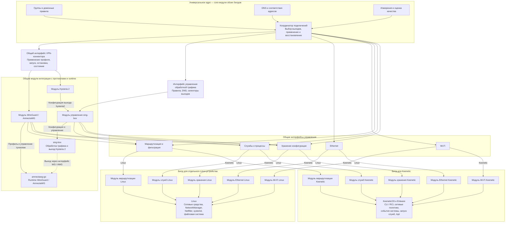

# Устройство Keenetic и интеграция Hestia — архив

> **Архивный документ с 7 ноября 2026 года.** Как план дальнейших исследований он устарел. Актуальный объём работ определяется в [keenetic-platform-minimal.md](keenetic-platform-minimal.md). Этот файл сохраняется как историческая сводка результатов, ограничений и источников; его статусы и следующие шаги отражают момент составления и не задают текущую работу. Подтверждённые факты оцениваются по датам, среде и свидетельствам в соответствующих [отчётах экспериментов](../experiments/README.md).


Этот документ — единое место исследований устройства Keenetic, его ограничений и интеграции Hestia, включая разбор исходников конкурентов. По решению владельца от 6 ноября 2026 года исследование двух поставок перенесено сюда из `deployment-targets-research.md`. Планы работ остаются в [дорожной карте Keenetic](keenetic-roadmap.md), критерии — в спецификациях, сырые свидетельства и протоколы прогонов — в [отчёте аппаратных проверок](../experiments/keenetic-capabilities/README.md).

Исходная архитектурная оценка выполнена на ревизии `d6a6dbf`; последующие переносы системных операций описаны в [документе модулей](features/platform-modules.md). Владелец согласовал два билда с универсальным ядром и платформенными модулями. Команда `show version` на целевом KN-1012 6 ноября 2026 года вернула KeeneticOS 5.2 Beta 3 (`5.02.B.3.0-2`); прежде сохранённые сведения о Beta 2 устарели. Запуск диагностического кода подтверждён на устройстве; полная служба Hestia ещё не установлена. Дата актуализации документа — 7 ноября 2026 года; даты аппаратных проверок указаны в протоколах.

Навигация:

- [Шесть приоритетных исследований и их статус](#матрица-возможностей-hestia-на-keenetic)
- [Минимальный объём исследования API для коннекторов](keenetic-platform-minimal.md)
- [Управление подключениями: узкое исследование](#узкое-исследование-управления-подключениями--6-ноября-2026-года)

- [Подтверждённые ограничения устройства](#подтверждённые-ограничения-целевого-устройства)
- [Документация и network namespaces](#документация-производителя-и-сетевые-пространства-имён)
- [Два способа размещения](#два-способа-размещения) и [модули платформы](#универсальное-ядро-и-модули-управления)
- [Wireless ISP и порты](#wireless-isp-и-управление-портами)
- [Доступ к Entware](#подтверждённый-ssh-доступ-к-entware)
- [Исходники XKeen, SKeen и HydraRoute](#реализация-похожих-решений-исходный-код)
- [Выводы для Гестии](#что-применимо-к-гестии)

## Матрица возможностей Hestia на Keenetic

[Минимальный объём исследований и контракт результата](keenetic-platform-minimal.md) вынесены в отдельный план. Здесь сохраняются фактические результаты и ограничения.

Цель исследований — найти и проверить программные интерфейсы Keenetic, достаточные для реализации коннекторов и платформенных адаптеров Hestia. Под интерфейсом здесь понимается конкретный HTTP API/RCI, CLI-вызов либо доступный интерфейс ОС/Entware. Для каждого результата нужно указывать, к какому из этих слоёв он относится: работа отдельного runtime не подтверждает наличие API KeeneticOS.

Единственные приоритеты — шесть направлений ниже. Исследование завершается описанием проверенных операций и границ коннектора. Группы, приоритеты, собственные списки, оценка качества, прогрев и GeoIP могут реализовываться в общем ядре Hestia; наличие одноимённых функций в Keenetic не является обязательным условием. Сквозная приёмка этих функций остаётся последующим этапом.

Ограниченная проверка включения и выключения двух штатных VPN-профилей завершена. Подготовка переключения WISP остановлена владельцем до изменения состояния. Ethernet возобновлён только для read-only исследования RCI; изменение настроек не разрешалось. Остальные направления остаются на паузе. Переписывание плана не означает новый аппаратный прогон; полученные результаты и ограничения сохранены ниже.

| Приоритетное исследование | Какие вопросы закрывает | Что нужно доказать | Подтверждённый объём и текущий статус |
|---|---|---|---|
| **1. [Управление подключениями](keenetic-platform-minimal.md#минимальный-объём-исследования-управления-подключениями)** | Перечень и состояние объектов; создание, настройка и жизненный цикл подключений | Найти вызовы перечисления, чтения, создания/удаления и изменения нужных объектов; проверить их параметры, ответы и восстановление. Для Wi-Fi — получить разбираемый результат сканирования обоих диапазонов. | **Частично проверено; Ethernet read-only исследование RCI возобновлено, подготовка цикла WISP остановлена до запуска.** Проверены чтение портов и переходы линка порта 1, чтение сохранённого WISP, ответы site-survey обоих диапазонов. Штатные WireGuard/SSTP включены до connected=yes и возвращены в down/connected=no; восстановление подтверждено отдельным чтением. Предварительный RCI GET без авторизации получил отказ соединения на порту 79 и HTTP 401 на порту 80; JSON-ответ не получен и свидетельство попытки не сохранено, поэтому это не подтверждённый контракт. Полный разбор сканирования, создание VPN и полный путь трафика не подтверждены. [Подробности](#узкое-исследование-управления-подключениями--6-ноября-2026-года). |
| **2. [Выбор пути трафика](keenetic-platform-minimal.md#минимальный-объём-исследования-выбора-пути-трафика)** | Политики, маршруты, выбор выхода и блокировка | Найти и проверить операции чтения и применения маршрутов/правил/политик для узкого тестового потока; определить способ изменения выхода и блокировки без конфликтов с KeeneticOS. | **На паузе.** Есть локальные TCP/UDP direct/block-пробы. В опыте urltest подтверждён выбор A для TCP; UDP завершился тайм-аутом. Резерв, возврат и all-down блокировка не доказаны. [Протокол](../experiments/keenetic-exit-failover/README.md). |
| **3. [Измерения и наблюдение](keenetic-platform-minimal.md#минимальный-объём-исследования-измерений-и-наблюдения)** | Состояние, счётчики, привязка проб и события потоков | Найти источники наблюдений и способ отправки собственной пробы через заданный выход, включая резервный; проверить контракт и атрибуцию результата. | **На паузе; целевая аппаратная проверка не проведена.** Журналы отдельных локальных опытов не подтверждают измерения и наблюдение всех подключений. |
| **4. [Доменные правила](keenetic-platform-minimal.md#минимальный-объём-исследования-доменных-правил)** | Чтение списков Keenetic и применение доменного решения Hestia | Найти интерфейс чтения списков и обнаружения изменений; определить доступный механизм связи домена/адреса с маршрутом, отделив его от логики списков Hestia. | **На паузе; целевая аппаратная проверка не проведена.** Локальные FakeIP-опыты ниже подтверждают отдельный механизм, но не импорт списков Keenetic и не выбор группы по списку. |
| **5. [DNS](keenetic-platform-minimal.md#минимальный-объём-исследования-dns)** | Интеграция собственной DNS-службы и доступные данные DNS | Найти операции чтения и изменения DNS-настроек, подключения своей службы и привязки upstream к выходу; определить границу между DNS Keenetic и кэшем/прогревом Hestia. | **На паузе.** Проверены локальные A/NXDOMAIN UDP/TCP, FakeIP и смена loopback-цели после TTL. Есть прогон CNAME/TCP fallback; его независимая пересборка не завершена. Клиентская интеграция и прогрев не подтверждены. [DNS](../experiments/keenetic-dns-local/README.md), [TTL](../experiments/keenetic-fakeip-ttl/README.md), [CNAME/fallback](../experiments/keenetic-dns-fallback/README.md). |
| **6. [GeoIP](keenetic-platform-minimal.md#минимальный-объём-исследования-geoip)** | Применение решения по IP и граница ответственности GeoIP | Подтвердить достаточность операции маршрутизации по IP/префиксу для решения GeoIP; определить, нужны ли дополнительные операции Keenetic. Геолокация и API 2ip относятся к Hestia и внешнему сервису. | **На паузе; целевая аппаратная проверка не проведена.** Требуется установить достаточность API маршрутизации по IP. Уточнение через 2ip относится к общей логике Hestia и внешнему API, а не к этому исследованию Keenetic. |

### Свидетельства уже проведённых исследований

Ниже сохранены результаты фактических проверок, включая неполные и неуспешные. Это основания для шести направлений выше, а не дополнительные приоритеты. Строки прежнего перечня функций, для которых имелись только планы или отметка «не проверено», удалены. Успех отдельного механизма не подтверждает весь сценарий; ограничения каждого прогона сохраняются.

| Проверка | Фактический результат и ограничения |
|---|---|
| [Обнаружение Ethernet-портов, состояние кабеля и готовность IPv4](features/physical-connections.md) | Частично: через ndmc прочитаны ID и link пяти Ethernet-портов, скорость и дуплекс активных. Порт 1 ↔ GigabitEthernet0/0 подтверждён подключением/отключением ноутбука (down→up 1000/full→down); нумерация LAN1–4 сверена с документацией KN-1012. Read-only RCI подтвердил подключение `ПАКТ` как `GigabitEthernet1`, а его default route — через этот интерфейс; параллельная проверка Linux-маршрутов связала активный default egress с `eth3`, тогда как `eth2.1` состоит в `br0`. RCI сам по себе Linux-имена не выдаёт, прямая карта `GigabitEthernet1/0` ↔ netdev не установлена. Готовность IPv4 отдельного выхода и программное управление не проверены. [Протокол](../experiments/keenetic-ethernet-management-20261106/README.md). |
| [Wireless ISP: подключение к Wi-Fi 2,4/5 ГГц, SSID и пароль](features/physical-connections.md) | Частично: прочитано состояние сохранённого WISP 5 ГГц (connected/up, не default gateway); команды show site-survey для 2,4 и 5 ГГц завершились успешно. Полный разбор списка, поиск тестового SSID и свежесть результатов не подтверждены. Выключение/включение WISP не выполнялось. [Протокол](../experiments/keenetic-wifi-management-20261106/README.md). |
| [VLESS: клиентское подключение первого выпуска](requirements.md) | Частично: sing-box 1.14.4 на KN-1012 передаёт TCP/UDP-маркеры через локальные VLESS-клиент и сервер; неверный UUID отклонён в TCP-пробе при живом сервере. Внешний сервер, WAN и клиентский транзит не проверены. [Протокол](../experiments/keenetic-vless-local/README.md). |
| [Полный туннель Hysteria 2 через sing-box](features/hysteria2.md) | Частично: sing-box 1.14.4 на KN-1012 передаёт TCP/UDP через локальные Hysteria 2 клиент и сервер с проверкой CA и имени TLS; неверный пароль отклонён без роста счётчиков сервиса. Финальный прогон сохранил четыре хеша маршрутов/правил; в предыдущем изменился хеш IPv4 rules, причина не установлена. Полный WAN-туннель не проверен. [Протокол](../experiments/keenetic-hysteria2-local/README.md). |
| [Автоматический резерв внутри группы и возврат после восстановления](requirements.md) | **Исследование не завершено — приостановлено по просьбе владельца.** Первая попытка urltest подтвердила выбор выхода A для TCP, UDP-проба завершилась таймаутом. Переключение на резерв, возврат и блокировка при отказе обоих выходов не проверены; исправленный прогон не запускался. [Протокол](../experiments/keenetic-exit-failover/README.md). |
| [Блокировка при отказе всех выходов явной группы без перехода в другую страну](requirements.md) | **Исследование не завершено — приостановлено по просьбе владельца.** Первая попытка urltest подтвердила выбор выхода A для TCP, UDP-проба завершилась таймаутом. Переключение на резерв, возврат и блокировка при отказе обоих выходов не проверены; исправленный прогон не запускался. [Протокол](../experiments/keenetic-exit-failover/README.md). |
| [FakeIP для связи доменного решения с TCP/UDP-потоком и смена реального IP после TTL](dns-rotation.md) | Частично: sing-box 1.14.4 на KN-1012 выдал FakeIP для синтетического домена; TCP/UDP-запросы через SOCKS к числовому FakeIP доставили маркеры локального сервиса, журнал подтвердил восстановление домена. Маршруты/правила не изменились. Дополнительный прогон на Beta 3 показал TCP/UDP к новой loopback-цели после TTL с прежним FakeIP, без повторного DNS-запроса клиента; старая цель оставалась доступна. Независимая сверка TTL-прогона и пересборка helper подтверждены; клиентский транзит и смена группы не проверены. [TTL-протокол](../experiments/keenetic-fakeip-ttl/README.md). [Протокол](../experiments/keenetic-fakeip-local/README.md). |
| [Сохранение привязок FakeIP после перезапуска без назначения старого IP другой группе — эксперимент, ещё не интегрирован](roadmap.md) | Частично: на KN-1012 sing-box 1.14.4 с store_fakeip восстановил привязку после штатного перезапуска собственного процесса; TCP/UDP к прежнему числовому FakeIP прошли без повторного DNS-запроса клиента. Проверены один домен и неизменный конфиг; перераспределение между группами, сбой питания и смена диапазона не проверены. [Протокол](../experiments/keenetic-fakeip-local/README.md). |
| [DNS-проверки: CNAME и TCP fallback при усечённом ответе](features/connection-quality.md) | **Исследование не завершено — приостановлено по просьбе владельца.** Аппаратные прогоны завершены; осталось независимо воспроизвести сборку helper. Подтверждено частично: на KN-1012 / KeeneticOS 5.2 Beta 3 sing-box 1.14.4 передал полный CNAME+A ответ и повторил усечённый UDP-запрос по TCP. Одиночный CNAME передавался без дополнительного запроса псевдонима. Интеграция с измерителем Hestia не проверена; журналы независимо сверены, пересборка helper остаётся неподтверждённой из-за неполного снимка зависимостей. [Протокол](../experiments/keenetic-dns-fallback/README.md). |
| [Проверка возможностей устройства и доступности операций в панели](features/platform-modules.md) | Подтверждено частично: `ndmc -c 'show version'`, `show system` и `show ip policy` завершились успешно; `show ip policy` сохранён только как размер и SHA-256. Token-auth HTTP RCI подтвердил GET version и interface на KeeneticOS 5.2 Beta 3; настройки не менялись. [Протокол](../experiments/keenetic-rci-readonly/README.md). |
| Доставка диагностической сборки по SSH и проверка целостности | Проверено: отдельный каталог в /opt/tmp, проверка SHA-256. [Способ и свидетельство](keenetic-platform.md#проверенные-способы-подготовки). |
| Запуск статической ARM64-диагностики и инвентаризация | Проверено: help, version и чтение окружения. [Способ и свидетельство](keenetic-platform.md#проверенные-способы-подготовки). |
| Чтение существующих IPv4/IPv6-правил и таблиц | Проверено чтение через ip; изменение маршрутов не проверено. [Способ и свидетельство](keenetic-platform.md#проверенные-способы-подготовки). |
| Запуск amneziawg-go только с --version | Проверено для закреплённой статической сборки; туннель не запускался. [Способ и свидетельство](keenetic-platform.md#проверенные-способы-подготовки). |
| Изоляция процессов в Linux network namespace | Текущие исследования не смогли дать положительный ответ касательно работоспособности этой фичи в среде Keenetic. [Результат проверки и причина](keenetic-platform.md#подтверждённые-ограничения-целевого-устройства). |
| Прямой запуск sing-box из текущего Linux-комплекта | Текущие исследования не смогли дать положительный ответ касательно работоспособности этой фичи в среде Keenetic. [Результат проверки и причина](keenetic-platform.md#подтверждённые-ограничения-целевого-устройства). |
| Прямой запуск awg-tools из текущего Linux-комплекта | Текущие исследования не смогли дать положительный ответ касательно работоспособности этой фичи в среде Keenetic. [Результат проверки и причина](keenetic-platform.md#подтверждённые-ограничения-целевого-устройства). |
| Запуск sing-box через загрузчик Entware `/opt/lib` | Проверено для неизменённого динамического ARM64 sing-box 1.14.4: `version`, `check`, запуск и HTTP 200 через loopback SOCKS/direct. Статическая сборка, VPN и клиентский транзит этим не подтверждены. [Протокол и свидетельства](../experiments/keenetic-capabilities/README.md#совместимый-sing-box-loopback-прототип--6-ноября-2026-года). |
| Совместимый awg-tools; загрузчик Entware и статическая альтернатива | Статический ARM64/musl awg-tools v3.1.20260812 из закреплённого исходного коммита успешно выполняет `--version` и `--help`. Прежний динамический бинарник требует GLIBC_2.33/2.34 и не работает с glibc 2.27. VPN/UAPI не проверены. [Протокол и свидетельства](../experiments/keenetic-awg-runtime/README.md). |
| Локальный SOCKS TCP/UDP и блокирующий outbound sing-box | Проверено на sing-box 1.14.4: TCP/UDP-маркеры через SOCKS; UDP к второму loopback-адресу блокируется при живом процессе и доступном напрямую ответчике. Клиентский транзит и блокировка группы не проверены. [Протокол](../experiments/keenetic-singbox-udp-block/README.md). |
| IPv6 SOCKS TCP/UDP и блокирующий outbound sing-box | На KN-1012 с sing-box 1.14.4 проверены direct-маркеры для TCP/UDP на `::1` и блокировка двух других IPv6 loopback-портов; хеши маршрутов/правил до и после совпали. Глобальный IPv6, клиентский транзит и DNS не проверялись. [Протокол и свидетельства](../experiments/keenetic-ipv6-loopback/README.md). |
| Локальная DNS-служба sing-box по UDP/TCP | Проверены A и NXDOMAIN для синтетических `.test` через собственный loopback-ответчик в финальном прогоне. Источник дополнительного TCP A-запроса не установлен. Интеграция с DNS Keenetic, порт 53 и клиентский перехват не проверены. [Протокол](../experiments/keenetic-dns-local/README.md). |
| Запуск amneziawg-go и приватный UAPI | Проверена отдельная сборка закреплённого v3.1.20260828 с приватным путём сокета: запуск на собственном TUN, set/get синтетического ключа с проверкой публичного производного, ноль пиров, интерфейс DOWN, штатный выход и очистка. Handshake и трафик не проверены. [Протокол](../experiments/keenetic-awg-uapi/README.md). |
| Создание и очистка непостоянного TUN | Проверено на KN-1012: `TUNSETIFF` с `IFF_TUN_EXCL`, появление интерфейса и удаление закрытием дескриптора; снимки маршрутов и правил совпали. [Протокол и свидетельства](../experiments/keenetic-tun/README.md). |

## Узкое исследование управления подключениями — 6 ноября 2026 года

Три отдельных исследования отделяют чтение состояния от изменения конфигурации и реальной передачи трафика:

| Область | Подтверждено | Следующая проверка и ограничения |
|---|---|---|
| [Ethernet](../experiments/keenetic-ethernet-management-20261106/README.md) | CLI и token-auth RCI вернули ID/link/скорость/дуплекс. RCI обнаружил пять `type=Port`: `GigabitEthernet0/0` (down), `/0/1` и `/0/2` (up, 100/full), `/0/3` (down), `GigabitEthernet1/0` (up, 1000/full). Физический LAN1 сопоставлен с `GigabitEthernet0/0` по подключению/отключению ноутбука и ранее проверенному link-событию. | RCI schema подтверждена только на KN-1012 / KeeneticOS 5.2 Beta 3 для `GET /rci/show/interface`. Остальные физические гнёзда не переключали и не сопоставляли; программное изменение параметров порта, IPv4 отдельного выхода и передача через него не проверены. Link down не означает физически пустой разъём. [RCI JSON-свидетельство](../experiments/keenetic-ethernet-management-20261106/evidence/attempt-20261106T221126Z-rci-interface-filtered/result.json). |
| [Wi-Fi/WISP](../experiments/keenetic-wifi-management-20261106/README.md) | Сохранённый профиль телефона на WifiMaster1/WifiStation0 наблюдался connected/up; проводной WAN оставался текущим default gateway. По обоим радиомодулям получены ответы show site-survey, код 0; состояния master и, в повторе, станции 5 ГГц до/после сохранялись. | Полный список сетей и совпадение тестового SSID не подтверждены из-за неполного парсинга; свежесть ответа не установлена. Отдельные AP не проверялись. Цикл выключения/включения WISP не выполнен; владелец подтвердил работоспособность проводного управления после подключения Mac кабелем. Повторная инструментальная проверка не требуется. Подготовка цикла восстановления WISP остановлена по просьбе владельца до запуска; переключение не выполнялось. |
| [Виртуальные подключения](../experiments/keenetic-virtual-management-20261106/README.md) | Штатные Wireguard2 и SSTP1 последовательно включены до state up / connected yes, затем возвращены в down / connected no. Отдельные чтения после каждого цикла подтвердили восстановление; SSH-маршрут не проходил через эти профили. | Проверено управление существующими профилями средствами Keenetic. Создание нового профиля, handshake и TCP/UDP-трафик не проверены. У WireGuard сразу после выключения status ещё был up при state/link down и connected no; отдельное чтение позже показало status down. Работа runtime Hestia этим не доказана. |

В Ethernet/Wi-Fi-прогонах настройки не менялись. В VPN-прогонах временно менялось только состояние двух разрешённых профилей; исходное отключённое состояние восстановлено. Ранние попытки имеют явно описанные пробелы сохранения исходников; утраченные версии не восстанавливались. Точные исходники поздних попыток сохранены отдельно, в том числе поздним копированием при совпадении заранее записанного SHA-256. Эти ограничения учитываются при оценке воспроизводимости.

## Проверенные способы подготовки

Эти способы подтверждают только перечисленные операции. Полная служба Hestia, VPN-туннели и правила перехвата этим опытом не проверены.

- **Доставка:** подключение к SSH Entware по ключу с проверкой host key, отдельный временный каталог `/opt/tmp/hestia-*`, копирование файлов и сравнение SHA-256 до запуска. Диагностическая поставка не регистрирует службу. Точный порядок и результаты — в [протоколе инвентаризации](../experiments/keenetic-capabilities/README.md) и [свидетельствах](../experiments/keenetic-capabilities/evidence/router-inventory-20261106/).
- **Статическая диагностика:** Linux ARM64-бинарник без динамического загрузчика выполняет `help`, `version` и чтение сведений о системе. Контракт безопасных операций описан в [спецификации диагностики](features/keenetic-diagnostics.md); наличие конкретного устройства или файла не означает поддержку всей функции.
- **Чтение маршрутизации:** доступный `ip` читает IPv4/IPv6 rules и routes. Снимки до и после проб совпали по байтам, хешам и числу записей. Команды и результаты сохранены в [свидетельствах runtime](../experiments/keenetic-capabilities/evidence/router-runtime-20261106/). Для записи правил потребуется отдельная проверка согласования с KeeneticOS.
- **Проверка загрузки AWG runtime:** закреплённый статический `amneziawg-go --version` завершился успешно и сообщил `v3.1.20260828`. Версия и хеш входного файла зафиксированы в [runtime lock](../scripts/build/runtime-lock.json), результат — в тех же свидетельствах runtime. В последующем [опыте приватного UAPI](../experiments/keenetic-awg-uapi/README.md) отдельная сборка того же исходного релиза с изменённым через линковщик каталогом сокетов прошла запуск на собственном TUN и set/get синтетического состояния без поднятия интерфейса. Handshake не проверен.

## Подтверждённые ограничения целевого устройства

- Инвентаризация: Linux ARM64, ядро `4.9-ndm-5`, около 486 МиБ памяти, `/dev/net/tun` существует. Последующая [проба TUN](../experiments/keenetic-tun/README.md) подтвердила создание непостоянного интерфейса и очистку, но не передачу пакетов или работоспособность VPN.
- Прямой системный вызов `unshare(CLONE_NEWNET)` на закреплённом потоке вернул `EINVAL (22)`; `/proc/self/ns/net` отсутствует. Сетевые пространства имён недоступны в проверенном контексте. Конфигурация ядра не получена, поэтому точная причина, например выключенный `CONFIG_NET_NS`, остаётся выводом по совокупности признаков, а не прочитанным параметром сборки. Простая установка утилиты `ip netns` не устраняет этот результат системного вызова.
- Штатная policy routing уже используется: наблюдались правила по меткам и несколько таблиц IPv4/IPv6. В `/proc/net/ip_tables_names` видны `nat`, `mangle`, `filter`; отсутствие CLI `iptables` в проверенных каталогах не означает отсутствия Netfilter.
- Закреплённый статический `amneziawg-go` успешно выводит версию. Linux-бинарники `sing-box` и `awg` из нашего комплекта требуют `/lib/ld-linux-aarch64.so.1`; этот путь отсутствует, прямой запуск завершается кодом 127. Последующая [loopback-проба](../experiments/keenetic-capabilities/README.md#совместимый-sing-box-loopback-прототип--6-ноября-2026-года) подтвердила запуск неизменённого sing-box 1.14.4 через `/opt/lib/ld-linux-aarch64.so.1 --library-path /opt/lib`, проверку конфигурации и HTTP через SOCKS. Для awg тот же загрузчик выявил несовместимость символов GLIBC_2.33/2.34 с glibc 2.27; [статическая ARM64/musl-сборка](../experiments/keenetic-awg-runtime/README.md) успешно выполнила `--version` и `--help`. Системные ссылки и библиотеки не менялись.
- В первом опыте процессы VPN и изменение маршрутизации были пропущены из-за отсутствия netns. Во втором цикле [amneziawg-go запущен без пиров и поднятия интерфейса](../experiments/keenetic-awg-uapi/README.md): эксклюзивный TUN и UAPI переданы готовыми дескрипторами, путь наблюдаемого сокета перенесён параметром линковщика в приватный временный каталог. Исходный `/var/run/amneziawg` не использовался. Полный VPN-туннель и изменение маршрутизации не проверены.

Команды, хеши, коды завершения, проверка сохранности маршрутов и границы выводов находятся в [протоколе](../experiments/keenetic-capabilities/README.md). Результаты относятся к проверенной прошивке и комплекту, не ко всем моделям Keenetic.

## Документация производителя и сетевые пространства имён

Проверены первичные источники 6 ноября 2026 года:

| Источник | Что найдено | Ограничение |
|---|---|---|
| [Официальный центр загрузок KN-1012](https://support.keenetic.com/hero/kn-1012/en/28382-download-center.html) и [справочник CLI](https://storage.googleapis.com/docs.help.keenetic.com/cli/4.3/en/cli_manual_kn-1012.pdf) | Команды `ip policy`, `ip policy route`, `ip policy standalone`, `show ip policy`; в выводе политики описаны метка и таблица | Руководство для KeeneticOS 4.3, редакция 1.162 от 14.11.2025; не полный контракт установленной 5.2 Beta 3 (`5.02.B.3.0-2`) |
| [Примечания к KeeneticOS 5.2 для KN-1012](https://support.keenetic.com/hero/kn-1012/en/35528-latest-development-release.html) | Развитие политик и FQDN-маршрутов, в частности `ip policy ... dns-proxy route` | В просмотренных материалах описание Linux network namespaces не найдено; это не доказательство отсутствия во всех версиях |
| [Сегменты сети KN-1012](https://support.keenetic.com/hero/kn-1012/en/14628-network-segments.html) | Сегментация сети средствами KeeneticOS | Сегменты и политики не предоставляют автоматически изолированный Linux network namespace для процесса |

Поиск `namespace` в тексте CLI-справочника не дал совпадений. Практическое решение для текущего устройства определяется прямой пробой ядра, а не отсутствием упоминания в документации. Подмена Linux netns политиками требует отдельного проектирования: политики могут разделять выходы, но сами по себе не доказывают изоляцию одинаковых адресов SSTP, локальных сокетов или Netfilter нескольких экземпляров.

## Вывод

Две поставки остаются согласованным направлением архитектуры; работоспособность полного набора функций на Keenetic пока не установлена. Для отдельного устройства уже существует Linux ARM64-сборка и установщик. Для Keenetic KN-1012 рассматривается пакет Entware `.ipk` с адаптацией управления службами, сетью и размещения файлов. Выявленные ограничения netns и ABI требуют отдельных решений перед аппаратной приёмкой.

Производитель указывает для KN-1012 установщик Entware aarch64. Проект SKeen демонстрирует интеграцию sing-box с перехватом TUN/TProxy на Keenetic. Исходники показывают кандидатный способ такой интеграции; аппаратной проверкой Hestia это не является. Совместимость конкретного комплекта Гестии требует отдельной проверки. [Entware для KN-1012](https://support.keenetic.com/hero/kn-1012/en/20980-installing-the-entware-repository-on-a-usb-drive.html) · [SKeen](https://github.com/jinndi/SKeen)

Поставка для Keenetic рассматривается как устанавливаемая служба Entware со своей веб-панелью. Модули управления внутри Гестии описаны ниже как части её архитектуры. Возможность включения в каталог официальных компонентов KeeneticOS или встраивания панели в штатный интерфейс остаётся отдельным вопросом к производителю.

## Исходные зависимости и текущее состояние переноса

Ниже сохранена инвентаризация исходной ревизии `d6a6dbf`, на которой начиналось исследование. Впоследствии прямые системные операции backend вынесены в Linux-адаптеры; актуальное состояние и контракты описаны в [модулях платформы](features/platform-modules.md). Keenetic-адаптеров и `.ipk` ещё нет.

- `Makefile` собирает команды с `CGO_ENABLED=0 GOOS=linux GOARCH=arm64`. Angular собирается в статические ресурсы.
- `deploy/install.sh` устанавливает службы systemd, использует Python и пути `/etc/hestia`, `/usr/local/bin`, `/usr/local/lib/hestia`.
- `backend/internal/physical/physical.go` обнаруживает интерфейсы через sysfs и управляет Wi-Fi через NetworkManager и `/usr/bin/nmcli`.
- `backend/internal/awg/` использует фиксированные Linux-пути к утилитам и обращается к systemd.
- `backend/internal/binding/engine.go` и `awg_services.go` используют systemd внутри транзакционного применения и восстановления. Адаптации требует также этот жизненный цикл.
- `.github/workflows/go.yml` содержит общие проверки backend и frontend. Подготовку `.ipk` предстоит добавить.

Основания находятся в [Makefile](../Makefile), [установщике](../deploy/install.sh), [управлении физическими подключениями](../backend/internal/physical/physical.go), [AWG](../backend/internal/awg/) и [CI](../.github/workflows/go.yml).

## Два способа размещения

| Свойство | Внутри Keenetic | Отдельный Linux ARM64-шлюз |
|---|---|---|
| Системная сеть | Интеграция с настройками и событиями KeeneticOS | Управление сетевыми интерфейсами собственной ОС |
| Путь клиента | LAN/Wi-Fi → локальный перехват → sing-box → выбранный выход | Клиент → Keenetic → Ethernet или локальный туннель → Гестия → выбранный выход |
| Службы и файлы | Entware, каталог `/opt`, механизм запуска Entware | systemd и существующая раскладка Linux |
| Ресурсы | Общие с Wi-Fi и всеми службами роутера | Ресурсы отдельной платы и её накопителя |
| Wireless ISP | Предлагаемый адаптер команд KeeneticOS | Собственный Wi-Fi-адаптер либо отдельная интеграция управления Keenetic |
| Аппаратные проверки | Прошивка, ядро, Netfilter, TUN, ресурсы, взаимодействие с ускорением | Конкретная плата, образ, драйверы Ethernet/Wi-Fi, охлаждение и восстановление |

Для отдельного устройства проект предусматривает схему «провайдер → Гестия → Keenetic» с двумя Ethernet-портами. В этой схеме пакеты передаются по Ethernet. Существующий однокабельный вариант использует локальный WireGuard, чтобы разделить клиентский трафик и транспорт внешних VPN. Дополнительный вариант с VLAN и маршрутизацией потребует своего проектирования и испытаний. [Схемы проекта](architecture.md)

## Сборка и выбор возможностей

Согласовано выпускать два целевых билда — для отдельного Linux-устройства и для Keenetic. Каждый билд объединяет универсальное ядро, соответствующие платформе модули управления и средства установки. Ядро содержит общую логику правил, DNS, измерений и выбора выходов. Взаимодействие с системой выносится в отдельные модули по областям ответственности.

Для KN-1012 и отдельной ARM64-платы целевая архитектура процессора одинакова. Два билда различаются набором подключённых реализаций модулей и поставкой. Совместимость каждого проверяется на целевой системе, включая минимально поддерживаемое ядро и системные вызовы. Статическая сборка сохраняет требования к ядру, устройствам и внешним программам.

Цель сборки определяет платформенный комплект модулей. Конкретный механизм его выбора — например, точки сборки или Go build tags — предстоит определить при проектировании реализации. Дополнительные флаги отдельных функций рассматриваются при подтверждённой необходимости. Во время запуска модули проверяют возможности конкретной системы. Доступность операций в панели должна следовать типизированному ответу backend, а backend проверяет разрешённость операции при выполнении.

CI должен собирать и проверять обе цели. Предлагается использовать общие проверки ядра и отдельные задания сборки и упаковки Linux и Keenetic. Entware-задание формирует `.ipk`, зависимости, права, запуск служб, обновление и удаление. Проверки должны покрывать сохранение конфигурации, восстановление после сбоя установки и очистку принадлежащих Гестии правил. Испытания пакета на KN-1012 дополняют CI. Окончательные метаданные архитектуры opkg и версии зависимостей определяются по фактическому feed целевой прошивки.

## Универсальное ядро и модули управления

Согласованный принцип — ядро обращается к типизированным интерфейсам управления. Для каждой области Linux- и Keenetic-реализации предоставляют ядру одинаковый контракт, а операции над устройством выполняют средствами своей платформы. При запуске соответствующего билда ядру передаются реализации модулей этой платформы. Способ связывания модулей будет определён при реализации.

Ethernet и Wi-Fi выделяются в отдельные модули. Для остальных системных взаимодействий предлагается следующее разбиение, которое предстоит уточнить при проектировании.

| Модуль | Общий контракт для ядра | Реализация Linux | Реализация Keenetic |
|---|---|---|---|
| Ethernet | Перечень портов и подключений, состояние, применение поддерживаемых настроек | Интерфейсы и средства управления сетью Linux | Порты, сегменты и интерфейсы через управление KeeneticOS |
| Wi-Fi | Поиск сетей, настройка подключения, включение и чтение состояния | NetworkManager | Wireless ISP через команды KeeneticOS |
| Маршрутизация и фильтрация | Применение маршрутов и ограничений Гестии, чтение фактического состояния | Таблицы маршрутов и Netfilter Linux | Согласование с политиками и событиями KeeneticOS, доступные средства ядра |
| Службы и процессы | Запуск, остановка, состояние и восстановление компонентов | systemd | Механизмы Entware и события KeeneticOS |
| Хранение системной конфигурации | Сохранение, загрузка и восстановление принадлежащих Гестии настроек | Каталоги и права Linux-поставки | Каталоги `/opt` и интеграция с настройками KeeneticOS |

В общей части также выделяются модули VPN-коннекторов. Модуль WireGuard / AmneziaWG управляет внешним runtime `amneziawg-go`. Модуль Hysteria 2 формирует и применяет выход `hysteria2` в sing-box. Обе реализации предоставляют ядру общий интерфейс жизненного цикла подключения и состояния выхода. Протокольные параметры остаются типизированными для каждого коннектора. [WireGuard / AmneziaWG](features/amneziawg-connector.md) · [Hysteria 2](features/hysteria2.md)

Схема показывает целевое разбиение core-модулей, протокольных модулей и платформенных адаптеров. Названия интерфейсов условные. Сплошные стрелки обозначают управление и использование контрактов, пунктирные — путь пользовательского трафика. Каждый билд подключает свой комплект платформенных адаптеров. Совместимость runtime и конкретных возможностей коннекторов проверяется отдельно на каждой платформе.



Модули интеграции используют общие интерфейсы маршрутизации, служб и хранения для системных операций. Например, запуск `amneziawg-go` выполняется через адаптер служб выбранного билда, а настройка его интерфейса и транспортного пути — через адаптер маршрутизации. Для Hysteria 2 жизненным циклом процесса sing-box управляет общий модуль sing-box, который согласует изменения нескольких выходов в одной конфигурации. Координатор ядра определяет порядок применения и восстановления при ошибке. В локальном Keenetic build подключены Entware AWG runtime, фиксированные AWG instance services, route runner и отдельные Hysteria 2/WireGuard/AmneziaWG panel API. Это подтверждает только наличие кода и сборки; работа маршрутов и VPN dataplane на KN-1012 остаётся неподтверждённой.

На схеме показаны два способа исполнения VPN. Выход Hysteria 2 работает внутри sing-box. Для WireGuard / AmneziaWG sing-box направляет пользовательский трафик через интерфейс, обслуживаемый `amneziawg-go`. Привязка внешнего транспорта каждого VPN к Ethernet или WISP определяется ядром и применяется платформенными адаптерами. Это позволяет сохранить общие правила выбора выходов при разных механизмах управления Linux и KeeneticOS.

Контракты должны описывать результат операции, ошибки, доступные возможности, повторное применение и восстановление после частичного отказа. Различия оборудования и прошивок выражаются в перечне возможностей модуля. Например, модуль Wi-Fi сообщает доступность сканирования и настройки WISP. Ядро использует эти сведения для принятия решения, а панель — для доступности действий. Обе реализации каждого интерфейса должны проходить общие проверки контракта и отдельные испытания взаимодействия с целевой системой.

## Wireless ISP и управление портами

Keenetic документирует WISP как основное или резервное интернет-подключение. В пределах одного диапазона клиент WISP и точка доступа используют общий радиомодуль и канал. Поэтому смена WISP может повлиять на Wi-Fi клиентов. [Документация WISP для KN-1012](https://support.keenetic.com/hero/kn-1012/en/14488-internet-connection-via-wi-fi--wisp-.html)

Предполагаемый путь управления из Гестии — адаптер KeeneticOS через CLI/RCI. Нужно отдельно подтвердить операции сканирования, выбора сети, аутентификации, включения, чтения состояния и сохранения конфигурации на конкретной прошивке. Существующий backend NetworkManager потребуется адаптировать. Сетевой путь через выбранный WISP проверяется отдельно от успешного изменения настроек.

Проект NDMS предоставляет `ndmq` для программного вызова команд. HydraRoute использует локальный RCI и учитывает различия авторизации между версиями прошивки. Это основания для оценки осуществимости адаптера. Контракт WISP для установленной прошивки остаётся открытым. Локальный RCI на loopback доступен процессу внутри роутера; отдельному устройству потребуется аутентифицированный удалённый канал или локальный посредник. [NDMS ndmq](https://github.com/ndmsystems/ndmq) · [Реализация HydraRoute](https://github.com/Ground-Zerro/HydraRoute/blob/main/Neo/docs/CORE.md)

Внутри роутера Гестия сможет работать с доступными ядру интерфейсами и правилами перенаправления. Физический RJ45, порт коммутатора, VLAN, мост и Linux-интерфейс требуют явного сопоставления. Изменение назначения порта должно проходить через согласованный адаптер настроек KeeneticOS. Прямой перенос текущего sysfs-обнаружения может дать неполный перечень портов.

Изменение ролей портов и назначение дополнительных WAN описаны производителем для KN-1012. [Управление портами](https://support.keenetic.com/hero/kn-1012/en/16485-changing-the-operating-mode-and-role-of-network-ports.html)

Для встроенного размещения предлагается локальный перехват TUN/TProxy. Локальный WireGuard между Keenetic и Гестией в такой топологии можно исключить после подтверждения перехвата и блокировки. Внешние VPN продолжают быть отдельными выходами. Для отдельного устройства доступны только его собственные аппаратные интерфейсы; управление портами удалённого Keenetic потребует отдельного канала управления.

Если отдельная Гестия использует WISP именно на Keenetic, транспорт её VPN должен идти обратно через Keenetic по выделенному транзитному пути. Это требует исключить петлю между клиентским маршрутом к Гестии и маршрутом Гестии к интернету. Для независимого выбора проводного WAN и WISP нужно подтвердить привязку каждого VPN и каждой измерительной пробы к нужному внешнему подключению. Переключение глобального default route может затронуть сразу несколько выходов.

## Подтверждённый SSH-доступ к Entware

6 ноября 2026 года по разрешению владельца настроен и проверен вход по SSH-ключу. Сведения о прошивке и установке получены из вывода команд владельца; результат входа проверен непосредственно с Mac.

| Параметр | Подтверждённое значение |
|---|---|
| Устройство | Keenetic Giga KN-1012, аппаратная версия 12108000 |
| Прошивка | KeeneticOS 5.2 Beta 3, release `5.02.B.3.0-2` (подтверждено `show version` 6 ноября 2026 года) |
| Архитектура | `aarch64` |
| Хранилище Entware | По сообщению владельца, отдельная USB-флешка 8 ГБ, подготовленная для Entware |
| Адрес и порт Entware SSH | `192.168.1.1`, TCP `222` |
| Пользователь | `root`, домашний каталог `/opt/root` |
| SSH-сервер | `/opt/sbin/dropbear`, версия `2025.89` |
| Файл разрешённых ключей | `/opt/root/.ssh/authorized_keys` |
| Ключ на Mac | `~/.ssh/hestia_keenetic`, Ed25519, загружен в SSH-агент |
| Сценарий запуска | `/opt/etc/init.d/S51dropbear` |
| Резервная копия сценария | `/opt/etc/S51dropbear.before-hestia-key` |

При первоначальном запуске Dropbear отклонял публичный ключ из `/opt/root/.ssh/authorized_keys`, хотя содержимое ключа совпадало с предлагаемым клиентом, а права каталогов и файла соответствовали требованиям. Диагностический экземпляр на порту `223` также отклонял ключ. После явного задания каталога параметром `-D /opt/root/.ssh` вход прошёл. Фактический каталог поиска ключей при исходном запуске остаётся неустановленным. Возможность задания каталога через `-D` описана разработчиком. [Документация Dropbear](https://github.com/mkj/dropbear/blob/main/manpages/dropbear.8)

В функции `start` сценария `/opt/etc/init.d/S51dropbear` закреплена следующая команда запуска.

```sh
$DROPBEAR -p "$PORT" -P "$PIDFILE" -D /opt/root/.ssh
```

Перед изменением сохранена резервная копия сценария. Проверка синтаксиса `sh -n` прошла. Основная служба перезапущена, затем выполнена проверка в режиме `BatchMode=yes` с обязательной проверкой известного ключа хоста.

```sh
ssh -p 222 -i ~/.ssh/hestia_keenetic \
  -o IdentitiesOnly=yes -o BatchMode=yes \
  -o StrictHostKeyChecking=yes root@192.168.1.1 \
  'id; uname -m; command -v opkg'
```

Команда завершилась с кодом `0` и вернула следующий результат.

```text
uid=0(root) gid=0(root)
aarch64
/opt/bin/opkg
```

Диагностический сервер на порту `223` после проверки остановлен. Для ручного подключения с этого Mac используется команда ниже.

```sh
ssh -p 222 -i ~/.ssh/hestia_keenetic root@192.168.1.1
```

Права `/opt/root/.ssh` установлены в `700`, файла `authorized_keys` — в `600`, владелец — `root`. Пароль root изменён владельцем. Пароли, их хеши и содержимое приватного ключа в документации не сохраняются.

Обновление пакета Dropbear может заменить сценарий запуска. После обновления следует проверить наличие параметра `-D` и повторить вход по ключу. Проверка после перезагрузки роутера ещё предстоит. Результат подтверждает доступ к оболочке Entware для будущей доставки пакетов; совместимость и установка самой Гестии требуют последующих испытаний.

## Проверки перед решением о реализации

1. Дополнить известные версию KeeneticOS и состояние Entware сведениями о версии ядра, необходимых компонентах и свободной памяти. Владелец — инженер по встраиваемому Linux. Результат — матрица совместимости KN-1012.
2. Проверить запуск бинарников, TUN, policy routing, Netfilter и необходимые средства изоляции SSTP. Для AWG проверить userspace runtime и UDP-путь. Результат — протокол запуска на конкретной прошивке.
3. Подтвердить управление WISP и сопоставление физических портов с интерфейсами. Владелец — инженер по сетям Linux. Результат — настройки до/после и фактический выход контрольных пакетов.
4. На выделенном клиенте проверить DNS, TCP, UDP, IPv6, отказ VPN, остановку Гестии, перезапуск роутера и восстановление правил после сетевых событий. Независимую проверку проводит тестировщик. Результат — захваты трафика, подтверждающие разрешённый выход либо блокировку.
5. Проверить обновление, удаление, откат, заполнение накопителя и исчезновение `/opt`. Владелец — DevOps-инженер. Измерить CPU, память и пропускную способность при целевом числе VPN и адресных проб.
6. Для отдельной платы повторить проверки пути, отказов, производительности и восстановления на выбранном образе. Результаты ВМ служат исходным материалом для этих проверок.

### Сверка синтаксиса BusyBox `ip` для Keenetic — 7 ноября 2026 года

Сохранённый KN-1012 inventory показывает BusyBox 1.37.0 и его справку: `ip route list|...`, `ip rule [list]|...`. Read-only снимки IPv4/IPv6 действительно получены командами `ip -4/-6 rule list` и `ip -4 route list table all`; они завершились с кодом 0 ([свидетельства](../experiments/keenetic-capabilities/evidence/router-runtime-20261106/routes-recon.json), [снимки](../experiments/keenetic-capabilities/evidence/router-runtime-20261106/routes-observed-capabilities.json)). Поэтому Keenetic runner переводит используемые общей RoutePolicy команды `route show` и `rule show` в BusyBox-форму `list`. Это ограниченная совместимость командного интерфейса, а не доказательство применения правил.

В исходниках BusyBox applet `ip` имеет отдельные обработчики списка/изменения маршрутов и правил; исходник показывает фильтрацию таблицы после чтения route dump, печать типа маршрута, `default` и метрики, а также command aliases `list`/`show` для правил ([`iproute.c`](https://coral.googlesource.com/busybox/+/refs/heads/staging/networking/libiproute/iproute.c), [`iprule.c`](https://coral.googlesource.com/busybox/+/refs/heads/master/networking/libiproute/iprule.c)). Ветка исходников не закреплена к бинарнику Keenetic, поэтому точный формат числовых таблиц, вывод `unreachable`, ошибки kernel/Netlink и соответствие записи правил остаются открытыми до узкой целевой проверки. Сами сохранённые снимки правил сняты только через `list`; отдельный `rule show` на KN-1012 не нужен для нашего контракта.

Доступ к личной ВМ `hestia-prod` и её Keenetic требует отдельного разрешения владельца по правилам проекта. В рамках этой работы владелец разрешил подключение к роутеру и настройку SSH-авторизации по ключу. До испытаний Гестии остаются открытыми доступность необходимых функций ядра, поддерживаемый набор VPN, расход памяти и скорость.

## Реализация похожих решений: исходный код

Исследованы исходники трёх проектов на 6 ноября 2026 года. Это чтение кода, а не испытание их установщиков или доказательство поведения пакетов на нашем KN-1012. Репозитории клонированы на рабочую машину; сторонний код не запускался, обращения к роутеру в рамках этого исследования не выполнялись.

| Проект и зафиксированная версия | Что изучено | Основной способ интеграции |
|---|---|---|
| [XKeen, jameszeroX, `bc9b59b`](https://github.com/jameszeroX/XKeen/tree/bc9b59bdf46495d486f706bac05a7adf5db6b958) | Установочные генераторы init/netfilter, выбор ядра, обработка сбоев | Xray/Mihomo, Redirect/TProxy, политики Keenetic, собственные цепочки и таблица маршрутов |
| [SKeen, jinndi, `980b6e3`](https://github.com/jinndi/SKeen/tree/980b6e3adfbab7390a5fc601506bb2ae4477bfb6) | `skeen.sh`, включая установку sing-box и полный цикл start/stop | sing-box, Redirect/TProxy либо OpkgTun, перехват DNS, netfilter.d |
| [HydraRoute, Ground-Zerro, `7fb556e`](https://github.com/Ground-Zerro/HydraRoute/tree/7fb556ec493adda131f3e8f97106226751b59528) | Вариант Neo: C-код маршрутизации, DNS, RCI, firewall, пакет Entware | ipset и CONNMARK, штатные политики/интерфейсы Keenetic, собственные таблицы для прямого выбора интерфейса |

Этот раздел ограничен тремя Keenetic-проектами. PolyWAN, failoverd и OpenWrt/mwan3 из общего исследования здесь повторно не исследовались.

Под именем XKeen существуют разные форки; выводы ниже относятся именно к `jameszeroX/XKeen` на указанном коммите. У HydraRoute изучен Neo, выводы не переносятся автоматически на Classic и другие варианты.

В трёх деревьях исходников поиск `netns`, `unshare`, `CLONE_NEWNET` не дал совпадений. Рассмотренные пути интеграции используют общее сетевое пространство роутера. Это подтверждает наличие подходов без netns, но не доказывает возможность воспроизвести всю архитектуру Гестии: отдельные таблицы не изолируют адреса интерфейсов, сокеты и DNS так, как отдельные сетевые пространства.

### XKeen: согласование с Keenetic и восстановление правил

#### Актуализация RCI-доступа в XKeen на 7 ноября 2026 года

Выпуск XKeen 2.1 добавил поддержку токенов RCI для KeeneticOS 5.2; в конфигурации `xkeen.json` для этого предусмотрено поле `rci_token`. В выпуске 2.1 также указаны права `700` для каталога конфигурации и `600` для файла `xkeen.json`, где хранится токен. Это отличается от хранения логина и пароля администратора: XKeen получает токен доступа через интерфейс Keenetic и использует его при обращении к локальному RCI. [История выпусков XKeen](https://github.com/jameszeroX/XKeen/releases) · [Описание параметра `rci_token`](https://github.com/jameszeroX/XKeen/blob/main/wiki/%D0%9A%D0%BE%D0%BD%D1%84%D0%B8%D0%B3%D1%83%D1%80%D0%B0%D1%86%D0%B8%D0%BE%D0%BD%D0%BD%D1%8B%D0%B9-%D1%84%D0%B0%D0%B9%D0%BB.md)

Обсуждение механизма KeeneticOS 5.2 указывает на RCI по `127.0.0.1:79` и передачу токена в `X-NDMA-TKN`; неавторизованный доступ по loopback планировалось убрать. В том же обсуждении отмечено, что локальная команда `ndmc` использует Unix-сокет, а не HTTP RCI. Следовательно, установка Hestia на самом роутере позволяет ей обращаться к RCI, но на KeeneticOS 5.2 интеграции следует предусмотреть токен и проверить фактический ответ целевой прошивки. Наличие локального адреса само по себе не означает обход авторизации. [Обсуждение токенов RCI в KeeneticOS 5.2](https://forum.keenetic.ru/topic/29419-%D1%82%D0%BE%D0%BA%D0%B5%D0%BD%D1%8B-%D0%B4%D0%BE%D1%81%D1%82%D1%83%D0%BF%D0%B0-%D0%B2-ndms-52/)

Для XKeen RCI — вспомогательный интерфейс чтения данных Keenetic, например метки политики; перехват и маршрутизацию трафика проект выполняет средствами Entware/Linux и hook `netfilter.d`. Поэтому XKeen показывает, что локальный пакет может использовать RCI с токеном, но не является примером полного управления роутером только через RCI. Сведения о токене здесь основаны на истории релизов и документации XKeen, а не на запуске XKeen на KN-1012.

Генератор создаёт `/opt/etc/ndm/netfilter.d/proxy.sh`. В нём предусмотрены сериализация одновременных вызовов и применение собственных цепочек через `iptables-restore --noflush`. Это полезный образец для сосуществования с NDM: после пересоздания firewall штатной системой дополнение возвращает свои правила, сохраняя прочие таблицы. Подробности находятся в [генерации hook и применении правил](https://github.com/jameszeroX/XKeen/blob/bc9b59bdf46495d486f706bac05a7adf5db6b958/scripts/_xkeen/02_install/07_install_register/04_register_init.sh#L2320-L2595).

Для TProxy задаются `TPROXY --tproxy-mark`, правило `ip rule ... fwmark ... lookup` и `local default dev lo` в собственной таблице. Таблица получает также маршруты из выбранной политики либо `main`, кроме default/unreachable/blackhole. При повторном событии код сначала сравнивает фактическое и желаемое состояние, чтобы без необходимости не очищать таблицу и не обрывать текущие потоки. Redirect и смешанный TCP Redirect/UDP TProxy являются отдельными режимами. Это видно в [перехвате и configure_route](https://github.com/jameszeroX/XKeen/blob/bc9b59bdf46495d486f706bac05a7adf5db6b958/scripts/_xkeen/02_install/07_install_register/04_register_init.sh#L2690-L2875).

Kill-switch существует, но **по умолчанию выключен**. При включении он создаёт отдельную mangle-цепочку с DROP для выбранных policy marks; отсутствие подходящих меток считается ошибкой. Код предназначает этот механизм для неожиданного отказа ядра прокси, с отдельной логикой сохранения при остановке. Поэтому нельзя переносить из проекта утверждение «любая остановка всегда блокирует выход»: нужны конкретная конфигурация и сценарий. См. [значение по умолчанию](https://github.com/jameszeroX/XKeen/blob/bc9b59bdf46495d486f706bac05a7adf5db6b958/scripts/_xkeen/02_install/07_install_register/04_register_init.sh#L238-L252) и [kill-switch](https://github.com/jameszeroX/XKeen/blob/bc9b59bdf46495d486f706bac05a7adf5db6b958/scripts/_xkeen/02_install/07_install_register/04_register_init.sh#L3788-L3889).

Для ARM64 загрузчик Xray выбирает архив `Xray-linux-arm64-v8a.zip`, загрузчик Mihomo — `mihomo-linux-arm64-…gz`. Это выбор конкретных upstream-артефактов, а не универсальное решение совместимости любых ARM64 ELF с Entware. [Xray downloader](https://github.com/jameszeroX/XKeen/blob/bc9b59bdf46495d486f706bac05a7adf5db6b958/scripts/_xkeen/04_tools/07_tools_downloaders/01_downloaders_xray.sh), [Mihomo downloader](https://github.com/jameszeroX/XKeen/blob/bc9b59bdf46495d486f706bac05a7adf5db6b958/scripts/_xkeen/04_tools/07_tools_downloaders/01_downloaders_mihomo.sh#L70-L90).

После успешного применения hook и загрузки наборов адресов startup сбрасывает `keep_killswitch` и вызывает `disable_killswitch`; задержанная проверка процесса следует позднее. Это ещё одна причина отдельно проверять готовность и переходные окна, а не выводить их отсутствие из имени механизма. [Снятие блокировки при старте](https://github.com/jameszeroX/XKeen/blob/bc9b59bdf46495d486f706bac05a7adf5db6b958/scripts/_xkeen/02_install/07_install_register/04_register_init.sh#L4098-L4128).

### SKeen: наиболее близкий пример запуска sing-box

SKeen использует `/opt/bin/skeen-box`, каталог `/opt/etc/skeen`, init-файл `/opt/etc/init.d/S99SKeen` и hook `skeen_firewall.sh`. Запуск выполняется через `start-stop-daemon`, процесс получает группу `skeen`, наличие процесса проверяется в течение ограниченного времени. Это проверка запуска, не подтверждение готовности всех VPN-выходов. [Пути и параметры](https://github.com/jinndi/SKeen/blob/980b6e3adfbab7390a5fc601506bb2ae4477bfb6/skeen.sh#L14-L80), [запуск процесса](https://github.com/jinndi/SKeen/blob/980b6e3adfbab7390a5fc601506bb2ae4477bfb6/skeen.sh#L2616-L2699).

Установщик определяет Entware по `/opt/bin/opkg`, затем выбирает **OpenWrt `.ipk`** из релизов sing-box, распаковывает пакет и извлекает `usr/bin/sing-box`. Это конкретная альтернатива выбранному ранее generic Linux-артефакту Гестии. Однако без проверки ELF выбранной версии нельзя утверждать ни статическую линковку, ни совместимость с нашим ядром. [Выбор формата](https://github.com/jinndi/SKeen/blob/980b6e3adfbab7390a5fc601506bb2ae4477bfb6/skeen.sh#L673-L685), [загрузка и извлечение](https://github.com/jinndi/SKeen/blob/980b6e3adfbab7390a5fc601506bb2ae4477bfb6/skeen.sh#L833-L914).

TProxy использует fwmark `0x12`, таблицу `12`, приоритет правила `12` и local default через lo. Режимы Redirect, TUN и DNS обходят настройку этой TProxy-таблицы. Номера являются внутренними константами проекта: переносить их в Гестию без проверки занятости нельзя. DNS TCP/UDP 53 перехватывается через штатную `_NDM_HOTSPOT_DNSREDIR` и собственные цепочки. [Маршрутизация](https://github.com/jinndi/SKeen/blob/980b6e3adfbab7390a5fc601506bb2ae4477bfb6/skeen.sh#L1364-L1405), [применение firewall](https://github.com/jinndi/SKeen/blob/980b6e3adfbab7390a5fc601506bb2ae4477bfb6/skeen.sh#L2240-L2404).

Для TUN проект создаёт `OpkgTunN` через `ndmc`: задаёт адрес /32, MSS, default route, `ip global auto`, поднимает интерфейс и выполняет `system configuration save`. Это интеграция в конфигурацию Keenetic, а не изолированный временный netns. Отдельные filter-правила обслуживают `opkgtun+`. Автоматически повторять эту последовательность на рабочем роутере нельзя в рамках опыта «только запуск процесса»: она меняет сохраняемую сетевую конфигурацию. [Создание OpkgTun](https://github.com/jinndi/SKeen/blob/980b6e3adfbab7390a5fc601506bb2ae4477bfb6/skeen.sh#L1836-L1955).

При штатном stop вызывается очистка firewall; при части ошибок start также удаляются правила. В прочитанном пути не обнаружена постоянно сохраняемая блокировка защищаемой группы, аналогичная требованию Гестии. Это различие контрактов, а не доказанная уязвимость проекта. [Очистка](https://github.com/jinndi/SKeen/blob/980b6e3adfbab7390a5fc601506bb2ae4477bfb6/skeen.sh#L2405-L2475), [start/stop](https://github.com/jinndi/SKeen/blob/980b6e3adfbab7390a5fc601506bb2ae4477bfb6/skeen.sh#L2654-L2760).

### HydraRoute Neo: использование маршрутизации самого Keenetic

Neo полезен как пример контроллера поверх существующих выходов. Он захватывает DNS-ответы через AF_PACKET, разбирает A/AAAA/CNAME и использует полученные адреса для маршрутизации через ipset. Это отличается от обязательного перенаправления всех DNS-запросов в собственный resolver. Видимость DNS зависит от фактического пути запросов клиента; наличие парсера не доказывает полноту классификации при DoH/DoT, кэше и обходе захвата. [Захват](https://github.com/Ground-Zerro/HydraRoute/blob/7fb556ec493adda131f3e8f97106226751b59528/Neo/source/src/packet_capture.c#L1-L90), [обработка ответа](https://github.com/Ground-Zerro/HydraRoute/blob/7fb556ec493adda131f3e8f97106226751b59528/Neo/source/src/main.c#L252-L303), [DNS parser](https://github.com/Ground-Zerro/HydraRoute/blob/7fb556ec493adda131f3e8f97106226751b59528/Neo/source/src/dns.c).

Для политики Keenetic код получает её mark через RCI; для прямого выбора интерфейса создаёт собственные fwmark/table. Цепочка `HRNEO_CONNMARK` сопоставляет адрес назначения с ipset, устанавливает connmark и восстанавливает packet mark. Получается путь «классификация → conntrack mark → policy routing → штатный VPN/интерфейс». [CONNMARK и выбор метки](https://github.com/Ground-Zerro/HydraRoute/blob/7fb556ec493adda131f3e8f97106226751b59528/Neo/source/src/iptables.c#L187-L355), [правила и таблицы](https://github.com/Ground-Zerro/HydraRoute/blob/7fb556ec493adda131f3e8f97106226751b59528/Neo/source/src/routing.c#L122-L300).

Если прямой интерфейс неактивен либо отсутствует в ядре, в его таблицу устанавливается `blackhole default`. Это полезный принцип предотвращения перехода к обычному default. Но обновление содержит очистку таблицы с последующим восстановлением, а некоторые другие ошибки лишь журналируются. Наличие blackhole в исходнике не доказывает отсутствие переходного окна или утечек при каждом отказе. [Обработка неактивного/отсутствующего интерфейса](https://github.com/Ground-Zerro/HydraRoute/blob/7fb556ec493adda131f3e8f97106226751b59528/Neo/source/src/routing.c#L161-L300).

RCI-клиент работает через loopback, умеет отправлять `X-NDMA-TKN` и различает локальный доступ, необходимость токена и отказ. Это важно для новых KeeneticOS: нельзя считать доступ без авторизации постоянным свойством платформы. [RCI transport/auth](https://github.com/Ground-Zerro/HydraRoute/blob/7fb556ec493adda131f3e8f97106226751b59528/Neo/source/src/rci.c#L20-L245).

Hooks `netfilter.d` и `ifstatechanged.d` только проверяют PID и посылают процессу SIGUSR1; reconciliation выполняет демон. Init использует Entware `rc.func`. Такая схема уменьшает работу внутри системного hook. [netfilter hook](https://github.com/Ground-Zerro/HydraRoute/blob/7fb556ec493adda131f3e8f97106226751b59528/Neo/source/ipk/rootfs/opt/etc/ndm/netfilter.d/015-hrneo.sh), [interface hook](https://github.com/Ground-Zerro/HydraRoute/blob/7fb556ec493adda131f3e8f97106226751b59528/Neo/source/ipk/rootfs/opt/etc/ndm/ifstatechanged.d/015-hrneo.sh), [init](https://github.com/Ground-Zerro/HydraRoute/blob/7fb556ec493adda131f3e8f97106226751b59528/Neo/source/ipk/rootfs/opt/etc/init.d/S99hrneo).

AArch64-сборка использует `aarch64-linux-musl-gcc`, `-static -static-libgcc`, отдельные ARMv8-флаги; native-сборка динамическая. Это явный способ убрать зависимость от отсутствующего системного ELF loader, хотя совместимость системных вызовов и модулей ядра всё равно проверяется на устройстве. [Makefile](https://github.com/Ground-Zerro/HydraRoute/blob/7fb556ec493adda131f3e8f97106226751b59528/Neo/source/Makefile#L1-L62).

### Исследовательские наблюдения для `/rci/show/interface` — 7 ноября 2026 года

В открытом исходнике [dummylabs/keenetic-cli](https://github.com/dummylabs/keenetic-cli/blob/main/keenetic_cli.py) метод `show_interface()` делает `GET /rci/show/interface` и ожидает объект, где записи доступны по имени интерфейса; его текстовый просмотр использует `type`, `connected`, `link`, `address` и `description`. Это сторонняя реализация, а не документация производителя и не свидетельство KN-1012: она не задаёт контракт для нашей прошивки и не используется как доказательство структуры RCI. Для извлечения схемы подготовлена Go-команда `keenetic-rci-interface-schema`, использующая общий `keeneticrci.DescribeSchema`; команда собирается локально, но запрос на KN-1012 ещё не отправлялся. В выводе схема скрывает произвольные ключи интерфейсов и все значения. Источник — [код проекта](https://github.com/dummylabs/keenetic-cli/blob/main/keenetic_cli.py); текущие подтверждённые поля остаются ограничены Ethernet `type=Port`, ID, link, speed и duplex.

### Что применимо к Гестии

1. **Отдельный адаптер Keenetic вместо предположения о наличии netns.** Сохранять исходную архитектуру для обычного Linux; для Keenetic явно перечислить поддерживаемые сценарии. Изученные проекты показывают TProxy/политики/OpkgTun в общем namespace, но не решение коллизий адресов двух SSTP-сессий и независимых проб по ним.
2. **Совместимый runtime проверять по конкретному артефакту.** Для sing-box 1.14.4 уже подтверждены запуск через загрузчик Entware, `check` и локальный SOCKS/direct-запрос без изменения маршрутов ([протокол](../experiments/keenetic-capabilities/README.md#совместимый-sing-box-loopback-прототип--6-ноября-2026-года)). VPN и перехват требуют следующих прототипов. Для awg-tools проверка загрузчика выявила несовместимость glibc; статическая ARM64/musl-сборка v3.1.20260812 прошла команды версии и справки ([протокол](../experiments/keenetic-awg-runtime/README.md)). Совместимость VPN/UAPI остаётся отдельной проверкой.
3. **Исследовать клиентский TUN до выбора механизма перехвата.** Синг-box 1.14.4, закреплённый в поставке, описывает TUN inbound и `auto_route`; `auto_redirect` использует nftables. Предыдущий [опыт на KN-1012](../experiments/keenetic-tun/README.md) подтвердил только создание/очистку эксклюзивного TUN без передачи пакетов. Текущий Entware aarch64-k3.10 каталог [iptables](https://bin.entware.net/aarch64-k3.10/Packages.html) не перечисляет TPROXY target, но это не доказывает отсутствие поддержки в KeeneticOS или ядре. Нужно проверить безопасную выборку одного клиента, uplink loop prevention и fail-closed прежде чем включать клиентский dataplane. Это кандидат исследования, не разрешение на изменение рабочего роутера. См. [спецификацию TUN](https://github.com/SagerNet/sing-box/blob/v1.14.4/docs/configuration/inbound/tun.md).
4. **Рассмотреть штатный VPN как выход через адаптер RCI/policy routing.** HydraRoute демонстрирует механизм интеграции; он не доказывает выполнение требований Гестии по адресному переключению, независимым пробам, DNS и нескольким одинаковым адресам VPN. OpkgTun — отдельный кандидат, требующий согласованной сохраняемой конфигурации и восстановления.
5. **Обработка событий и блокировка должны иметь собственный контракт.** Короткий hook сообщает демону о событии; демон сравнивает состояние и восстанавливает только свои объекты. Защищаемый поток остаётся заблокирован до доказанной готовности выхода. Нужны отдельные испытания падения процесса, исчезновения интерфейса, переписывания firewall, старых conntrack-сессий, IPv6 и DNS при рабочем альтернативном WAN.

Ни один из этих вариантов пока не подтверждает полное выполнение требований Гестии на Keenetic. Исследование определяет реальные механизмы платформы и следующий набор проверок; оно не заменяет захваты пакетов и доказательство фактического выхода либо блокировки.
