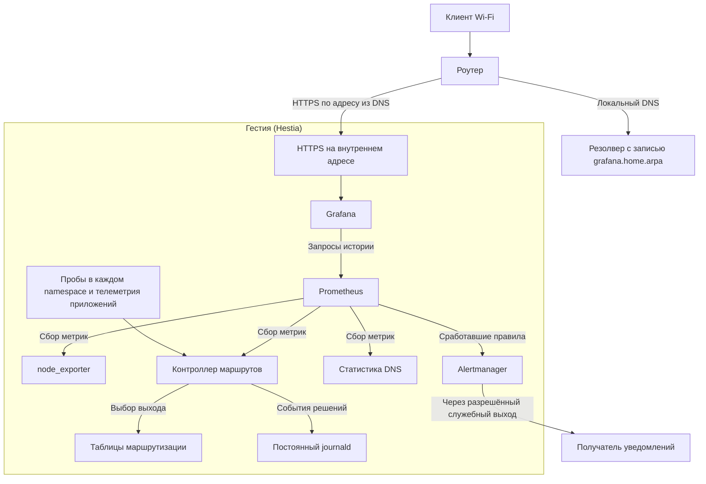

# Мониторинг на Гестии

На Гестии работают Prometheus, Grafana и Alertmanager. Контроллер маршрутов сам получает результаты проб, оценивает качество и переключает выходы. Prometheus периодически читает метрики контроллера. Остановка наблюдения оставляет контроллер и его историю измерений в работе. Это проектная схема для [стендовых испытаний](validation.md#проверки-мониторинга).

## Как открыть Grafana из Wi-Fi

1. Закрепить за интерфейсом шлюза со стороны роутера постоянный адрес. Wi-Fi-клиенты должны иметь маршрут к этому адресу через роутер. Если роутер делает NAT, в журнале шлюза источником может быть адрес роутера.
2. В DNS, который роутер выдаёт клиентам Wi-Fi, создать локальную запись A для `grafana.home.arpa` с этим адресом. AAAA добавлять при рабочем внутреннем IPv6. Если клиенты используют DNS роутера, запись можно хранить на нём или передавать запросы к этой зоне на резолвер шлюза. Локальная запись имеет приоритет над доменными правилами стран и доступна без внешнего DNS.
3. Направить HTTPS с внутреннего адреса на Grafana, включить вход под учётной записью. Сертификат должен содержать имя `grafana.home.arpa`, а Wi-Fi-клиент должен доверять выдавшему его центру. Разрешить доступ со стороны роутера, закрыть вход к панели с WAN и VPN для обеих используемых версий IP. Prometheus, Alertmanager и точки сбора метрик доступны локальным службам.
4. Подключиться к Wi-Fi и открыть **https://grafana.home.arpa**. При проблеме сначала проверить на клиенте ответ локального DNS, затем доступность HTTPS и доверие к сертификату. Клиент с принудительным внешним DoH должен использовать локальный резолвер для этой зоны.

## Метрики и журнал

| Источник | Что собираем |
|---|---|
| Linux и сеть | Через node_exporter — загрузку CPU, доступную память, свободное место, дисковый ввод-вывод, объём трафика, ошибки и отброшенные пакеты интерфейсов. Отдельно контролируем заполнение conntrack, состояние служб, время загрузки и место под Prometheus и журнал. |
| Пробы и SSTP | По постоянному ID канала, контрольной цели и протоколу — числа отправленных, полученных и завершившихся тайм-аутом проб, время последнего завершённого измерения, RTT и джиттер. Снимаем данные и с резервов в их namespace. Для SSTP — состояние PPP, переподключения и физическая линия под туннелем. Измеренную скорость сохраняем вместе со временем теста. |
| Политики и маршруты | Число живых каналов в группе, предпочтительный и фактически выбранный выход для контрольной цели, переключения по причине и масштабу, состояние блокировки. Сквозной запрос к подконтрольному серверу сравнивает наблюдаемый внешний IP с допустимыми выходами политики. |
| DNS | По каналу и настроенному резолверу — количество запросов, задержка, тайм-ауты, SERVFAIL, попадания и промахи кэша. Контрольные имена проверяют исключения и выбор DNS при переходе на резерв. |
| Сам мониторинг | Успешность опроса экспортёров, свежесть серий, ошибки вычисления правил и доставки уведомлений. Время последней успешной пробы храним отдельно от времени последней попытки. |

Долю потерь считаем по завершённым пробам за одно окно. Рядом показываем объём выборки. При свежих завершённых тайм-аутах возможны 100% потерь, а при остановке измерителя показываем «нет данных». Для каждого канала сопоставляем короткое окно с настраиваемым длинным (по умолчанию 60 минут). Возможность ICMP-ответа и доставка UDP до приложения отображаются раздельно. Для меток достаточно ограниченного набора идентификаторов каналов, групп, целей и протоколов. Домены пользователей и произвольные IP назначения не включаем в метки.

Каждое переключение оставляет в постоянном journald время, группу, старый и новый выход, область действия (группа или сервис), причину, окно, объём выборки и потери на обоих путях. Панель переключений использует метрики событий, а подробности оператор находит в журнале по времени и ID канала. Хранение Prometheus ограничивается по времени и размеру, journald — по размеру, с резервом свободного места для системы. Loki и Alloy можно добавить, если понадобится искать журналы прямо в Grafana.

## Журнал прохождения трафика

Предлагается записывать каждое новое TCP-соединение и каждый новый UDP-поток, включая повторные обращения к тому же IP. Если действующий поток меняет выход, записывать новое событие. События DNS и переключения каналов дополняют журнал трафика. Сам DNS-запрос не подтверждает, что клиент воспользовался ответом.

| Что искать | Поля записи |
|---|---|
| Когда и куда пошёл трафик | Время, идентификатор потока, протокол, реальный IPv4 или IPv6 назначения и порт, домен при достоверной связи с потоком. При FakeIP хранить и виртуальный, и реальный адрес. При прямом IP или неоднозначном общем IP оставлять домен неизвестным. |
| Почему выбрана группа | ID группы и основание решения на момент события: список и совпавшая маска, страна и запись карты GeoIP либо причина выбора группы по умолчанию. |
| Почему выбран этот выход | ID подключения, namespace и интерфейс, причина выбора внутри группы (исходный приоритет, потери до назначения, отказ другого канала). Это различает два `ppp0` даже при совпадающих адресах. |
| Что произошло | Для пересланного потока фиксировать наблюдаемый выход первого пакета. Если известно только решение контроллера, отмечать «выход не подтверждён». При блокировке записывать причину без выходного интерфейса. |

Журнал хранится на шлюзе и отображается на экране «Журнал трафика» в панели управления. Фильтры применяются ко всем записям выбранного периода. Строка поиска сопоставляется с доменом или IP назначения, а выбор протокола дополнительно сужает результат. Например, запрос `deepseek` с выбранным UDP показывает только UDP-потоки с таким фрагментом в имени. В поиске по домену должны быть видны все его фактические адреса и выходы за выбранный период, а в поиске по IP — также потоки без известного имени. Срок хранения журнала трафика настраивается в веб-панели и по умолчанию составляет 24 часа. Записи старше заданного срока подлежат удалению. Администратор задаёт лимит диска в мегабайтах, по умолчанию — 1 ГБ. На стенде измеряем суточный объём при типичной нагрузке. Контролируем число потерянных событий, чтобы пропуск записи был виден оператору.

### Диагностика медленного открытия домена

Для клиентского DNS-запроса фиксируем ID, имя и тип запроса, найденное правило, время приёма, момент ответа клиенту и результат. Для каждой попытки с тем же ID записываем группу, ID подключения, namespace, интерфейс, резолвер, попадание в кэш или время отправки, длительность, код DNS либо тайм-аут, полученные IP и TTL. Отдельно фиксируем, какие адреса получил клиент (включая FakeIP), и какие ответы пришли уже после этого. Параллельные интервалы сравниваем по общей шкале времени.

В журнале трафика показываем выбранный реальный IP, причину выбора группы и фактический выход. При надёжной связи с DNS-решением сохраняем его ID. Для TCP можно наблюдать время от SYN до SYN-ACK, повторы SYN и отсутствие ответа; для UDP — интервал до первого наблюдаемого обратного пакета. Клиентский кэш или общий IP могут сделать связь с конкретным DNS-запросом неоднозначной. В таком случае отмечаем неопределённость. Если шлюз отдал DNS-ответ быстро, а соединение долго ждало первого ответного пакета, оператор увидит, на каком этапе возникла задержка. Скорость обработки страницы внутри браузера из этих данных не следует.

## Дашборды Grafana

| Дашборд | На какой вопрос отвечает |
|---|---|
| Обзор шлюза | Какие страны доступны сейчас? Для каждой группы показать выбранный выход, живой резерв, блокировку, результат сквозной проверки и последнее переключение. Отдельно показать свежесть данных. |
| Качество каналов | Где теряется UDP? Для одной цели рядом показать FI-1 и FI-2, процент потерь, размер выборки, RTT и джиттер в обоих окнах. Совместить график с моментами переключений. |
| DNS и политики | Через какой резолвер и какой выход прошёл тестовый запрос? Показать задержку, ошибки и эффективность кэша по каналам, ожидаемую политику и результат проверки внешнего выхода. |
| Linux и SSTP | Есть ли локальная причина деградации? Совместить ресурсы машины, заполнение диска и conntrack, ошибки физических интерфейсов и перезапуски туннелей. |

## Алерты и пределы наблюдения

| Уровень | Условие и действие |
|---|---|
| Критический | Все выходы группы недоступны — указать страну и факт блокировки. Контрольный сервер увидел запрещённый выход — указать ожидаемую политику и наблюдаемый выход. |
| Предупреждение | Потерян резерв, устойчиво растут потери UDP, DNS канала выдаёт ошибки, идут частые переключения или заканчивается место. В сообщение включить затронутую цель, канал, окно и ссылку на нужный дашборд. |
| Нет данных | Экспортёр недоступен или свежие пробы перестали поступать. Отразить время последнего измерения. Этот сигнал требует проверки измерителя и отдельно учитывается при расчёте качества. |

Prometheus вычисляет правила, Alertmanager группирует уведомления по инциденту и подавляет производные сообщения при подтверждённой общей причине. Конкретные пороги, минимальную выборку, выдержку перед алертом и получателя выбираем на стенде. Если отказал один канал, уведомление можно доставить по разрешённому служебному выходу. При отказе всех внешних линий локальные панели и журнал доступны по Wi-Fi, а доставка наружу зависит от восстановления связи.

При выключенном питании или зависании всей машины на ней останавливаются и сбор, и панель, и отправка уведомлений. После запуска проверяем время загрузки, конец журнала предыдущей загрузки и разрыв в данных. Сам шлюз также не видит весь путь конкретного телефона через Wi-Fi, поэтому пользовательский доступ проверяем отдельно с клиента.
