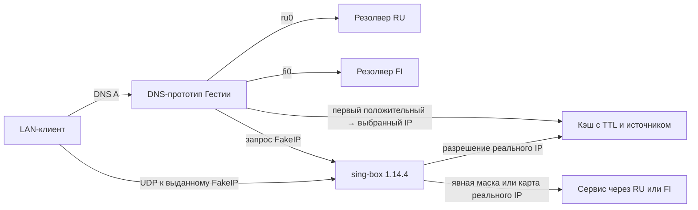

# Разные DNS-ответы, FakeIP и выбор группы по адресу

Исходники проверки: [tests/lab/dns-geo](../../tests/lab/dns-geo/). Отчёт и свидетельства остаются здесь. Перед повторным запуском применяйте [правила выбора стенда](../../agents/virtual-machines.md); исторические имена ВМ не являются указанием создать или запустить их.

На изолированной ВМ Debian ARM64 проверили гипотезу для одного A-ответа: при отсутствии доменного правила шлюз сохраняет первый пригодный адрес вместе с резолвером, через который его получил. Адрес определяет группу для потока. Явное правило выбирает группу и для внешнего DNS-запроса, и для пользовательских данных.



Для опыта DNS-прототип на Python одновременно отправляет два внешних запроса обычного DNS по UDP. Сокет каждого запроса привязан к своему интерфейсу. После первого пригодного ответа прототип получает клиентский FakeIP у локального sing-box. Остальные попытки завершаются в фоне. Временно принятый адрес сохраняется отдельно от ответов-кандидатов, ключ кандидата содержит имя и выход. Все записи опыта имеют класс IN и тип A. На новом потоке sing-box восстанавливает домен и получает выбранный реальный IP от локального прототипа. На стенде собственный DNS-кэш sing-box отключён, чтобы разрешением времени жизни управлял один компонент.

В двух изолированных внешних сетях стоят отдельные резолверы и экземпляры UDP-сервиса по одинаковым тестовым IP. Статическая карта использует `203.0.113.11` для страны RU и `203.0.113.22` для FI. Для `203.0.113.33` страна неизвестна. Группа по умолчанию — RU. Это воспроизводимая замена геобазы, а не вывод о стране документальных адресов. В основной таблице есть рабочий маршрут по умолчанию через RU. Захваты LAN, ru0 и fi0 фиксируют внешние DNS-запросы и маркированные UDP-пакеты. Сервер подтверждает полученный адрес назначения и интерфейс по фактическому источнику.

## Результаты 4 ноября 2026 года

| Сценарий | DNS клиенту | Как прошёл поток |
|---|---|---|
| FI быстрее RU, ответы различаются | FI вернул RU-адрес .11, 37 мс | Через RU |
| RU быстрее FI, ответы различаются | RU вернул FI-адрес .22, 36 мс | Через FI |
| RU первым вернул NXDOMAIN | Шлюз дождался положительного FI, 191 мс | Через RU к .11 |
| Явная финская маска | Только запрос через FI, 33 мс | Через FI к .11, несмотря на запись RU для этого IP |
| Вершина финской маски в верхнем регистре | Запрос ONLY-FI.LAB.TEST ушёл только через FI, 33 мс. После отключения группы тот же запрос получил SERVFAIL без повторных обращений к внешним резолверам | В исправной группе через FI к .11 |
| Страна неизвестна | Первый ответ FI, 37 мс | Через группу по умолчанию RU к .33 |
| Повтор имени после завершения фонового запроса | Тот же FakeIP, 1,36 мс, внешних запросов не было | Через RU к прежнему .11 |
| Финская группа объявлена недоступной | Для нового имени под её маской — SERVFAIL | Попытка по прежнему FakeIP другого финского имени видна на LAN и отсутствует на обоих выходах. Разрешённый контрольный поток через RU успешно дошёл |

Для медленного резолвера задана задержка 750 мс, для быстрого — 30 мс. Фиксация времени подтверждает, что ответ клиенту в обоих сценариях с разными положительными ответами пришёл до завершения медленного запроса. Поздний кандидат сохранил собственные TTL и источник, не заменив уже выданный выбор. Разрешённая контрольная проба при недоступности FI получила ответ от единственного разрешённого, медленного резолвера за 762 мс. Эти числа получены на локальной ВМ и описывают конкретный прогон.

## Отрицательный контроль

В отдельном прогоне для указанного маршрута через FI применили только `ip route replace prohibit 203.0.113.0/24 table 102`. В таблице появилась запрещающая запись, но проверка маршрута с `oif fi0` по-прежнему возвращала `dev fi0`. После перевода группы в состояние «недоступна» пакет по ранее выданному FakeIP дошёл до FI. Получен ответ от FI, а обход через RU в этом контроле не наблюдался. Почему поиск маршрута вернул этот результат на данной комбинации таблиц и привязки интерфейса, отдельно не локализовано. [Фактический маршрут и ответ сервера](evidence/negative-control.txt).

В успешном прогоне перед отправкой новых проб применены правило `oif fi0 prohibit` с высоким приоритетом и запрет OUTPUT для недоступного fi0. DNS-прототип также исключает группу из разрешённых попыток. Счётчик OUTPUT зарегистрировал одну заблокированную попытку. Сама пара интерфейсов оставалась поднята, так что пропуск запрета был бы заметен в захвате и на сервере. Назначение отказа вручную и последовательное применение правил здесь моделируют полностью недоступную группу. Атомарность переключения работающего контроллера этот опыт не проверяет. [Правила](evidence/down-rules.txt) · [Счётчик](evidence/down-guard.txt).

В опыте использованы одиночные IPv4-адреса и UDP-потоки. Выбор между несколькими адресами одного ответа, AAAA/CNAME, изменение реального адреса при истечении TTL и долговременный кэш требуют отдельных испытаний. [Сценарии и доказательства](evidence/verification.txt) · [Ответы клиента](evidence/clients.jsonl) · [Журнал DNS и кэша](evidence/decisions.log) · [Версии](evidence/version.txt) · [Захваты LAN](evidence/lan0.pcap), [RU](evidence/ru0.pcap), [FI](evidence/fi0.pcap).

## Повторение

Для ARM64-ВМ используйте [закреплённый образ и сборку sing-box 1.14.4](../fakeip/README.md). Для параллельной работы имя ВМ — `hestia-dns-geo`. Внутри ВМ установить зависимости и выполнить из каталога `tests/lab/dns-geo`:

```sh
sudo apt-get install -y --no-install-recommends python3-dnspython tcpdump iproute2 iptables
out=$(mktemp -d)
sudo bash lab.sh "$out"
sudo cat "$out/verification.txt"
```

Интернет нужен только для подготовки ВМ. Трафик опыта проходит между временными Linux network namespaces. Для офлайн-проверки на машине с Python 3 и tcpdump выполнить `python3 -B tests/lab/dns-geo/verify.py experiments/dns-geo/evidence` из корня репозитория.
