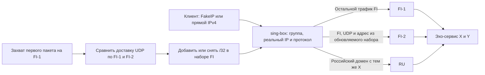

# Исключение для нового IPv4 без перезапуска шлюза

Исходники проверки: [tests/lab/dynamic-exception](../../tests/lab/dynamic-exception/). Отчёт и свидетельства остаются здесь. Перед повторным запуском применяйте [правила выбора стенда](../../docs/virtual-machines.md); исторические имена ВМ не являются указанием создать или запустить их.

4 ноября 2026 года на отдельной Debian ARM64-ВМ проверили ручное и автоматическое переключение. В каждом прогоне начальная конфигурация sing-box 1.14.4 содержит пустой набор исключений. После запуска процесса стенд выбирает новый случайный IPv4 X для финского и российского доменов. Клиент получает FakeIP для этих двух имён и для контрольного назначения Y. Первое UDP-обращение к финскому имени проходит по FI-1. Сценарий извлекает реальный X из захвата этого пакета и начинает сравнивать два финских подключения для наблюдаемого назначения.



Группа по умолчанию на стенде — FI, российское имя задано явной маской с более ранним правилом. Рабочий основной маршрут Linux ведёт через RU, и захват на нём выявил бы ошибочный выход. Внешний DNS в этом опыте заменяет изолированный UDP-резолвер с синтетическими записями. Поведение DNS при разных ответах исследуется отдельно.

Для FI задано одно постоянное правило «UDP и реальный адрес из набора». Контроллер заменяет JSON-файл набора атомарным переименованием в той же директории. Эффект изменения подтверждает отдельная проба по старому FakeIP с ответом через новый выход. Пакет, отправленный сразу после записи файла, может воспользоваться прежним выбором до перечитывания: в ручном прогоне такие пакеты действительно видны. Время от записи до подтверждения составило около 105 мс при ручном добавлении и снятии, 268 и 272 мс в автоматическом опыте, включая контрольный запрос через маршрут с потерями. Это задержки лабораторного подтверждения. [Поддержка обновления локальных наборов в sing-box](https://sing-box.sagernet.org/configuration/rule-set/#path) · [Контрольные запросы](evidence/combined/barrier.jsonl)

## Результаты

| Прогон | Действие | Фактическое поведение |
|---|---|---|
| Ручной, X = 203.0.113.103 | Добавить адрес в изначально пустой набор FI, затем снять его | Новые UDP-потоки к X прошли сначала через FI-1, затем через FI-2, после снятия снова через FI-1. 21 клиентский поток проверен. |
| Автоматический, новый X = 203.0.113.114 | Сравнить пары одинаковых UDP-проб через оба выхода | В первых 20 парах потерь нет. Затем на FI-1 потеряно 12 из 120 пакетов, на FI-2 — 0 из 120. Общий алгоритм по 140 парам выбрал FI-2 и установил исключение. |
| Тот же автоматический прогон | Восстановить FI-1, затем ухудшить FI-2 | В следующих 100 парах FI-1 потерял 0, FI-2 — 50. В накопленной истории потери 12 против 50. Алгоритм выбрал FI-1 и снял исключение. 21 клиентский поток проверен за три фазы. |

В обеих сериях TCP к X и UDP к Y проходили через FI-1. Российское имя с тем же реальным X всё время пользовалось RU. Проверены новые запросы напрямую по IP и через ранее выданные FakeIP. Один экземпляр sing-box обслуживал все фазы своего прогона. Маркеры сопоставлены с PCAP каждого выхода, входом LAN и журналом принимающего сервера. В автоматическом опыте 240 пар наблюдений соответствуют 480 отправленным UDP-пробам.

Решение принимает [общий алгоритм опыта с частичными потерями](../../tests/lab/partial-loss/policy.py). Он сравнивает данные, попавшие в окно 3600 с, и требует достаточного числа пар и устойчивой разницы качества. Измерения этого прогона заняли секунды, полную часовую историю на этой ВМ мы не накапливали. Равенство качества само по себе сохраняет выбранный выход. Чтобы проверить снятие исключения, стенд создаёт измеримое преимущество FI-1. Решение пересчитывается после каждого блока измерений. Пороговые значения, влияние потерь в реальной сети и смена уже открытого UDP-потока требуют отдельной проверки. Стенд хранит один набор для одного резервного выхода и испытывает одно обнаруженное исключение; несколько одновременных исключений, возобновление после аварии и согласование нескольких писателей в область опыта не входят.

[Ручной прогон](evidence/manual/verification.txt) · [Автоматический прогон](evidence/combined/verification.txt) · [Журнал этапов](evidence/combined/events.log) · [Выбор резерва](evidence/combined/loss-decision.json) · [Возврат к FI-1](evidence/combined/reverse-decision.json) · [Захваты и исходные измерения](evidence/combined/)

## Повторение

Подготовить отдельную ARM64-ВМ по [инструкции базового стенда](../fakeip/README.md). В госте требуются sing-box 1.14.4, bash, Python 3, iproute2, iptables с расширением statistic и tcpdump. Из корня копии проекта выполнить:

```sh
out=$(mktemp -d)
sudo bash tests/lab/dynamic-exception/lab.sh "$out" manual
out=$(mktemp -d)
sudo bash tests/lab/dynamic-exception/lab.sh "$out" combined
```

Каждый запуск создаёт отдельные пространства имён для клиента, шлюза и сервера и удаляет их при выходе. Сохранённые данные проверяются на машине с tcpdump и Python 3:

```sh
python3 -B tests/lab/dynamic-exception/fixture.py verify experiments/dynamic-exception/evidence/manual
python3 -B tests/lab/dynamic-exception/fixture.py verify experiments/dynamic-exception/evidence/combined
python3 -B tests/lab/dynamic-exception/sweep.py verify experiments/dynamic-exception/evidence/combined
```
