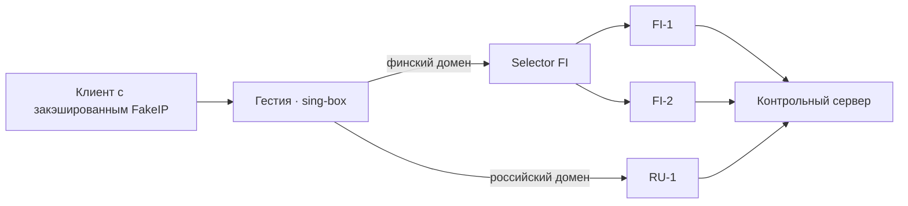

# Отказ выхода после выдачи FakeIP

Исходники проверки: [tests/lab/failover](../../tests/lab/failover/). Отчёт и свидетельства остаются здесь. Перед повторным запуском применяйте [правила выбора стенда](../../agents/virtual-machines.md); исторические имена ВМ не являются указанием создать или запустить их.

Клиент уже получил виртуальный адрес финского домена и начинает новое соединение после отказа FI-1. Проверяем, сможет ли он использовать прежний адрес через FI-2 и останется ли финский трафик внутри группы при потере обоих выходов. Состояние подключений в этом опыте задаёт стенд. [Критерии приёмки](../../docs/mvp-routing.md)



Два домена ведут на один реальный IPv4 и порт. Положительная проверка требует ответа сервера и подтверждения выходного интерфейса по захвату. Для блокировки дополнительно проверяем исходящие попытки подключения и внешний DNS. Российский контроль в том же прогоне подтверждает, что чужой выход работает.

## Повторный запуск

Подготовить гостевую Debian ARM64 по [инструкции базового стенда](../fakeip/README.md). В гостевой системе требуются sing-box 1.14.4 со включённым Clash API, iproute2, tcpdump, curl, bash и Python 3. Из корня копии проекта внутри ВМ выполнить:

```sh
out=$(mktemp -d)
sudo bash tests/lab/failover/lab.sh "$out"
sudo cat "$out/verification.txt"
```

При переносе файлов в ВМ сохранить соседний каталог `tests/lab/fakeip` с `traffic.py`. Результаты пишутся в переданный пустой каталог. Стенд создаёт временные сетевые пространства, внешний тестовый DNS и сервер эха внутри гостя. Основной маршрут Гестии ведёт через рабочий RU-1, так что попытка уйти по обычному маршруту видна в захвате. Локальный управляющий API слушает loopback внутри сетевого пространства шлюза.

Для полной блокировки сценарий выбирает выход `deny` в селекторе финской группы. И исходящие соединения, и внешний DNS этого выхода привязаны к `deny0`. Для него Linux возвращает запрет маршрутизации из отдельной таблицы. После каждой смены выхода сценарий читает фактическое состояние селектора обратно через API. Непрерывные захваты охватывают всю серию на трёх интерфейсах, а записи отдельных фаз позволяют отличить контрольный российский трафик от попытки утечки.

## Результат 4 ноября 2026 года

На Debian 12 ARM64 с ядром 6.1 и sing-box 1.14.4 все 24 пробы дали ожидаемый результат. Клиент получил `198.18.0.3` для `fi.lab.test` и `198.18.0.2` для `ru.lab.test`. Во всех фазах он повторно использовал эти адреса. Для проверки внешнего DNS сценарий дополнительно обращался к уникальным именам.

| Фаза | Наблюдение |
|---|---|
| Исходное состояние | Финские TCP и UDP прошли по FI-1, российские по RU-1. Тестовый резолвер зарегистрировал исходящий запрос для нового финского имени с адреса FI-1. |
| Отключение FI-1 и выбор FI-2 | Финский сервис ответил через FI-2 по обоим протоколам. Между запросом смены селектора и подтверждением его состояния прошло около 16 мс в этом прогоне. Это время выполнения команды после заданного стендом отказа. |
| Отключение FI-2 и выбор deny | Потоки по старому FakeIP и по новому финскому имени заблокированы. В окне этих финских проб на RU-1 отсутствуют исходящие пакеты к тестовому сервису и внешние DNS-запросы для финских имён. |
| Контроль RU при том же полном отказе FI | Обе российские пробы достигли сервера через RU-1. |
| FI-2 физически восстановлен, выбран deny | Финский трафик и внешний DNS по-прежнему заблокированы. |
| Выбран восстановленный FI-2 | Клиент снова получил ответы по TCP и UDP через FI-2, используя первоначальный FakeIP. |

Фазы отказа и восстановления прошли в одном процессе sing-box. Проверка охватывает новые IPv4-потоки, ручной выбор всего финского выхода и UDP-резолвер стенда. Время обнаружения деградации, судьба уже открытого сеанса и частичное переключение только одного назначения остаются отдельными экспериментами. Причину выбора записывает сценарий управления. Пользовательский журнал контроллера предстоит реализовать.

[Версия и ядро](evidence/version.txt) · [События переключения](evidence/events.log) · [Проверка 24 проб](evidence/verification.txt) · [Наблюдения резолвера](evidence/dns.log) · [Непрерывный захват RU](evidence/continuous-ru0.pcap) · [FI-1](evidence/continuous-fi1.pcap) · [FI-2](evidence/continuous-fi2.pcap)
