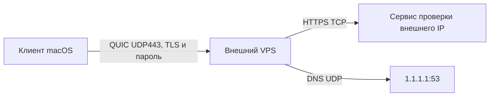

# Установка Hysteria 2 на внешний сервер

## Вопрос и среда

6 ноября 2026 года проверили, работает ли установленный внешний сервер Hysteria 2 с клиентом вне VPS: проверка TLS, парольная аутентификация, TCP и UDP. В отчёте адрес обозначен `VPS_IP`; реальные данные подключения хранятся отдельно от Git.

Сервер — Ubuntu 24.04.3 LTS, x86_64, Hysteria 2 v2.13.0, systemd. Клиент — официальный Hysteria 2 v2.13.0 для macOS ARM64. Исходники приложения не менялись; база рабочей копии Гестии — `66bb2faafc3c053e3010936a3a9d1fa89e70337b`, с посторонними незакоммиченными изменениями. Настройки установки описаны в [инструкции](../../deploy/docs/hysteria2-server.md).



## Условия и результат

До установки служба была неактивна и выключена; UDP443 свободен. Docker слушал UDP42346. После установки независимый тестировщик использовал отдельные локальные порты SOCKS5 `127.0.0.1:10819` и UDP forwarding `127.0.0.1:10539`. Доверие задано публичным PEM, `insecure: false`; TLS проверяет IP сервера.

| Проверка | Ожидание | Наблюдение |
|---|---|---|
| Правильные PEM и пароль | Клиент подключается | `connected to server`, UDP разрешён |
| HTTPS через SOCKS5 | Внешний адрес равен VPS | Получен адрес VPS |
| DNS через UDP forwarding | Ответ от удалённого резолвера | `NOERROR`, два A-ответа, 37 мс |
| Неверный пароль | Отказ до открытия локального прокси | Ошибка аутентификации HTTP404, exit 1 |
| Нет доверенного PEM | Отказ TLS | `x509: certificate signed by unknown authority`, exit 1 |
| Служба после установки | Автозапуск, работает без root | `enabled`, `active`, пользователь и группа `hysteria`, `NRestarts=0` |
| Соседний UDP listener | Сохранён | Docker UDP42346 IPv4/IPv6 присутствует |

Проверки выполнены 16:45–16:46 по Москве. Проверяемое свидетельство: [обезличенный протокол](evidence/summary.txt). Ошибок развёрнутой службы в этих сценариях не обнаружено. Временный тестовый клиент остановлен.

## Воспроизведение

Используйте подготовленный приватный `client.yaml` и публичный PEM из инструкции. Для независимой проверки замените локальный SOCKS5-порт на 10819 и добавьте:

```yaml
udpForwarding:
  - listen: 127.0.0.1:10539
    remote: 1.1.1.1:53
```

В каталоге с профилем и PEM запустите `./hysteria-darwin-arm64 client -c verify-client.yaml`, затем:

```sh
curl --silent --show-error --max-time 20 --socks5-hostname 127.0.0.1:10819 https://api.ipify.org
dig @127.0.0.1 -p 10539 example.com A +time=5 +tries=1
ssh root@VPS_IP 'systemctl is-enabled hysteria-server; systemctl is-active hysteria-server; systemctl show hysteria-server -p User -p Group -p NRestarts; ss -ulnp'
```

Для отрицательных сценариев создайте отдельные копии профиля: в первой замените пароль заведомо неверным, во второй удалите `tls.ca`. Обе команды клиента должны завершиться с кодом 1 по соответствующей причине. Не публикуйте профиль или пароль в Git и журналах. После проверок остановите клиент.

## Границы вывода

Подтверждена доступность QUIC и передача одного HTTPS-запроса и одного DNS-запроса с текущего Mac. Не проверялись нагрузка, длительная устойчивость, другие провайдеры, восстановление после перезагрузки VPS и интеграция с работающей Гестией. Исполнитель установки проверил перезапуск службы; тестировщик независимо проверил её активность после этого. Наличие Docker listener не доказывает работоспособность всего соседнего приложения. Срок действия и последующая замена сертификата требуют сопровождения по инструкции.
