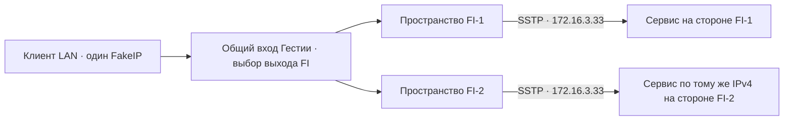

# Клиент за Гестией и два SSTP с одинаковым внутренним IP

Исходники проверки: [tests/lab/sstp-gateway](../../tests/lab/sstp-gateway/). Отчёт и свидетельства остаются здесь. Перед повторным запуском применяйте [правила выбора стенда](../../agents/virtual-machines.md); исторические имена ВМ не являются указанием создать или запустить их.

Проверяем новые TCP- и UDP-потоки от отдельного клиента за общим шлюзом. Два одновременно установленных SSTP получают одинаковые локальный и удалённый PPP-адреса. В каждом сетевом пространстве есть свой маршрут к сервису с одинаковым адресом и портом. Клиент один раз получает FakeIP и использует его до конца серии.

| Состояние | Критерий |
|---|---|
| Оба SSTP работают, выбран FI-1 | Клиент получает ответы по TCP и UDP. Уникальные маркеры видны на пути первого туннеля, их получает сервер FI-1. |
| FI-1 оборван | Подтверждено прекращение первого сеанса при сохранении второго. В журнале различимы отказ и момент выбора резерва. |
| Выбран FI-2 | Новые TCP- и UDP-потоки к прежнему клиентскому адресу получают ответ через второй туннель. Подмена выхода определяется по захватам и идентификатору сервера. |

Проверяем способность общего шлюза доставлять клиентские потоки и переключать их между реальными SSTP. Отдельный [опыт совпадающих PPP-адресов](../sstp/README.md) проверял пробы из самих пространств туннелей.



## Как проходит пакет

Клиент посылает пакет к FakeIP через LAN на общий вход sing-box. Финский селектор выбирает один из двух выходов. У каждого выхода своя пара veth, ведущая в пространство SSTP-клиента. В этом пространстве Linux направляет пакет назначения в PPP-интерфейс и подставляет его согласованный адрес источника `172.16.3.33`. Несмотря на совпадение адресов, обратный пакет попадает в пространство своего туннеля. В каждой удалённой сети работает отдельный экземпляр сервиса по адресу `203.0.113.77:19091`; ответ содержит ID этого экземпляра.

## Как повторить

Подготовить изолированную ARM64-ВМ по [инструкции SSTP-стенда](../sstp/README.md) и установить [sing-box 1.14.4 из базового опыта](../fakeip/README.md) с включённым Clash API. В госте также нужны curl, tcpdump и Python 3. Из корня проекта выполнить:

```sh
out=$(mktemp -d)
sudo bash tests/lab/sstp-gateway/lab.sh "$out"
sudo cat "$out/verification.txt"
```

Для проверки опубликованных захватов на машине с Python 3 и tcpdump:

```sh
python3 -B tests/lab/sstp-gateway/probes.py verify experiments/sstp-gateway/evidence
```

## Результат 4 ноября 2026 года

Три полных прогона прошли успешно. В одной предшествующей попытке FI-2 не согласовал PPP-адрес за 18 секунд, и стенд завершил работу до отправки клиентского трафика. Причина этого сбоя запуска не установлена. В опубликованном прогоне клиент получил `198.18.0.2` одним DNS-запросом. Все шесть попыток использовали этот адрес и новые исходные порты. До отказа TCP и UDP получили ответы FI-1. Стенд завершил первый SSTP-клиент и дождался исчезновения его PPP-интерфейса. В тот же момент у FI-2 оставались PPP-адрес `172.16.3.33` и установленное соединение с TLS-сервером.

Пока был выбран отключённый FI-1, обе новые попытки не получили ответа, а контрольные запросы не вышли через FI-2. Затем сценарий переключил селектор через локальный API и подтвердил его новое состояние. Обе следующие попытки получили ответы FI-2. Проверка захватов сопоставила метки в обоих направлениях на LAN и соответствующем PPP-интерфейсе с журналом удалённого сервиса.

Резерв выбирает сценарий стенда после наблюдения состояния обоих туннелей. Двухсекундный промежуток в журнале включает отрицательную контрольную пробу и не измеряет время автоматического обнаружения отказа. Сохранение установленных до отказа соединений и работа с внешними провайдерами в этот опыт не входят.

[Протокол](evidence/verification.txt) · [События переключения](evidence/events.log) · [Состояние в момент отказа](evidence/outage.txt) · [Захват LAN](evidence/ingress.pcap) · [FI-1](evidence/FI1.pcap) · [FI-2](evidence/FI2.pcap)
