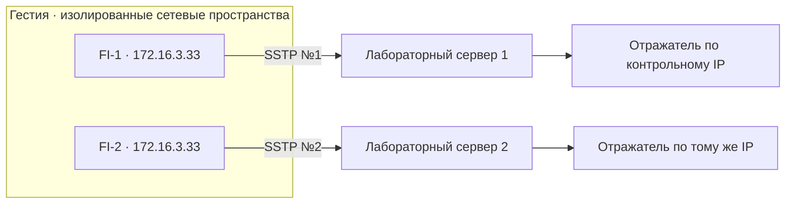

# Два SSTP-подключения с одинаковым внутренним IPv4

Исходники проверки: [tests/lab/sstp](../../tests/lab/sstp/). Отчёт и свидетельства остаются здесь. Перед повторным запуском применяйте [правила выбора стенда](../../docs/virtual-machines.md); исторические имена ВМ не являются указанием создать или запустить их.

Цель — проверить, может ли Гестия различать два подключения, если оба получают `172.16.3.33`. Запускаем одинаковые UDP-пробы одновременно к одной цели. Привязываем пробу к сетевому пространству конкретного подключения. Сравниваем ответы отражателя, журналы установления туннелей и захваты пакетов.

| Состояние | Ожидаемое поведение |
|---|---|
| Оба подключения исправны | В каждом пространстве виден один и тот же локальный IPv4. Метки FI-1 и FI-2 доходят через соответствующее подключение. |
| Потери внесены только в FI-1 | В тот же период ответы по FI-1 пропадают, FI-2 продолжает доставлять пробы. |
| Потери сняты | Пробы снова возвращаются по обоим подключениям. |



В каждом пространстве отправитель использует один и тот же порт 34000 и обращается к одному и тому же IPv4 на порту 19091. Отражатели помечают ответы идентификатором своего пути. Каждый интервал содержит пять отправок с периодом 150 мс. Расписание отправки одинаково для обоих каналов и не зависит от получения ответа.

## Результат 4 ноября 2026 года

Оба клиента sstpc 1.0.18 установили SSTP поверх TLS с отдельными экземплярами accel-ppp 1.15.0. PPP подтвердил CHAP-аутентификацию, локальный адрес `172.16.3.33` и адрес партнёра `172.16.3.1` у каждого клиента. Оба процесса и их интерфейсы работали одновременно. Целью на каждой стороне был отдельный экземпляр отражателя с одинаковым числовым адресом `203.0.113.77:19091`.

| Возвращено проб | FI-1 | FI-2 |
|---|---:|---:|
| До внесения потерь | 5/5 | 5/5 |
| FI-1 отбрасывает UDP на входе сервера | 0/5 | 5/5 |
| После снятия правила | 5/5 | 5/5 |

Проверка сопоставила все 30 уникальных маркеров с захватами PPP-интерфейсов и журналами отражателей. Счётчик на первом сервере зарегистрировал ровно пять отброшенных пакетов. Окна измерения двух путей пересекались во всех фазах. После опыта сетевые пространства удалены.

Для Гестии это подтверждает возможность привязать измерение к **ID подключения и его сетевому пространству** даже при совпадении всех адресов и портов. Проверка охватывает измерение из пространства каждого подключения. Передача клиентского трафика от общего входа Гестии в эти пространства подтверждена [отдельным сквозным опытом](../sstp-gateway/README.md). Производительность и работа с внешними провайдерами SSTP требуют отдельных испытаний.

[Сеансы PPP](evidence/ppp-sessions.log) · [Маршрут FI-1](evidence/FI1-route.txt) · [Маршрут FI-2](evidence/FI2-route.txt) · [Счётчик потерь](evidence/impairment.txt) · [Протокол](evidence/verification.txt) · [Захват FI-1](evidence/FI1.pcap) · [Захват FI-2](evidence/FI2.pcap)

## Повторение в изолированной Debian 12 ARM64

Для SSTP клиентам нужен PPP ядра Linux. В испытанном образе с `6.1.0-53-cloud-arm64` отсутствовал модуль `ppp_generic`. На этой же ВМ с универсальным Debian `6.1.0-54-arm64` загрузились `ppp_generic` и `ppp_async`, появился `/dev/ppp`. Использовали стандартные пакеты ядра. Для физического шлюза эту проверку нужно повторить на образе выбранной платы.

В гостевой ВМ установить зависимости и загрузиться с универсальным ядром из пакета `linux-image-arm64`. Перед продолжением проверить `uname -r`, загрузку модулей и устройство `/dev/ppp`. При установленном облачном ядре тоже следует явно выбрать универсальное ядро в загрузчике.

```sh
sudo apt-get update
sudo apt-get install --no-install-recommends linux-image-arm64 ppp sstp-client iproute2 iptables tcpdump python3 openssl curl cmake build-essential libssl-dev libpcre2-dev libcap-dev
```

Из каталога `tests/lab/sstp` в гостевой ВМ собрать сервер из архива с закреплённой SHA-256 и запустить стенд:

```sh
sudo modprobe ppp_generic
sudo modprobe ppp_async
test -c /dev/ppp
curl -fL https://github.com/accel-ppp/accel-ppp/archive/refs/tags/1.15.0.tar.gz -o accel-1.15.0.tgz
bash build-server.sh accel-1.15.0.tgz
out=$(mktemp -d)
sudo bash lab.sh "$out"
sudo cat "$out/verification.txt"
```

Каждый сервер доступен только из своей тестовой сети. Сертификаты и пароли создаются специально для прогона. Для использованного пакета ppp Debian отмечает уязвимость обработки LCP, поэтому перед развёртыванием на реальном шлюзе требуется отдельно проверить статус исправления. [Версии стенда](evidence/version.txt) · [Debian Security Tracker](https://security-tracker.debian.org/tracker/CVE-2026-85495).

Захваты из репозитория можно перепроверить на машине с Python 3 и tcpdump командой `python3 -B tests/lab/sstp/probes.py verify experiments/sstp/evidence 203.0.113.77` из корня репозитория.
