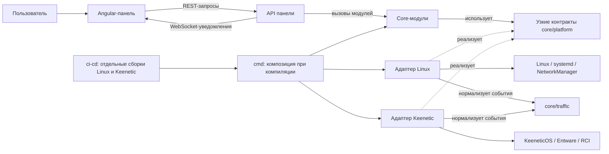

# Идеи для версии 1.0.0

Этот документ собирает предложения по новой версии Hestia 1.0.0 и решения, принятые в ходе интервью. Новую версию пишем с нуля в `src/`; работающую текущую версию сохраняем в корневом `v0/` как справочник поведения и уже реализованных функций. Детальные требования и критерии приёмки для реализации предстоит оформить в соответствующих спецификациях.

**Объём версии 1.0.0:** весь текущий функционал Hestia должен войти в релиз полностью. Новая реализация с нуля не должна удалять или урезать существующие пользовательские возможности; `v0/` служит рабочим справочником для проверки поведения. Новые возможности, например автоматический выбор WISP-сети по сигналу, рассматриваются отдельно и могут относиться к версии 1.1.

В 1.0 также входит локальная аутентификация панели. Её согласованные требования приведены ниже.

В сборку Keenetic 1.0 входит настройка и проверка RCI-токена. Linux-сборка не показывает интерфейс настройки RCI.

**Совместимость Keenetic:** поддерживаются KeeneticOS 5.2 и новее на `aarch64`, включая beta/dev-сборки; точная модель и заранее созданный RCI-токен не требуются. До установки проверяются версия KeeneticOS командой `ndmc -c 'show version'` и архитектура командой `uname -m`.

**Статус сборки и токена:** после входа API сообщает платформу сборки (`linux` или `keenetic`); для Keenetic оно сообщает только булев признак валидности сохранённого RCI-токена. Сам токен никогда не передаётся в браузер.

Если API инициализации не отвечает на любой платформе, панель остаётся заблокированной и повторяет запрос до успеха. Экран настройки RCI существует только в Keenetic-сборке.

**Проверка RCI-токена:** HTTP 2xx от `GET /rci/show/version` означает валидный токен независимо от тела ответа; HTTP 401/403 означает, что токен отвергнут; timeout и ошибка сервера означают временный сбой и требуют повторной проверки, а не повторного ввода токена.

Если токен отсутствует или отвергнут ответом 401/403, панель блокируется обязательным незакрываемым окном настройки до ввода и проверки валидного токена.

Инструкция в окне настройки использует ссылку `http://192.168.1.1/administrator/tokens` как значение по умолчанию и поясняет, что фактический адрес роутера может отличаться.

Окно содержит пошаговую инструкцию: открыть страницу токенов, добавить токен с описанием `Hestia`, создать и скопировать его, вставить в скрытое поле панели и сохранить.

Новый токен сначала проверяется read-only запросом к RCI и сохраняется только при успехе. При неудачной проверке backend не сохраняет токен, frontend очищает поле, показывает ошибку и позволяет повторить ввод.

Проверенный RCI-токен хранится защищённо на backend; его точный путь и платформенный способ хранения определяются при проектировании. Токен не передаётся браузеру.

Значение RCI-токена не записывается в журналы; диагностика ограничивается статусом проверки или типом ошибки.

**Начальные учётные данные:** для новой установки используются логин и пароль `admin`/`admin`; они продолжают работать до ручной смены администратором. Владелец принимает, что клиент доверенной LAN, знающий эти данные, может войти в панель до их смены.

**Модель учётной записи:** в 1.0 есть одна локальная учётная запись администратора; несколько пользователей, роли и внешний сервис идентификации не входят в этот объём.

Администратор может менять и логин, и пароль.

**Защита панели:** все страницы приложения и операции REST и WebSocket требуют действующую сессию, проверяемую backend. До входа доступны экран входа и необходимые статические файлы; endpoint входа не требует сессии.

**Смена пароля:** для неё требуется текущий пароль либо недавняя повторная аутентификация.

Сменить логин можно из действующей сессии без повторного ввода пароля.

**Политика пароля:** минимум 8 символов, без дополнительных требований к составу; поле подтверждения должно совпадать с новым паролем.

**Отзыв сессий:** после смены логина или пароля все активные сессии отзываются; для дальнейшей работы нужно войти снова.

**Срок сессии:** сессия завершается после 30 минут бездействия и в любом случае не позднее чем через 12 часов.

После истечения сессии Hestia сообщает об этом, просит пользователя войти и после успешного входа возвращает его на прежнюю страницу.

**Ограничение входа:** после неверных попыток входа задержка перед следующей попыткой постепенно увеличивается; учётная запись не блокируется навсегда.

**Восстановление доступа:** отдельная локальная CLI-команда с административными правами сбрасывает только логин и пароль к `admin`/`admin`, не меняя остальные настройки; команда вызывает `core` напрямую и не входит в UI/API.

**Хранение учётных данных:** пароль хранится как Argon2id-хеш. Пароли и идентификаторы сессий не записываются в журналы.

**Защита запросов:** все запросы из сессии, изменяющие состояние, защищаются от CSRF.

**Сетевое ограничение панели:** панель работает по HTTP только в доверенной LAN и не должна публиковаться в WAN. Владелец принимает, что наблюдатель в LAN может перехватить пароль входа или сессионные данные.

Аутентификация, смена учётных данных и настройка RCI выполняются локально и не обращаются к сторонним сервисам.

Пользовательские возможности версии 1.0 должны быть одинаковыми для Linux и Keenetic; платформенные реализации могут отличаться.

## Структура репозитория

Предлагается привести корень репозитория к компактной структуре, в которой исходный код проекта собран в одном месте, а сборка и поставка отделены от него:

```text
/
├── README.md                      # обзор новой версии Hestia
├── AGENTS.md                      # общие инструкции проекта
├── DOCUMENTATION.md               # короткий индекс областей репозитория
├── src/                           # исходный код новой версии 1.0.0
│   ├── ui/                        # панель и API панели
│   │   ├── frontend/              # веб-панель
│   │   │   └── tests/             # unit-тесты логики фронтенда
│   │   └── api/                   # REST и WebSocket-интерфейсы панели
│   │       └── contracts/         # типизированные контракты OpenAPI и AsyncAPI
│   ├── core/                      # предметная логика и контракты платформ
│   │   ├── platform/              # узкие контракты: WANDiscovery, WiFiClient, ClientTrafficIngress и др.
│   │   ├── channels/              # каналы WAN/WISP и состояние подключений провайдеров
│   │   ├── vpn/                   # VPN-интеграция и коннекторы к движкам/подмодулям
│   │   ├── routing/               # выбор группы по доменным правилам и GeoIP
│   │   ├── groups/                # управление группами соединений
│   │   ├── quality/               # проверки и результаты качества соединений
│   │   ├── selector/              # выбор выхода по качеству и классу TCP/UDP/QUIC
│   │   ├── traffic/               # приём и хранение нормализованных TrafficEvent
│   │   └── dns/                   # резолвер, кэш, правила и прогрев DNS
│   ├── platforms/                 # платформенные реализации и файлы установки
│   │   ├── keenetic/              # интеграция, Entware lifecycle и IPK hooks
│   │   └── linux/                 # интеграция и systemd units
│   └── cmd/                       # точки входа поставляемых программ
│       ├── hestia/                # связывает core, UI/API и выбранную платформу
│       └── reset-admin-credentials/ # CLI-команда сброса учётных данных через core
├── dist/                          # промежуточные сборки и готовые комплекты; исключён из Git
├── ci-cd/                         # автоматизированные сценарии сборки, тестирования, поставки и обновления
├── tests/                         # автоматизированные проверки продукта
│   ├── e2e/                       # сквозные UI-тесты на Playwright
│   ├── api/                       # проверки REST API и WebSocket
│   └── platforms/                 # платформенные интеграционные и установочные проверки
│       ├── linux/
│       └── keenetic/
├── tools/                         # исследовательские и разработческие утилиты
├── private/                       # локальные ключи и инструкции для ВМ; исключён из Git
├── agents/                        # проектные профили и инструкции
├── experiments/                   # исследования и свидетельства версии 1.0
├── v0/                            # текущая версия со своей документацией и свидетельствами
│   ├── backend/
│   ├── frontend/
│   ├── deploy/
│   ├── scripts/
│   ├── tests/                     # проверки текущей версии
│   ├── docs/                      # документация текущей версии
│   ├── experiments/               # отчёты и свидетельства текущей версии
│   └── ...                        # манифесты и конфигурации для сборки/запуска
├── docs/                          # продуктовая и эксплуатационная документация
│   ├── README.md
│   ├── product/                   # требования, roadmap и сведения о продукте
│   │   └── README.md
│   ├── architecture/              # архитектура и интеграционные решения
│   │   └── README.md
│   ├── features/                  # спецификации поведения функций
│   │   └── README.md
│   ├── deployment/                # инструкции и ограничения развёртывания
│   │   └── README.md
│   ├── operations/                # мониторинг, валидация и планы испытаний
│   │   └── README.md
│   └── ui/                        # панель и дизайн интерфейса
│       └── README.md
├── package.json                   # frontend/Node-зависимости и команды проекта (npm)
└── package-lock.json              # единый lock-файл npm
```

Каталоги на схеме обозначают границы модулей; внутреннее разбиение каждого модуля можно уточнить при проектировании. Core владеет функциональной логикой Hestia и объявляет узкие типизированные платформенные контракты по возможностям, а не один общий интерфейс `Platform`. Платформенный слой предоставляет системные операции и преобразует системные события в общие типы; он не реализует целые функциональные модули. Адаптеры Keenetic и Linux реализуют эти контракты, а `cmd/hestia` связывает выбранную реализацию с core и UI/API. Платформенные адаптеры нормализуют события своих систем и sing-box в `TrafficEvent`, после чего передают их в `core/traffic` для хранения. Журнал читается панелью через UI/API.

Принцип разделения предметной логики и системной реализации: core-модули не зависят от конкретной платформы, а платформенные адаптеры реализуют узкие контракты. Отдельный каталог `features/` не вводится: функциональные модули остаются непосредственно в `src/core/` согласно выбранной структуре.

`src/core/` содержит именованные модули с ясными ответственностями и не служит catch-all для нераспределённой логики. Контракты системных операций остаются централизованными в `src/core/platform/` и группируются по узким возможностям.



Для новой структуры 1.0 принимается правило `README.md` в каждом каталоге: README кратко объясняет назначение каталога и ссылается на README его непосредственных дочерних каталогов. Правило распространяется и на `src/ui/frontend/src`; при переходе нужно обновить Angular-правило, которое сейчас запрещает там другие файлы. Содержимое `v0/` сохраняется без этих изменений. Сгенерированные каталоги, кэши, артефакты сборки и сторонние зависимости исключаются.

`DOCUMENTATION.md` остаётся коротким индексом основных областей репозитория. Подробная навигация ведётся через README соответствующих каталогов; `docs/README.md` остаётся тематическим оглавлением продуктовой документации.

В документации явно различаются действующие решения и исторические материалы, чтобы архивные исследования не выглядели актуальными планами. Требования, решения, спецификации и эксплуатационные инструкции находятся в `docs/`; отчёты прогонов и свидетельства — в `experiments/`; инструкции агентов — в `agents/`; конфигурации лабораторных проверок — в `tests/lab/`; сценарии сборки, установки и поставки — в `ci-cd/`.

### Предварительная карта анализа текущих компонентов из `v0/`

Работающая текущая версия рассматривается как справочник по поведению, краевым случаям, системным ограничениям и интеграциям; уже выполненные исследования и проверки не требуется повторять без причины. Код `v0/` не является архитектурным шаблоном для 1.0: новую версию проектируем и реализуем заново по выбранным границам. Таблица показывает, что изучить и за какие обязанности отвечает будущий модуль, а не предписывает механически копировать или перемещать существующий код. Все пользовательские возможности текущей Hestia при этом должны быть учтены в 1.0. Нынешние `backend/internal/binding` и `backend/internal/controller` пересекают несколько будущих модулей, поэтому их поведение нужно разобрать по будущим владельцам.

Каталог `v0/` сохраняет комплект текущей версии, необходимый для её сборки, запуска и проверки: код backend и frontend, платформенные файлы, сценарии сборки и доставки, тесты, манифесты и связанные конфигурации. Документация и свидетельства исследований текущей версии находятся в `v0/docs/` и `v0/experiments/`; новые спецификации и эксперименты версии 1.0 — в корневых `docs/` и `experiments/`. Общие инструкции проекта остаются в корне. При использовании старого исследования из `v0/` новая документация ссылается на него, а не дублирует.

Миграция настроек и секретов из `v0/` не требуется. Обновления с 1.0 на последующие версии должны сохранять все настройки и секреты. Постоянные данные хранятся на целевой платформе в файлах и каталогах, которые переживают замену комплекта; конкретные пути и права определяются платформенной реализацией.

| Текущие компоненты для анализа | Целевое размещение | Поведение и ответственность, которые нужно учесть |
|---|---|---|
| `frontend/src/routes/`, `frontend/src/core/components/`, `frontend/src/core/services/`, `frontend/src/core/models/`, `frontend/src/styles/`, `frontend/src/assets/` | `src/ui/frontend/` | При переносе можно сохранить примерно нынешнюю организацию Angular-каталогов и компонентов. Это не означает механическое копирование исходников: структуру и код пересматривают с учётом нового API. Нынешний `frontend/src/core/` — frontend-инфраструктура, а не доменный core Hestia. |
| `backend/internal/panel/`, публичные типы `backend/internal/panelmodel/`, `backend/api/openapi.yaml` | `src/ui/api/` | HTTP-обработчики и API-модели панели, а также контракт REST. Типы `panelmodel`, используемые сейчас за пределами API, следует отделить от доменных типов core и платформенных контрактов. |
| `frontend/src/core/services/api/generated/`, `frontend/scripts/generate-client.mjs`, `backend/tools/openapi/` | `src/ui/frontend/`, `src/ui/api/contracts/`, `tools/` и `ci-cd/` | Angular API-клиент генерируется заново из контрактов нового API и размещается рядом с frontend; текущий сгенерированный клиент не переносится как готовый код. Контракты находятся в API, генераторы — в `tools/`, а `ci-cd/` запускает и проверяет воспроизводимость генерации. |
| `frontend/package.json`, `frontend/package-lock.json`, `frontend/angular.json` и TypeScript/ESLint/Prettier-конфигурация | корневой `package.json` и `src/ui/frontend/` | Зависимости фронтенда и корневые команды объединяются в `package.json`; конфигурацию самого Angular-приложения размещают рядом с его исходниками. Команды `package.json` вызывают сценарии `ci-cd/`. |
| `backend/internal/physical/`, `backend/internal/network/*physical/`, платформенные источники инвентаризации и `backend/internal/panel/physical.go` | `src/core/channels/`, контракты `src/core/platform/`, адаптеры `src/platforms/*/` и `src/ui/api/` | Канальный core использует два независимых контракта: `WANDiscovery` обнаруживает настроенные подключения провайдеров и возвращает сообщаемое платформой состояние без обязательной привязки к физическому порту; `WiFiClient` управляет одним клиентским профилем на обеих платформах в 1.0. Многопрофильное сканирование и автоподключение WISP отложены. |
| `backend/internal/binding/groups.go`, `order.go`, `move.go` и соответствующие обработчики `panel/` | `src/core/groups/` и `src/ui/api/` | Правила и операции управления группами переходят в core; API-обработчики остаются тонким интерфейсом панели. |
| `backend/internal/routing/`, `backend/internal/geoip/`, части `binding/domain_lists.go`, `country_routes.go`, `country_map.go` | `src/core/routing/` | Доменная и GeoIP-политика, выбирающая группу. Сейчас `routing.Decide` также выбирает выход; в целевой схеме эту часть ответственности нужно перенести в `src/core/selector/`. |
| `backend/internal/quality/`, части `backend/internal/controller/quality.go`, `balance.go`, `watch.go` и `backend/internal/observer/` | `src/core/quality/` и `src/core/selector/` | Проверки и измерения относятся к quality; выбор выхода по результатам проверок — к selector. Нынешнее ранжирование использует общую оценку, целевая схема — отдельные классы TCP, UDP и QUIC. CLI запуска наблюдений следует отделить от core-логики. |
| `backend/internal/traffic/`, `backend/internal/trafficcapture/`, `backend/internal/panel/traffic.go` | `src/core/traffic/`, `src/platforms/*/` и `src/ui/api/` | Модель и хранилище журнала относятся к core; sing-box, OS и другие платформенные источники разбирают адаптеры и нормализуют их в `TrafficEvent`; API предоставляет журнал панели. Сейчас модель события различает только TCP и UDP. |
| `backend/internal/dnspolicy/`, `dnsresolver/`, `dnsservice/` и связанные обработчики панели | `src/core/dns/`, `src/platforms/*/` и `src/ui/api/` | Политика выбора DNS, резолвер, кэш и прогрев составляют DNS-модуль; системная сеть, привязка к выходам и платформенный запуск остаются за адаптерами; настройки и журналирование панели обслуживает API. |
| `backend/internal/awg/`, `awgruntime/`, `awghealth/`, VPN-части `binding/`, `controller/hysteria_underlay.go` | `src/core/vpn/` и `src/platforms/*/` | Коннекторы AmneziaWG и Hysteria 2, профили и правила underlay относятся к `core/vpn`. Платформенные адаптеры предоставляют системные операции для запуска `amneziawg-go`/`sing-box`, маршрутов и служб; отдельные VPN-коннекторы в каждом `platforms/*` не создаются. |
| `backend/internal/network/{linuxphysical,linuxroute,keeneticphysical,keeneticroute,socket}/`, `backend/internal/services/{systemd,entware}/`, `backend/internal/storage/`, `backend/pkg/keeneticrci/` | `src/platforms/linux/` и `src/platforms/keenetic/` | Реализации системных операций: sysfs/NetworkManager, Linux-маршруты и guards, привязка probe-сокетов к интерфейсу/метке, Keenetic RCI/NDM, systemd/Entware и платформенные пути/файловые примитивы. Контракты по возможностям находятся в `src/core/platform/`; уже существующие `RoutePolicy`, `Physical` и `socket.Binder` показывают часть требуемых интерфейсов. |
| `backend/internal/platformhelper/`, привилегированные команды `backend/cmd/hestia/` | `src/ui/api/` и отдельный контракт `src/core/platform/` с реализацией в `src/platforms/*/` | Панель передаёт root-helper только разрешённые типизированные операции. Эта граница повышенных привилегий должна остаться явной; произвольный запуск команд через API не допускается. |
| `backend/internal/profileexec/`, `deploy/profile.py` | Семантические преобразования — в соответствующих core-модулях-владельцах; запуск компилятора и проверка готового runtime-конфига — через системный контракт платформы | Текущий `CompilerAPI` объединяет преобразования групп, правил и профилей с вызовом внешних Python/`sing-box` программ. В целевой схеме core-модули отвечают за смысл своих данных, а platform-контракт — за системный запуск компилятора и проверку результата. |
| `backend/internal/platform/opkgtun_keenetic.go`, `backend/internal/network/keeneticroute/`, `backend/internal/services/entware/ingress_keenetic.go` и соответствующие Linux-механизмы | Отдельный контракт `ClientTrafficIngress` в `src/core/platform/`; реализации в `src/platforms/linux/` и `src/platforms/keenetic/` | Создание/владение входным каналом клиента, установка и восстановление системных ingress-маршрутов и guards, readiness и fail-closed. Это не выбор группы в `core/routing` и не выбор выхода в selector. Keenetic использует NDM `OpkgTun`; сквозной путь клиентского трафика на нём пока не подтверждён. |
| `backend/internal/platform/compose_*.go` | `src/cmd/hestia/` | Выбор и связывание платформенной реализации в точке входа. Две целевые сборки используют общий исходный код, а адаптер Linux или Keenetic выбирается при компиляции; runtime-автоопределения платформы нет. Сейчас композиция также выбирается Go build tags. |
| `backend/cmd/hestia`, `hestia-panel`, `hestia-observe`, `keenetic-preflight`, CLI-трассировка потока | Поставляемые программы — в `src/cmd/`; ограниченная трассировка потока и исследовательские `keenetic-rci-*`/route-preflight — в `tools/` | Сохранить отдельные точки входа для программ в поставке. Сборочные сценарии включают `keenetic-preflight` в Keenetic-пакет. Ограниченная трассировка клиентского потока остаётся инженерной диагностикой вне продуктового релиза 1.0; продуктовый журнал событий остаётся в `core/traffic`. |
| `deploy/systemd/`, `deploy/keenetic/S99hestia`, `deploy/keenetic/ipk/`, `deploy/keenetic/netfilter.d/` | `src/platforms/linux/` и `src/platforms/keenetic/` | Unit-файлы служб Linux и Keenetic, Entware lifecycle и системные hooks хранятся вместе с соответствующими платформенными реализациями. |
| `scripts/build/`, `scripts/deploy/`, `scripts/test-source/`, `scripts/test/`, `deploy/install.sh`, `deploy/stage1-*.sh` | `ci-cd/` | Оркестрация сборки, установки/обновления, проверок исходников и установленного комплекта переезжает в CI/CD. Сценарии вызывают адаптеры выбранной платформы и используют платформенные файлы из `src/platforms/*`. |
| `frontend/tests/browser/`, `frontend/tests/*.test.mjs` и Go `*_test.go` рядом с пакетами | Playwright — `tests/e2e/`; API-тесты — `tests/api/`; unit-тесты фронтенда — `src/ui/frontend/tests/`; Go unit-тесты — рядом с пакетами в `src/` | Существующие сценарии Playwright переносятся в `tests/e2e/`. `tests/api/` покрывает REST и WebSocket: REST-проверки используют `node:test` и Playwright `APIRequestContext`, WebSocket проверяется встроенным клиентом Node.js. Текущие Node-тесты проверяют логику фронтенда, а не API, поэтому остаются с UI-модулем. |

Каждый core-модуль владеет моделью, форматом, правилами хранения и транзакциями своих данных. Платформенный слой предоставляет только необходимые системные примитивы: пути установки, защищённые файловые операции и блокировки. Управление службами включает не только start/stop, но и readiness, состояния `Active/Inactive/Unknown`, подтверждение остановки процессов и запрет снятия защитных маршрутов при неизвестном состоянии.

`ClientTrafficIngress` подводит клиентский поток к Hestia и удерживает системные правила/guards в безопасном состоянии; `core/routing` выбирает группу, а selector — выход внутри неё. Это отдельная граница от VPN underlay. Требование включено в целевую схему 1.0, но наличие кода или интерфейса ещё не означает подтверждённую сквозную работу на Keenetic ([цель клиентского dataplane](docs/features/keenetic-client-dataplane.md), [текущий статус поставки](README.md)).

REST и WebSocket обслуживают только панель. REST используется для запросов и изменения данных, WebSocket — для уведомлений об изменениях состояния каналов и VPN; при переподключении панель получает итоговое состояние REST-запросом. Для REST и WebSocket нужны строго типизированные контракты: OpenAPI для REST и AsyncAPI для WebSocket с генерацией моделей Go и TypeScript. UI/API не содержит предметную логику, а вызывает core-модули.

Для REST типизированные Go-операции и структуры данных являются источником OpenAPI-контракта; OpenAPI Generator выпускает Angular-клиент из него. Сгенерированный клиент не редактируется вручную, а CI/CD проверяет воспроизводимость генерации.

Поля ввода токенов, паролей и приватных ключей по умолчанию скрывают значение. Кнопка с иконкой глаза переключает показ и скрытие введённого значения.

Только запускаемые в поставке программы размещаются в `src/cmd/`. Исследовательские и разработческие утилиты остаются в корневом `tools/`; сценарии `ci-cd/` могут запускать их.

Go-пакеты 1.0 являются внутренними пакетами приложения; отдельный поддерживаемый публичный Go API для сторонних интеграторов не создаётся. Программный интерфейс для пользователей ограничен панелью и её типизированными API.

Автоматизированные проверки располагаются отдельно от исходного кода в корневом `tests/`. Сквозные тесты в `tests/e2e/` используют Playwright для проверки соответствия пользовательского интерфейса требованиям. `tests/api/` проверяет REST API через встроенный Node.js `node:test` и Playwright `APIRequestContext`, который отправляет HTTP-запросы без запуска браузера, а WebSocket — встроенным в Node.js клиентом. Установочные и платформенные интеграционные проверки размещаются в `tests/platforms/linux/` и `tests/platforms/keenetic/`; Go unit-тесты остаются рядом с пакетами. ([Node.js test runner](https://nodejs.org/api/test.html), [Playwright API testing](https://playwright.dev/docs/api-testing), [Node.js WebSocket](https://nodejs.org/api/globals.html#class-websocket)). Начиная с Node 22.4 WebSocket API больше не является экспериментальным; текущий `frontend/package.json` требует Node 22.22.3 или новее, поэтому это условие выполняется.

Корневые `package.json` и `package-lock.json` используют npm. Манифест хранит зависимости Angular, Playwright и Node API-тестов; секция `scripts` предоставляет команды для запуска сценариев из `ci-cd/`. Go и Python остаются отдельными toolchain, которые вызывают CI/CD-сценарии.

Новые команды проекта объявляются в корневом `package.json`; существующий Makefile и его команды остаются частью `v0/`, отдельный переходный Makefile для новой версии не вводится.

Оператору предоставляется единая точка входа с командами `install`, `update` и `uninstall`. Она запускает автоматизированные сценарии из `ci-cd/`; обязательное интерактивное меню не требуется.

CI/CD собирает из общей структуры два отдельных комплекта: Linux и Keenetic. В каждой сборке платформенный адаптер выбирается при компиляции, а точка входа связывает его с core; единый бинарник с runtime-выбором платформы не используется.

Перед установкой `ci-cd/` проверяет целевую платформу; после установки запускается минимальный набор post-install проверок, подтверждающий успешную установку и работоспособность комплекта. Если установка или эти проверки завершаются неудачно, поставка автоматически восстанавливает предыдущую рабочую версию, сохраняя настройки и секреты.

До поставки обе сборки — Linux и Keenetic — должны пройти полный CI gate: сборку, Go unit-тесты, API-тесты REST/WebSocket, Playwright E2E и платформенные интеграционные проверки. После установки на целевую платформу запускается отдельный короткий smoke-набор.

До установки комплект сверяется с манифестом, целевой платформой и проверкой целостности артефакта. Сборка, запуск тестов, поставка и обновление максимально автоматизируются скриптами в `ci-cd/`; ручные операции допускаются лишь изредка, когда автоматизация невозможна или требует осознанного операторского решения.

До коммита нужно проверить работоспособность изменённого кода; коммит, выбранный для поставки, должен представлять проверенное рабочее состояние. Перед формированием и передачей комплекта изменения исходников и конфигурации должны быть закоммичены, а поставляемый комплект должен соответствовать этому коммиту. При откате код возвращается к предыдущему известному рабочему коммиту; платформенные настройки и секреты сохраняются вне заменяемого кода.

Для каждой поставки формируется отчёт с целевой платформой, версией и commit ID комплекта, результатами preflight и установки, статусом post-install тестов и результатом восстановления при сбое.

### Обновление системы из панели

Адреса источников релизов (например, GitHub или другой веб-сервер) задаются в конфигурации поставки и не меняются через панель. Допускается любой URL; безопасность источника — ответственность оператора. Все источники публикуют единый формат индекса и манифеста Hestia, независимый от провайдера хостинга. При открытии раздела «Обновления системы» Hestia проверяет эти источники; администратор также может запустить проверку вручную. Фоновое периодическое расписание проверки не требуется. Раздел показывает список релизов текущей или более новой версии и позволяет выбрать любой из них, включая beta/dev; установить более старый релиз нельзя. Перед установкой выбранного релиза панель показывает его описание изменений. Hestia скачивает комплект в staging-каталог на платформе, проверяет манифест, совместимость платформы и checksum артефакта; криптографическую подпись релизов можно добавить позднее. Скачивание можно отменить; отменённая загрузка не сохраняется как задание. После завершения скачивания отмена недоступна, и установщик доводит процесс до успеха либо автоматического восстановления предыдущей рабочей версии. Старая версия на `8080` продолжает работать до завершения этих проверок.

После проверки запускается отдельная программа-установщик. На время переключения она поднимает временный read-only endpoint на `8081` с логами и приблизительным прогрессом по этапам. Открытая панель на `8080` опрашивает его и показывает ход операции. После staging установщик останавливает старую версию, переключает комплект, запускает новую Hestia на `8080` и проверяет её health-check. Если проверка не проходит, он восстанавливает предыдущую рабочую версию, не затрагивая постоянные настройки и секреты.

После успешного health-check установщик сохраняет итоговый статус и полный вывод команд последнего задания в постоянное платформенное хранилище, затем новая Hestia останавливает установщик. Хранится только последнее задание. Секреты, включая пароли, ID сессий и RCI-токен, редактируются до сохранения и показа логов; доступ к логам обновления предоставляется только администратору. Обновление выполняется независимо от вкладки и продолжается, даже если она закрылась или потеряла соединение. Вкладка обнаруживает остановку endpoint `8081`, переподключается к новой Hestia на `8080`, получает результат задания и обновляет страницу. Endpoint прогресса доступен только в рамках активного задания; конкретная защита межпортового запроса и проверка доступности `8081` определяются при проектировании и испытаниях на обеих платформах.

Платформенные build tags применяются только на границе выбора и связывания Linux/Keenetic-реализаций в точке композиции. Общие core-модули не содержат платформенно-зависимых веток сборки.

Общий каталог для платформенных реализаций не создаётся заранее. Совместно используемые системные ресурсы выделяются в отдельную область только при фактическом использовании обеими платформами; продуктовая общая логика находится в core.

Каталог `dist/` содержит промежуточные результаты сборки и готовые комплекты для Linux и Keenetic. Его содержимое не коммитится в Git; поставляемые комплекты могут передаваться отдельно от исходного репозитория.

Каталог `private/` добавляется в `.gitignore`. Он хранит ключи доступа, а также локальные инструкции по подключению и развёртыванию на виртуальные машины. Другие документы могут ссылаться на файлы внутри `private/`; сами секреты и локальные инструкции не попадают в Git.

### Слои приложения

Приложение предлагается разделить на три слоя:

1. **UI-слой (`src/ui/`)** — всё, что связано с пользовательским интерфейсом: фронтенд и API-слой. Не ограничивать API только синхронным REST: REST подходит для запросов и изменения данных, а асинхронный API (например, WebSocket) можно применять для уведомлений об изменении состояния с последующим REST-запросом актуального состояния. Для версии 1.0.0 предложены WebSocket-уведомления об изменениях состояния физических каналов WAN/WISP и VPN-подключений; панель должна узнавать об изменении примерно за секунду.
2. **Core-слой (`src/core/`)** — функциональные модули, которые предоставляют основную логику Hestia.
3. **Платформенный слой (`src/platforms/`)** — скрывает детали реализации Hestia для конкретной платформы и содержит интеграции с Keenetic и Linux.

**Сравнение с текущей архитектурой:** в целевой структуре core объявляет узкие платформенные контракты по возможностям в `src/core/platform/`, а Linux- и Keenetic-адаптеры реализуют их в `src/platforms/`. Конкретный состав контрактов определяется по функциональным модулям; пользовательские возможности должны быть доступны на обеих платформах, хотя их системные реализации могут отличаться.

Подтверждённое направление зависимостей: core объявляет типизированные контракты, Linux- и Keenetic-модули их реализуют, а `src/cmd/` собирает выбранную платформенную реализацию при запуске.

Уточнённая граница: REST API обслуживает панель; другие API-клиенты не входят в цель версии 1.0.0. Локальная административная CLI-команда остаётся отдельной точкой входа в `src/cmd/` и вызывает `core` напрямую, вне UI/API-слоя.

Уточнено: `src/cmd/` содержит точки входа только тех исполняемых программ, которые входят в поставку. Бизнес-логика остаётся в функциональных слоях; исследовательские и разработческие утилиты размещаются отдельно.

Инженерные утилиты не входят в `src/`: для исследовательских и разработческих инструментов предназначен отдельный корневой каталог `tools/`. Сценарии в `ci-cd/` могут запускать эти утилиты.

Контракты синхронных и асинхронных API должны быть строго типизированы. Для WebSocket или другого выбранного асинхронного API нужно исследовать средства описания схемы и генерации клиентских типов/кода, сопоставимые с OpenAPI Generator для REST.

После переподключения WebSocket панель перечитывает актуальное состояние через REST. Повторно доставлять промежуточные изменения за время отключения не требуется.

**Предварительный выбор для WebSocket:** описывать сообщения в AsyncAPI и использовать официальный `@asyncapi/cli` для генерации моделей обоих языков из одной схемы: `asyncapi generate models golang <asyncapi-файл>` и `asyncapi generate models typescript <asyncapi-файл>`. CLI использует Modelina. Обработку WebSocket-соединения в Go и клиент Angular писать вручную, используя эти модели; сообщения на сетевой границе проверять при выполнении. Команда CLI для генерации моделей поддерживает обе цели; документация проверена 10 ноября 2026 года ([AsyncAPI CLI](https://www.asyncapi.com/docs/tools/cli/usage), [CLI и Modelina](https://www.asyncapi.com/docs/tools/cli), [Modelina](https://github.com/asyncapi/modelina)).

В текущей реализации WebSocket используется внутри `trafficcapture` для чтения журнала sing-box. Это внутренний протокольный канал; типизированный контракт уведомлений для панели сейчас описан только для REST через OpenAPI.

### Модули core-слоя

- **Модуль каналов связи платформы** — в версии 1.0 использует отдельные контракты `WANDiscovery` и `WiFiClient`. Первый обнаруживает настроенные на платформе интернет-подключения провайдеров и отдельно сообщает их платформенное состояние; однозначная связь с физическим портом не обязательна. Второй позволяет настроить один Wi-Fi-клиентский профиль на обеих платформах. Достижимость интернета и качество проверяет отдельный quality-модуль. Многопрофильный WISP-сценарий рассматривается для исследования и реализации в версии 1.1: панель хранит несколько сетей SSID + пароль, Hestia отслеживает сигнал на 2,4 и 5 ГГц и автоматически подключается к подходящей сети.
- **Модуль интеграции с VPN** — в `core/vpn` предоставляет коннекторы к VPN-подмодулям и протоколам. Например, AmneziaWG через `amneziawg-go` и Hysteria 2 через `sing-box`; платформенный слой даёт им необходимые системные операции.
- **Модуль маршрутизации/policy** — выбирает группу по доменным правилам, GeoIP и правилам по умолчанию.
- **Модуль группировки соединений** — объединяет соединения в группы.
- **Модуль проверки качества связи** — выполняет проверки и публикует данные о качестве доступных соединений.
- **Модуль выбора подключения** — по данным от quality-модуля и классу текущего трафика (`TCP`, `UDP` или `QUIC`) определяет приоритетное подключение. Другие распознаваемые протоколы не получают отдельных классов и приоритетов в версии 1.0; их можно добавить при появлении конкретных требований.
- **Модуль журнала трафика (`core/traffic`)** — получает и хранит события трафика. UI/API предоставляет журнал панели, но не владеет сбором и хранением его данных.
- **DNS-модуль** — включает весь текущий DNS-функционал Hestia: резолвер и кэш, выбор DNS по подключению/группе, правила и управление прогревом.

**Сравнение с текущей версией:** DNS-резолвер, политика, фоновый прогрев и связанные настройки уже реализованы в отдельных пакетах backend. В версии 1.0 это существующее поведение объединяется границей функционального DNS-модуля в `core`.

**Сравнение с текущей версией:** в текущем продукте наблюдатель измеряет качество отдельно, а controller использует оценки при выборе выхода группы. Для 1.0 предлагается разделить роли: quality-модуль публикует результаты проверок, отдельный модуль выбора определяет приоритетное подключение с учётом класса трафика.

Порядок выбора сохраняет текущую политику: доменные и GeoIP-правила выбирают группу, после чего selector определяет выход только среди подключений этой группы. Selector не меняет выбранную правилами группу.

Порядок выходов, заданный вручную, остаётся исходным предпочтением и fallback. Подтверждённые оценки качества могут менять приоритет выходов отдельно для каждого класса трафика.

Для выбора по классу трафика предлагается использовать соответствующие проверки: TCP — TCP/HTTPS, UDP — UDP, QUIC — HTTP3. Если подходящих quality-данных нет, сохраняется заданный вручную порядок группы. Для версии 1.0 поддерживаются только классы TCP, UDP и QUIC; нераспознанный UDP относится к классу UDP.

**Сравнение с текущей версией:** журнал и диагностика потоков сейчас различают TCP и UDP. Проверка `HTTP3` проверяет доступность сервиса через QUIC, но не присваивает класс QUIC пользовательскому потоку. QUIC переносится внутри UDP; в RFC описаны распознаваемые long-header пакеты при установлении соединения и short-header пакеты после него. Встроенный sniffing sing-box умеет определять QUIC и использовать результат в правилах маршрутизации ([RFC 9000](https://www.rfc-editor.org/rfc/rfc9000.html), [sniffing sing-box](https://sing-box.sagernet.org/configuration/route/sniff/), [правила sing-box](https://sing-box.sagernet.org/configuration/route/rule/)). Для Hestia это возможно, если поток проходит через классификатор до выбора выхода. Если QUIC не распознан, поток считается обычным UDP и получает UDP-приоритет. Классификацию потоков выполняет selector. В журнале при этом сохраняются отдельно транспорт (`TCP` или `UDP`) и класс selector-а, чтобы распознанный QUIC отображался отдельно при сохранении UDP как underlying transport.

WAN-подключения показываются в панели в отдельной таблице, но их можно добавлять в группы наравне с VPN-подключениями. VPN-подключение может устанавливать транспорт через WAN или через другое VPN-подключение.

**Сравнение с текущей версией:** группы уже принимают прямые и VPN-выходы. Для AWG и Hysteria уже поддерживаются упорядоченные underlay-подключения через прямые или другие VPN-выходы; циклические зависимости отклоняются. Эта возможность относится к сохраняемому поведению, а новое предложение меняет её границы и представление в целевой архитектуре.

Действующий выбор группы по доменным правилам и GeoIP должен полностью сохраниться в `core/routing`.

**Сравнение с текущей версией:** журнал и сбор событий сейчас разделены между backend-пакетами `traffic` и `trafficcapture`. В версии 1.0 платформенные адаптеры разбирают собственные источники и передают нормализованные типизированные `TrafficEvent` в `core/traffic`; core хранит события, UI/API предоставляет журнал панели.

**Отличие от текущей версии:** Ethernet-инвентаризация сейчас read-only: она обнаруживает интерфейсы и link state, но не назначает и не настраивает WAN. Настройка Wi-Fi-клиента реализована отдельно через Linux NetworkManager для выбранного адаптера и одного профиля. Постоянного мониторинга сигнала и автоматического выбора между несколькими SSID нет. Общий core-модуль WAN отсутствует, а интеграция Keenetic с несколькими WAN ещё не завершена. Для версии 1.0 предложено обнаружение настроенных провайдерских интернет-подключений и их платформенного состояния; сопоставление с физическим интерфейсом может отсутствовать. WISP-сценарий отложен для исследования и возможной реализации в 1.1.

Для паритета в версии 1.0 настройка одного Wi-Fi-клиентского профиля должна быть доступна и на Keenetic. Многопрофильное сканирование и автоматический выбор WISP-сети остаются предложением для 1.1.

Состояние провайдерского подключения, сообщаемое платформой, показывается отдельно. Достижимость интернета и качество проверяет модуль качества связи. Обнаруженные WAN отображаются отдельной таблицей и могут добавляться в группы наравне с VPN-подключениями.

## Следующие темы

Добавляйте сюда идеи по мере обсуждения версии 1.0.0. Когда предложение будет согласовано, перенесите его требования и критерии приёмки в соответствующую спецификацию или план проекта.
