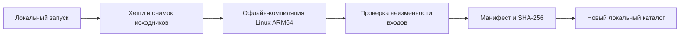

# Диагностический комплект Keenetic

Комплект предназначен для первой инвентаризации KN-1012. Он не устанавливает Гестию, не запускает VPN и не проверяет прохождение трафика. Исполнение на роутере выполняется только после возвращения владельца и согласования загрузки и запуска.

## Локальная сборка

Из корня репозитория:

```sh
python3 scripts/build-keenetic-diagnostics/run.py
python3 -B -m unittest discover -s scripts/build-keenetic-diagnostics
```

Требуются Python 3.10+ и локальный Go, удовлетворяющий `backend/go.mod` (при подготовке проверен Go 1.27.3). Сборка использует только стандартную библиотеку Go. Автоматическое скачивание toolchain и модулей отключено. Она не обращается к устройствам и не выполняет установки. Если локальный Go или исходники недоступны, команда завершается с ошибкой.

Результат — новый каталог `dist/keenetic-diagnostics/<версия>/`:

- `bin/hestia-keenetic-diagnostics` — статический Linux ARM64-бинарник;
- `README.md` — эта инструкция;
- `SPECIFICATION.md` — снимок спецификации;
- `manifest.json` — ревизия, состояние рабочего дерева, SHA-256 всех исходных входов (включая новые файлы), версия компилятора и ограничения;
- `SHA256SUMS` — хеши бинарника, документов и манифеста.

Параметр `--output` задаёт другой локальный каталог, `--version` — имя версии. Повторное использование имени запрещено. Исходники копируются во временный снимок до компиляции; изменение входов во время сборки отменяет публикацию. Одновременная сборка одного имени блокируется локальным каталогом `.версия.lock`. После аварийного завершения процесса этот пустой каталог может остаться: перед его ручным удалением убедитесь, что соответствующая сборка уже не работает. Обычная ошибка очищает временные файлы и блокировку, не публикуя готовую версию.



`make build` отдельно выпускает экспериментальный комплект приложения. Его наличие не означает готовность установки на Keenetic; эта утилита не обходит отказ установщика.

## Проверка готового комплекта

Перейдите в напечатанный сборщиком каталог. На Mac проверьте:

```sh
shasum -a 256 -c SHA256SUMS
file bin/hestia-keenetic-diagnostics
```

Ожидается Linux ELF для ARM64. Этот бинарник не запускается непосредственно на macOS. Сверка SHA-256 обнаруживает повреждение файлов; доверие к источнику комплекта подтверждается отдельно.

## Будущий запуск на роутере

Ни одна команда загрузки или подключения здесь не выполняется автоматически. После отдельного согласования владелец выбирает временный каталог, переносит комплект и сверяет контрольные суммы имеющимся средством SHA-256. Не заменяйте этим комплектом существующие файлы Гестии или службы Entware.

Внутри перенесённого каталога:

```sh
./bin/hestia-keenetic-diagnostics --help
./bin/hestia-keenetic-diagnostics --version
./bin/hestia-keenetic-diagnostics --inventory > inventory.json
```

Без аргументов выводится справка. Только `--inventory` собирает JSON; сама утилита ничего не записывает. В последней команде оболочка создаёт `inventory.json`: используйте новый файл, чтобы не перезаписать прежнее свидетельство. Сохраните отчёт вместе с манифестом вне устройства перед удалением временного каталога.

Отчёт содержит ограниченную инвентаризацию среды и явно непроверенные сетевые возможности. Наличие утилиты или `/dev/net/tun` не подтверждает работу TUN, netns, маршрутизации, Netfilter или VPN. На другой ОС отчёт не считается результатом проверки Keenetic. Ошибки отдельных источников не заменяют аппаратные испытания.

В этой версии не проверяются скорость, блокировка при отказе VPN, DNS/IPv6, WISP, перехват, аппаратное ускорение, автозапуск, обновление или восстановление. Для этого нужен отдельный согласованный опыт с выбранным клиентом и планом отката. Никаких служб, правил и файлов, требующих системного отката, сама утилита не создаёт.
