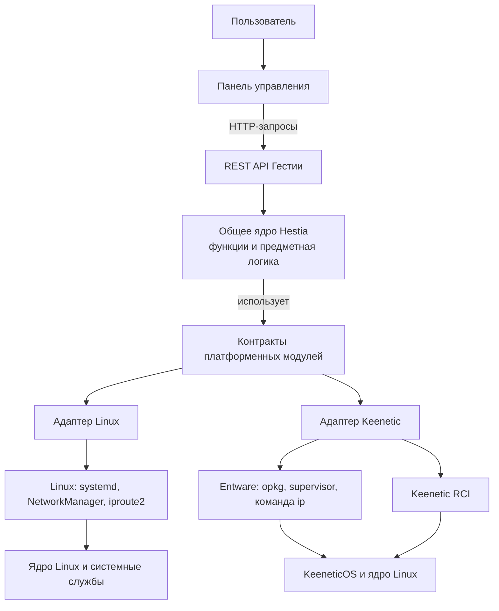

# Реорганизация Hestia

Этот документ задаёт предлагаемое направление реорганизации репозитория Hestia. Его цель — сделать границы ответственности видимыми в структуре каталогов, отделить продуктовую логику от платформенных адаптеров и развести платформу, схему установки и способ доставки. Структура является планом для обсуждения и поэтапной реализации; переносы файлов начинаются после согласования целевого дерева и порядка работ.

## Принципы структуры

Каталоги должны отражать ответственность кода и документации. Общая логика не должна зависеть от конкретной платформы; платформенная реализация не должна содержать продуктовые правила; схема установки не должна дублировать платформенный установщик.

Платформа, схема установки и транспорт доставки — отдельные характеристики:

- **Платформа** — среда выполнения Hestia, например Linux ARM64 или KeeneticOS/Entware.
- **Схема** — сетевое размещение Hestia относительно маршрутизатора и клиентов.
- **Транспорт** — способ соединения с целевым стендом, например Lima или SSH.

Сборочный комплект выбирается по платформе. Схема определяет топологию и конфигурацию. Транспорт используется инструментами доставки и проверки и сам по себе не определяет ни платформу, ни схему.

В каждом каталоге целевой структуры размещается `README.md`, описывающий его назначение, что в нём размещать и куда перейти дальше. README родительского каталога содержит ссылки на README непосредственных дочерних каталогов; навигация строится последовательно по дереву. README корня крупной области, например `backend/`, `frontend/` или `deploy/`, служит входной страницей этой области. Папочные README остаются краткими индексами и ссылаются на подробные продуктовые документы в `docs/`, не дублируя их. Сгенерированные каталоги, кэши, артефакты сборки и сторонние зависимости не входят в это правило. Для `frontend/src/` потребуется отдельно согласовать это правило с действующим ограничением, разрешающим в корне `src` только `main.ts`, `index.html` и `styles.css`.

Корневой `DOCUMENTATION.md` станет индексом основных документированных областей репозитория и будет ссылаться на их входные README: `docs/README.md`, `backend/README.md`, `frontend/README.md`, `deploy/README.md`, README сценариев сборки и проверки в `scripts/`, README лабораторных проверок в `tests/lab/`, а также `agents/README.md` и `experiments/README.md`. Он не перечисляет каждый вложенный каталог: навигацию внутри области обеспечивают её README. Корневые `README.md` и `AGENTS.md` сохраняют свои отдельные роли — описание продукта и инструкции агентам.

## Структура backend

Предлагаемое верхнее дерево:

```text
backend/
├── README.md                    # обзор backend и ссылки на README всех каталогов ниже
├── cmd/                         # точки входа исполняемых программ
│   └── README.md
├── core/                        # общие предметные типы и платформенно-независимые правила
│   └── README.md
├── features/                    # вертикальные срезы функций Hestia
│   ├── README.md
│   ├── routing/
│   │   └── README.md
│   ├── connections/
│   │   └── README.md
│   ├── dns/
│   │   └── README.md
│   ├── quality/
│   │   └── README.md
│   ├── vpn/
│   │   └── README.md
│   ├── panel/
│   │   └── README.md
│   └── traffic/
│       └── README.md
├── platforms/
│   ├── README.md
│   ├── platform-linux/          # адаптеры и композиция Linux
│   │   └── README.md
│   └── platform-keenetic/       # адаптеры и композиция KeeneticOS/Entware
│       └── README.md
├── tools/                       # генераторы и проверки разработки
│   └── README.md
└── pkg/                         # только пакеты с намеренно поддерживаемым внешним API
    └── README.md
```

Каждый каталог в этом дереве содержит `README.md` с назначением каталога, описанием размещённых в нём материалов и правилом их группировки. Корневой `backend/README.md` служит навигационной страницей и содержит ссылки на README всех перечисленных подкаталогов. README промежуточных каталогов `features/` и `platforms/` также ссылаются на README своих дочерних каталогов, чтобы сохранять понятную навигацию при добавлении новых функций или платформ.

`core` следует держать небольшим: общие предметные типы, инварианты и правила, нужные нескольким функциям. Он не должен становиться новым каталогом для всего кода, который трудно классифицировать.

`features` группирует код по поведению продукта. Например, DNS-политика, разрешение имён и DNS-служба принадлежат функции DNS; журнал и захват событий — функции трафика. Интерфейсы внешних операций должны быть узкими и находиться рядом с потребляющей их функцией либо в явно общей части `core`.

`platforms` реализует эти контракты через системные службы, сеть, хранение, процессы и платформенные API. Зависимости направлены от точек входа к композиции, от композиции к функциям и от платформенных адаптеров к контрактам функций. Код `core` и `features` не импортирует конкретные реализации `platforms/platform-linux` или `platforms/platform-keenetic`.

Платформенный выбор задаётся в точке композиции сборки. Общая логика собирается для обеих целей; в конкретную сборку подключаются только её платформенные адаптеры и композиция. Сборочные теги не размещаются в функциях для сокрытия платформенных зависимостей.

### Целевая архитектура приложения

Эта схема задаёт архитектуру как текущей, так и будущей версии Hestia: панель обращается к общему ядру через REST API, а ядро выполняет системные операции через платформенные контракты. Linux- и Keenetic-адаптеры реализуют эти контракты для своих системных интерфейсов. Текущая кодовая база приходит к этому устройству поэтапно; диаграмма показывает целевое разделение ответственности, а не утверждает, что каждый адаптер и каждая функция уже завершены.



Стрелки показывают путь запроса и системных операций. В коде адаптеры реализуют контракты, от которых зависит ядро. Переносимая продуктовая логика остаётся общей; платформенные различия сосредоточены в адаптерах и композиции сборки. Недоступная платформе операция должна возвращать явный отказ. Фактические ограничения Keenetic фиксируются отдельно в спецификациях и отчётах проверок.

Текущие пакеты `backend/internal` нужно перемещать по ответственности небольшими этапами. Предварительные направления: `routing`, `controller`, `observer` и `quality` — функции маршрутизации и качества; `dnspolicy`, `dnsresolver` и `dnsservice` — DNS; `traffic` и `trafficcapture` — журнал трафика; `panel`, `panelmodel` и часть `binding` — панель и управление настройками. Пакеты `network/linux*`, `network/keenetic*`, `services/systemd`, `services/entware` и платформенные варианты `storage` относятся к адаптерам платформ. `awg` и `awgruntime` следует разделить по логике VPN-функции и операциям внешнего runtime.

`cmd` сохраняет исполняемые точки входа, а `tools` — генераторы и проверки разработки. Пакет `pkg/keeneticrci` нужно отдельно оценить: если он остаётся внутренней реализацией адаптера Keenetic и не имеет поддерживаемых внешних потребителей, его следует разместить под платформой Keenetic; иначе внешний контракт и его поддержка должны быть описаны явно.

## Структура deploy

Содержимое корневого `deploy/` и `scripts/deploy/` предлагается свести под единый каталог `deploy/`:

```text
deploy/
├── README.md
├── core/
│   ├── README.md
│   ├── host/                    # общий сценарий доставки готового комплекта
│   │   └── README.md
│   ├── transports/              # общий контракт способов соединения со стендом
│   │   └── README.md
│   └── tests/
│       └── README.md
├── platforms/
│   ├── README.md
│   ├── shared/                  # только ресурсы, используемые несколькими платформами
│   │   └── README.md
│   ├── platform-linux/
│   │   ├── README.md
│   │   ├── installer/
│   │   │   └── README.md
│   │   ├── systemd/
│   │   │   └── README.md
│   │   ├── runtime/
│   │   │   └── README.md
│   │   └── tests/
│   │       └── README.md
│   └── platform-keenetic/
│       ├── README.md
│       ├── opkg/
│       │   └── README.md
│       ├── runtime/
│       │   └── README.md
│       └── tests/
│           └── README.md
├── schemes/
│   ├── README.md
│   ├── scheme-1/                # Hestia установлена перед маршрутизатором
│   │   └── README.md            # описание схемы и Mermaid-схема сетевого пути
│   ├── scheme-2/                # Hestia установлена на отдельном устройстве в LAN
│   │   └── README.md            # описание схемы и Mermaid-схема сетевого пути
│   ├── scheme-3/                # Hestia работает в Linux-ВМ в LAN
│   │   ├── README.md            # описание схемы и Mermaid-схема сетевого пути
│   │   └── lima/                # инфраструктура запуска и проверки ВМ через Lima
│   │       └── README.md
│   └── scheme-4/                # Hestia установлена на Keenetic как opkg-пакет
│       └── README.md            # описание схемы и Mermaid-схема сетевого пути
├── examples/
│   └── README.md
└── docs/
    └── README.md
```

`deploy/core` отвечает за платформенно-независимую доставку: проверку манифеста и целостности комплекта, выбор стенда и транспорта, общий ход операции и отчёт. Платформенные операции установки и обновления остаются в адаптере целевой платформы.

`deploy/platforms/platform-linux` содержит Linux-установщик, systemd units, системные настройки и иные Linux-специфичные материалы. `deploy/platforms/platform-keenetic` содержит пакет opkg, lifecycle hooks и runtime-интеграцию Keenetic. `platforms/shared` создаётся и заполняется только при наличии реальных общих ресурсов; его не следует использовать как хранилище всего, что не удалось отнести к одной платформе.

Каталоги `schemes` описывают топологию: необходимые конфигурации, компоненты и специфичные шаги настройки или проверки. Они могут включать декларацию совместимой платформы, но не копируют её установщики и адаптеры. Схемы 1–3 используют Linux-платформу, схема 4 — Keenetic-платформу.

В каждой папке схемы находится `README.md`, описывающий её размещение, компоненты и путь трафика. Документ включает Mermaid-диаграмму от подключения провайдера через все узлы сети, включая маршрутизатор и Hestia в их фактическом порядке, до конечного пользовательского устройства, например мобильного телефона. Диаграмма явно показывает место Hestia, границы локальной сети и направление клиентского трафика. Специфичные для схемы конфигурации и инструкции располагаются рядом с этим описанием.

Каталог `schemes/scheme-3/lima` содержит инфраструктуру для запуска и проверки Linux-ВМ через Lima. Схема 3 описывает сетевое размещение Hestia в Linux-ВМ и может поддерживать другие способы создания или подключения к такой ВМ без изменения сетевого смысла схемы.

`scripts/deploy/run.py` и `run.sh` переносятся в `deploy/core/host`; платформенно-зависимые `apply.sh` и `fresh.sh` размещаются в Linux-адаптере. Текущие команды Make следует сохранить как интерфейс на переходный период. `scripts/shared` используется также сборкой и установленными проверками, поэтому переносить его целиком в `deploy` не следует; сначала нужно отделить действительно общие операции доставки от инфраструктуры, общей для нескольких процессов.

## Структура frontend

Текущая структура Angular уже соответствует принятым правилам размещения компонентов и не требует общей перестройки:

```text
frontend/
├── README.md                    # обзор приложения и ссылки на README каталогов
├── scripts/
│   └── README.md
├── src/
│   ├── README.md
│   ├── main.ts
│   ├── index.html
│   ├── styles.css
│   ├── assets/
│   │   └── README.md
│   ├── core/
│   │   ├── README.md
│   │   ├── components/
│   │   │   └── README.md
│   │   ├── models/
│   │   │   └── README.md
│   │   └── services/
│   │       └── README.md
│   ├── routes/
│   │   └── README.md
│   └── styles/
│       └── README.md
└── tests/
    ├── README.md
    └── browser/
        └── README.md
```

Страницы маршрутизатора размещаются в `src/routes`, подключаемые и повторно используемые компоненты — в `src/core/components`, сервисы — в `src/core/services`, сгенерированный API-клиент — в `src/core/services/api/generated`. Сгенерированные сервисы и модели обновляются из OpenAPI-контракта, а не редактируются вручную. До появления конкретных проблем достаточно сохранять этот порядок и не вводить дополнительные уровни каталогов. README в корне `src` потребует обновить существующее правило проекта, которое сейчас разрешает там только `main.ts`, `index.html` и `styles.css`.

## Структура документации

`docs/README.md` уже выполняет роль тематического оглавления, но в корне `docs/` накопилось много разнотипных файлов. Предлагается умеренно сгруппировать их, сохранив неглубокую иерархию:

```text
docs/
├── README.md
├── product/          # требования, дорожная карта, оборудование
│   └── README.md
├── architecture/     # архитектура, платформы, интеграционные исследования
│   └── README.md
├── features/         # спецификации поведения функций
│   └── README.md
├── deployment/       # схемы установки и ограничения
│   └── README.md
├── operations/       # мониторинг, валидация, планы испытаний
│   └── README.md
└── ui/               # панель и дизайн интерфейса
    └── README.md
```

Спецификации функций остаются в `features/`. Активные решения следует отличать от исторических материалов; архивные исследования не должны выглядеть как действующие планы. `docs/README.md` индексирует продуктовую документацию, а `DOCUMENTATION.md` ведёт к `docs/` и другим основным областям репозитория. Отчёты фактических прогонов и свидетельства остаются в `experiments/`, инструкции агентам — в `agents/`, конфигурации проверок — в `tests/lab/`, а сценарии сборки и проверок — в `scripts/`.

`docs/` остаётся источником подробной документации о продукте: требований, архитектуры, согласованных решений, спецификаций поведения функций и эксплуатационных инструкций. Папочные README описывают только содержимое и границы конкретного каталога, дают навигацию по его дочерним каталогам и ссылаются на соответствующие документы в `docs/`. Они не становятся копиями спецификаций или руководств. Исключение — `schemes/scheme-N/README.md`: он является основным описанием конкретной схемы установки и содержит Mermaid-диаграмму сетевого пути от подключения провайдера до пользовательского устройства.

## Объём и этапы версии 1.0.0

Версия 1.0.0 включает четыре последовательных этапа: (1) реорганизацию кода, (2) сборку и проверку работоспособности после реорганизации, (3) аутентификацию пользователя и (4) функционал обновления RCI-токена. Выпуск 1.0.0 считается готовым после завершения всех четырёх этапов. Проверка этапа 2 подтверждает исходную работоспособность новой структуры до добавления новых функций.

Требования ниже собраны по договорённостям владельца от 8 ноября 2026 года. Это проект спецификации для итогового согласования перед реализацией; выполненные пункты не следует считать подтверждённой функциональностью.

### Этап 1. Реорганизация кода

Выполнить переносы backend, deploy и документации по структурам и зависимостям, описанным в этом документе. Сохранить существующую Angular-структуру frontend и добавить недостающую навигацию README. На этом этапе новые функции аутентификации и RCI не добавляются.

### Этап 2. Сборка и проверка после реорганизации

До начала этапов 3 и 4 подтвердить, что после переносов Linux- и Keenetic-сборки собираются, существующие проверки проходят и установленная Hestia сохраняет ранее поддерживаемое поведение. Проверять каждую платформу отдельно; регрессии структуры и поведения исправлять до добавления новых функций.

### Этап 3. Аутентификация пользователя

- Hestia использует одну локальную учётную запись администратора. Если сохранённых учётных данных ещё нет, начальные логин и пароль — `admin` и `admin`. Они остаются рабочими, пока администратор не изменит их в разделе «Настройки пользователя».
- Пока стандартные данные не изменены, любой клиент доверенной LAN, знающий `admin/admin`, может войти и управлять Hestia. Это принятое владельцем поведение.
- После обновления уже сохранённые учётные данные сохраняются. Вход, смена учётных данных и настройка RCI не обращаются к сторонним серверам.
- Все страницы приложения и API чтения/изменения требуют действующую сессию, которую проверяет backend. До входа доступны экран входа и необходимые статические файлы приложения; endpoint входа является исключением, иначе начать сессию невозможно.
- После входа пользователь может изменить логин и пароль из активной сессии без повторного ввода текущего пароля. Новый пароль должен содержать не менее 8 символов; дополнительные требования к составу символов не вводятся, поле подтверждения должно совпадать с новым паролем.
- Смена логина или пароля немедленно отзывает все сессии. Hestia показывает форму входа и требует войти снова.
- Сессия истекает после 30 минут бездействия и в любом случае через 12 часов. После истечения Hestia сообщает об этом, просит войти и возвращает пользователя на прежнюю страницу после успешного входа.
- После неверных попыток входа Hestia постепенно увеличивает задержку между попытками, не блокируя учётную запись навсегда.
- Локальная команда с административными правами сбрасывает учётные данные к `admin/admin`. Восстановление доступа не меняет прочие настройки Hestia.
- Пароли хранятся в виде стойкого хеша Argon2id; пароли и идентификаторы сессий не попадают в журналы. Запросы изменения состояния из сессии защищаются от межсайтовой подделки.
- Панель работает по HTTP в доверенной LAN. Владелец принимает, что вход и сессионные данные могут быть перехвачены наблюдателем сетевого трафика; защита ограничивает прямые вызовы API без действующей сессии. Панель нельзя публиковать в WAN.

### Этап 4. Обновление RCI-токена

- Backend сообщает тип сборки `linux` или `keenetic`. Инициализационный запрос выполняется после успешного входа. Для Keenetic он также возвращает булево поле `rciTokenConfigured`; фактическое значение токена никогда не отправляется в браузер.
- Проверка пригодности Keenetic не требует точной модели или предварительно созданного RCI-токена. До установки пакет проверяет версию KeeneticOS и архитектуру системными CLI-командами. Поддерживается KeeneticOS 5.2 и выше, включая beta/dev-сборки, и архитектура `aarch64`. Подтверждённая команда чтения версии и архитектуры — `ndmc -c 'show version'`; архитектуру также можно проверить через `uname -m`.
- Если инициализационный запрос не удался на любой платформе, приложение остаётся заблокированным и автоматически повторяет запрос до успешного ответа. Linux-сборка не показывает экран настройки RCI.
- Для Keenetic Hestia проверяет сохранённый токен после входа read-only запросом `GET /rci/show/version` к RCI. HTTP 2xx означает, что токен принят; тело ответа не проверяется. Явный отказ авторизации, например HTTP 401/403, означает, что токен нужно ввести заново. Тайм-аут и серверная ошибка RCI считаются ошибкой инициализации: панель остаётся заблокированной и повторяет запрос.
- Если токен отсутствует или RCI отверг сохранённый токен, Hestia показывает обязательное, незакрываемое окно с инструкцией:
  1. Перейти в раздел «Управление — Пользователи и доступ — Токены доступа» по ссылке [http://192.168.1.1/administrator/tokens](http://192.168.1.1/administrator/tokens).
  2. Нажать «Добавить токен».
  3. Ввести описание токена, например `Hestia`, и нажать «Создать токен».
  4. Скопировать выпущенный токен, вставить его в поле Hestia и нажать «Сохранить».
- Backend проверяет введённый токен read-only запросом `GET /rci/show/version` к RCI только после аутентификации пользователя. Любой HTTP 2xx считается успешной проверкой независимо от тела ответа. При успехе backend сохраняет токен в защищённом файле Keenetic и открывает панель. При ошибке backend не сохраняет значение, frontend очищает поле, сообщает об ошибке и позволяет повторить ввод.
- RCI-токен не возвращается через API и не записывается в журналы. На Keenetic он хранится в `/opt/etc/hestia/keenetic-rci-token` в root-owned файле с правами `0600`.

### Критерии выхода по этапам

**Этап 1 завершён**, когда утверждённое целевое дерево реализовано, файлы перемещены по ответственности, README и ссылки обновлены, а общая логика не зависит от конкретной платформы.

**Этап 2 завершён**, когда Linux- и Keenetic-комплекты собираются и после реорганизации проходят существующие проверки и согласованные проверки установки/обновления на целевых платформах. Прежнее поведение подтверждено до добавления аутентификации и настройки токена.

**Этап 3 завершён**, когда выполнены критерии локального входа, защиты API, управления одной учётной записью, срока действия сессий и восстановления доступа.

**Этап 4 завершён**, когда проверка платформы, инициализация панели и весь сценарий добавления/замены RCI-токена соответствуют критериям раздела «Этап 4. Обновление RCI-токена».

## План исполнения

1. **Реорганизация кода.** Составить инвентаризацию каталогов, зависимостей, сборочных тегов, импортов, Make-целей и ссылок. Согласовать целевое дерево и выполнить переносы backend, deploy и документации небольшими функциональными срезами. Сохранить структуру Angular-компонентов и добавить README-навигацию.
2. **Сборка и проверка.** Собрать Linux- и Keenetic-комплекты, пройти существующие проверки, проверить установку/обновление и сравнить поведение до и после переносов. Не начинать новые функции, пока этот контрольный этап не принят.
3. **Аутентификация.** Добавить локальный вход, серверную защиту всех страниц и API, управление учётными данными и восстановление доступа согласно критериям этапа 3.
4. **Обновление RCI-токена.** Добавить тип сборки и статус токена в authenticated init API, проверку сохранённого токена, обязательное окно Keenetic и защищённое сохранение нового токена согласно критериям этапа 4.

## Критерии завершения

**Главный критерий:** для Linux и Keenetic успешно собираются отдельные комплекты, проходят все тесты проекта, а установка и обновление каждого комплекта на целевой платформе сохраняют работоспособность Hestia.

- Изменение одной платформы не требует редактирования исходников другой платформы.
- `core` и `features` не зависят от платформенных пакетов; системные операции доступны через узкие типизированные контракты.
- Linux- и Keenetic-композиции собираются независимо и используют общие функции без копирования их реализации.
- Каждый каталог backend имеет `README.md`; `backend/README.md` ссылается на все README подкаталогов, а README промежуточных каталогов связывают их дочерние разделы.
- В каталогах `frontend`, `deploy`, `docs` и их целевых подкаталогах действует та же рекурсивная навигация README; для этого обновляется конфликтующее правило о составе корня `frontend/src`.
- `DOCUMENTATION.md` ссылается на входные README основных областей; `docs/README.md` остаётся оглавлением продуктовой документации, а `README.md` и `AGENTS.md` в корне сохраняют свои отдельные назначения.
- Папочные README не дублируют продуктовые спецификации и руководства из `docs`; README схем остаются полными описаниями топологий с Mermaid-диаграммами.
- Каждая схема определяет топологию отдельно от платформы и транспорта; схема 3 не требует Lima.
- README каждой схемы содержит Mermaid-диаграмму пути от подключения провайдера до пользовательского устройства и показывает расположение Hestia и маршрутизатора.
- Доставка по существующим Make-командам сохраняет проверку комплекта, безопасный отказ, восстановление и отчётность.
- Установка и обновление Linux- и Keenetic-комплектов проверяются на целевых платформах и не нарушают работу приложения.
- Переезды документации не оставляют битых входящих ссылок, а оглавления отражают целевое расположение.
- Существующее поведение продукта сохраняется и проверяется теми же сценариями до и после каждого этапа.
